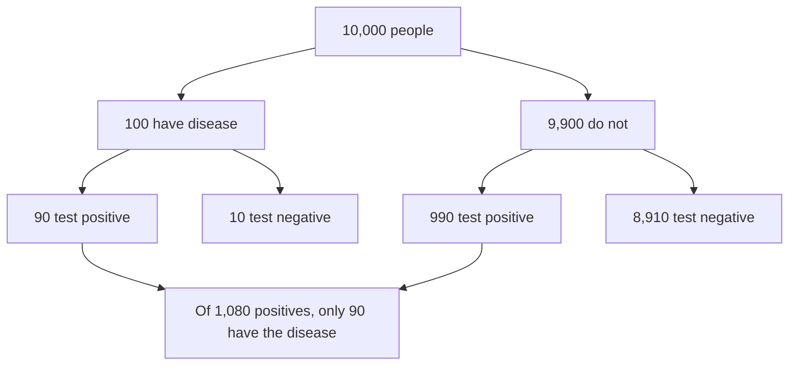

# Probability

**Prerequisites:** [Variables and data](01-variables-and-data.md).

@@IMG@@

Research results are always uncertain. Probability is the mathematics of uncertainty, and a small amount of it goes a long way in reading papers. This lesson covers the rules you need for the rest of the course: what a probability is, how probabilities combine, and the crucial idea of **conditional probability**.

## What a probability is

A **probability** is a number between 0 (impossible) and 1 (certain) describing how likely an event is. It is often written as a percentage: 0.25 is 25%. There are two main ways of interpreting it:

- **Frequentist:** probability is the long-run proportion of times an event happens in repeated trials. A fair coin lands heads with probability 0.5 because, over many tosses, about half are heads.
- **Bayesian:** probability is a degree of belief, given the available evidence. You can speak of the probability that a particular hypothesis is true, even though it is not a repeatable event.

Most papers in medicine use frequentist methods ([p-values](08-hypothesis-tests-and-p-values.md) and [confidence intervals](07-standard-error-and-confidence-intervals.md)), but Bayesian reasoning is essential for interpreting them, as you will see in [base rates and Bayes' theorem](14-base-rates-and-bayes-theorem.md).

The mathematics itself began with gambling. In 1654 Blaise Pascal and Pierre de Fermat corresponded about how to divide the stakes of an interrupted game of chance, and their letters are usually taken as the start of probability theory. There is more on this in the finance course's lesson on [probability and expected value](../../../../economics/finance/01-foundations/08-probability-and-expected-value.md).

## Basic rules

Write P(A) for "the probability of A".

- **Complement:** P(not A) = 1 − P(A). If the risk of a side effect is 0.02, the chance of not having it is 0.98.
- **Addition (for mutually exclusive events):** P(A or B) = P(A) + P(B). The chance of rolling a 1 or a 2 on a die is 1/6 + 1/6 = 1/3.
- **Multiplication (for independent events):** P(A and B) = P(A) × P(B). The chance of two heads in a row is 0.5 × 0.5 = 0.25.

**Independence** means that knowing one event tells you nothing about the other. Many real events are not independent: having one heart attack raises the chance of another. Treating dependent events as independent produces wildly wrong numbers. In the 1999 British trial of Sally Clark, a paediatrician told the jury that the chance of two cot deaths in one affluent non-smoking family was about 1 in 73 million, obtained by squaring the single-death figure. The Royal Statistical Society publicly criticised that calculation because cot deaths in the same family are not independent. Clark's conviction was overturned on appeal in 2003.

## Conditional probability

The most important idea in this lesson is **conditional probability**: the probability of A *given that* B has happened, written P(A | B).

Conditional probabilities are not symmetric. P(A | B) is usually *not* equal to P(B | A). Consider:

- P(positive test | disease): the chance that a person with the disease tests positive.
- P(disease | positive test): the chance that a person who tested positive has the disease.

These can be very different numbers. If a disease is rare, most positive tests can be false alarms even when the test is good. Confusing the two is so common it has names: the **confusion of the inverse**, or, in courtrooms, the **prosecutor's fallacy**. It returns in [sensitivity and specificity](15-sensitivity-and-specificity.md).

In the diagram above (illustrative numbers), the test catches 90% of real cases, P(positive | disease) = 0.9. But among everyone who tests positive, only 90 of 1,080, about 8%, have the disease, so P(disease | positive) ≈ 0.08.

## Natural frequencies

The psychologist Gerd Gigerenzer and colleagues have shown that people, including doctors, reason far better about such problems when numbers are given as **natural frequencies** ("90 out of 100 people with the disease test positive") rather than as conditional probabilities ("the sensitivity is 90%"). Whenever a paper gives you percentages, try converting them into counts out of 1,000 or 10,000 people. It is the single most effective trick in this course.

## Probability and risk

In health research, the probability of an outcome in a group over a period is called its **risk**: if 30 of 1,000 people have a stroke within five years, the five-year risk is 3%. Risk is a probability; **odds** are a different way of expressing the same information (30 to 970, about 0.031). The difference matters when papers report odds ratios; see [odds ratios and hazard ratios](19-odds-ratios-and-hazard-ratios.md).

## Key ideas

- Probability runs from 0 to 1 and can be read as long-run frequency or as degree of belief.
- Multiplying probabilities is valid only for independent events.
- P(A | B) is not P(B | A); confusing them is the prosecutor's fallacy.
- Convert percentages to natural frequencies (counts out of 1,000) to reason clearly.
- Risk is a probability over a period; odds express the same thing differently.

## Where this leads

- Next: [Distributions](03-distributions.md)
- Uses: [Base rates and Bayes' theorem](14-base-rates-and-bayes-theorem.md), [Sensitivity and specificity](15-sensitivity-and-specificity.md)
