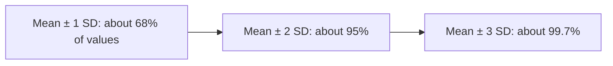

# Distributions

**Prerequisites:** [Probability](02-probability.md).

@@IMG@@

If you measured the height of every adult in Toronto and plotted how many people fell into each centimetre band, you would get a shape: most people near the middle, fewer at the extremes. That shape is a **distribution**. Distributions are how statistics describes variation, and most of the methods in papers assume something about their shape.

## Histograms and shapes

A **histogram** groups values into bins and draws a bar for how many fall in each. Looking at a histogram, ask:

- **Centre:** where is the bulk of the data? (See [mean, median and mode](04-mean-median-and-mode.md).)
- **Spread:** how widely are values scattered? (See [variance and standard deviation](05-variance-and-standard-deviation.md).)
- **Shape:** is it symmetric, or does it have a long tail on one side (**skewed**)? Does it have one peak or two (**bimodal**)?
- **Outliers:** are there isolated extreme values?

Income is a classic **right-skewed** distribution: most people earn moderate amounts, and a few earn enormous amounts, stretching the tail to the right. Hospital length of stay and healthcare costs are also right-skewed. Age at death in a wealthy country is **left-skewed**: most deaths occur at older ages, with a tail of early deaths.

## The normal distribution

The **normal distribution** (also called the Gaussian distribution, after Carl Friedrich Gauss, or the bell curve) is symmetric and bell-shaped. It is defined by two numbers: its mean (the centre) and its standard deviation (the spread). In a normal distribution:

- about 68% of values lie within one standard deviation of the mean,
- about 95% lie within two (more precisely, 1.96),
- about 99.7% lie within three.

Many biological measurements, such as adult height within one sex, are roughly normal. Many are not. Assuming normality for skewed data can mislead, which is why careful papers report medians for skewed variables.

## Why the normal distribution is everywhere: the central limit theorem

The normal distribution matters far more than the number of naturally normal variables would suggest, because of the **central limit theorem**. It says, roughly, that if you take many random samples and compute the average of each, those averages will be approximately normally distributed, *whatever the shape of the original data*, provided the samples are large enough.

This is the foundation for most confidence intervals and p-values. When a paper reports that the average blood pressure fell by 5 mmHg with a 95% confidence interval of 3 to 7, the calculation relies on the average being approximately normal, even if individual blood pressures are not. You will see how in [samples and populations](06-samples-and-populations.md).

## Other distributions you will meet

- **Binomial:** the number of "successes" in a fixed number of independent yes/no trials (for example, how many of 100 patients respond to a drug).
- **Poisson:** counts of rare events in a fixed time or space (for example, cases of a rare disease per year in a city). Its key property is that the variance equals the mean.
- **Log-normal:** a variable whose logarithm is normal; common for concentrations, costs and antibody levels. Papers often report **geometric means** for such data.
- **Uniform:** every value equally likely. Under the null hypothesis, p-values are uniformly distributed between 0 and 1, a fact used to detect [p-hacking](../06-research-integrity/04-p-hacking.md).

## Distributions of results across studies

The idea of a distribution applies to studies as well as people. If many studies estimate the same effect, their results form a distribution around the true value, wider for small studies and narrower for large ones. [Funnel plots](../05-anatomy-of-a-paper/09-funnel-plots.md) use this idea to detect missing studies: if small studies with unfavourable results have gone unpublished, one side of the funnel will be empty.

## Key ideas

- A distribution describes how values vary: centre, spread, shape and outliers.
- Skewed data (incomes, costs, lengths of stay) are better summarised by medians.
- The normal distribution has about 95% of values within two standard deviations of the mean.
- The central limit theorem makes averages approximately normal, underpinning most p-values and confidence intervals.
- Study results themselves form distributions, which funnel plots exploit.

## Where this leads

- Next: [Mean, median and mode](04-mean-median-and-mode.md)
- Later: [Samples and populations](06-samples-and-populations.md)
