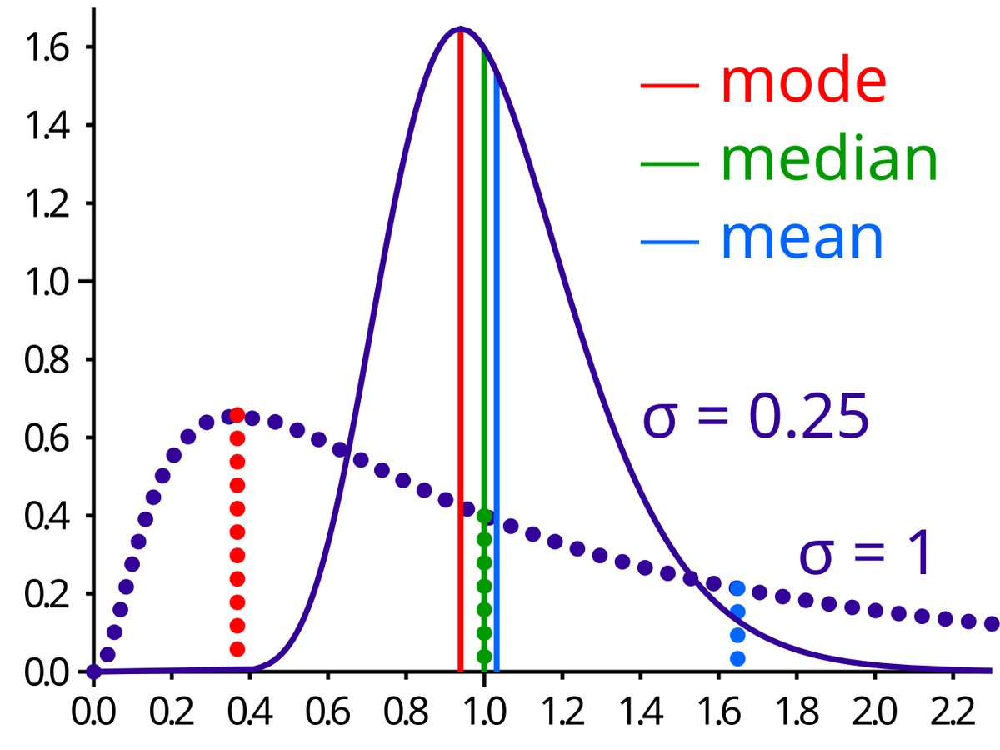
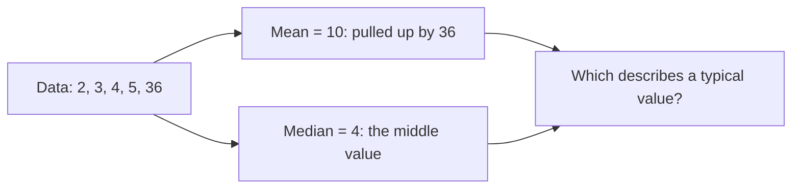

# Mean, median and mode

**Prerequisites:** [Distributions](03-distributions.md).

*Mean, median and mode in a skewed distribution. Credit: Cmglee. License: [CC BY-SA 3.0](https://creativecommons.org/licenses/by-sa/3.0). Source: [File:Comparison mean median mode.svg](https://commons.wikimedia.org/wiki/File:Comparison_mean_median_mode.svg).*

When a paper says "the average patient lost 4 kg", it is summarising a whole distribution with one number. There are several ways to do this, and the choice can change the story a lot.

## The three averages

- The **mean** (arithmetic mean) is the sum of all values divided by how many there are. The mean of 2, 3, 4, 5 and 36 is 50 ÷ 5 = 10.
- The **median** is the middle value when the data are sorted. For 2, 3, 4, 5, 36 it is 4. With an even number of values, it is the mean of the two middle ones.
- The **mode** is the most common value. It is mostly useful for categorical data ("the most common blood type is O").

In the example, one extreme value (36) drags the mean to 10, while the median stays at 4, which better describes a "typical" value. The mean is **sensitive to outliers**; the median is **robust**.

## Skew and the gap between mean and median

In a symmetric distribution, the mean and median are about the same. In a right-skewed distribution (incomes, hospital costs, survival times), the mean is larger than the median because the long right tail pulls it up. So when a paper reports a mean for something you suspect is skewed, look for the median too. A large gap tells you the distribution is lopsided and that "average" may not describe most people.

A practical example: "median survival" is the standard summary in cancer trials because survival times are skewed and some patients are still alive at the end of the study. The median survival is the time by which half the patients have died. It can be read straight off a [Kaplan-Meier curve](../05-anatomy-of-a-paper/08-kaplan-meier-curves.md).

## Quantiles and the five-number summary

The median splits the data in half. **Quartiles** split it into quarters: the first quartile (Q1) has 25% of values below it, the third (Q3) has 75% below it. The **interquartile range** (IQR), Q3 − Q1, describes the spread of the middle half and, like the median, is robust to outliers. Papers often report skewed variables as "median (IQR)", for example "median length of stay 4 days (IQR 2–7)".

A **box plot** draws this five-number summary (minimum, Q1, median, Q3, maximum, with outliers marked separately). See [reading graphs](../05-anatomy-of-a-paper/06-reading-graphs.md).

**Percentiles** generalise the idea: the 90th percentile has 90% of values below it. Growth charts for children are built from percentiles.

## Averages of groups versus individuals

An average describes a group, not any individual in it. If a drug lowers average blood pressure by 5 mmHg, some patients may have dropped by 20 and others not at all, or even risen. Trials usually report average effects; whether the effect is consistent across people is a separate question, and one that is much harder to answer, as discussed in [subgroups and secondary analyses](../09-from-lab-to-headline/04-subgroups-and-secondary-analyses.md).

A related trap is **change from baseline**. "Patients' symptom scores improved by an average of 10 points" tells you nothing about the drug unless you also know how much the control group improved. People enrolled in trials are often at their worst when they enrol, so they tend to improve anyway ([regression to the mean](17-regression-to-the-mean.md)).

## Weighted means and geometric means

A **weighted mean** gives some values more influence than others. [Meta-analyses](../03-study-designs/15-meta-analysis.md) use weighted means, giving larger, more precise studies more weight. A **geometric mean** multiplies values and takes the root; it suits ratios and log-normally distributed data such as antibody levels after vaccination, where results are often reported as "geometric mean titres".

## Key ideas

- The mean is the arithmetic average and is pulled by outliers; the median is the middle value and is robust.
- In skewed data, the mean exceeds the median; report both, or the median with IQR.
- Median survival is the standard summary for time-to-event outcomes.
- Group averages hide individual variation.
- Change from baseline means nothing without a comparison group.

## Where this leads

- Next: [Variance and standard deviation](05-variance-and-standard-deviation.md)
