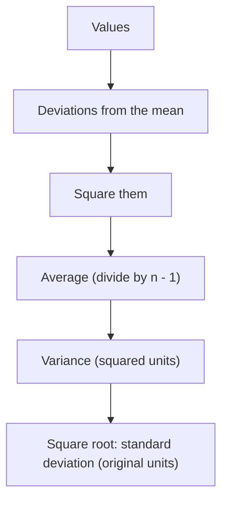

# Variance and standard deviation

**Prerequisites:** [[mean-median-and-mode|Mean, median and mode]].

@@IMG@@

Two classes can have the same average test score, 70, but in one every student scored between 65 and 75 while in the other scores ranged from 30 to 100. The average alone hides this. Measures of **spread** describe how much values vary around the centre, and spread is the raw material of statistical uncertainty.

## Range and interquartile range

The simplest measure is the **range**, the gap between the largest and smallest values. It depends entirely on the two most extreme observations, so it is unstable. The **interquartile range** (IQR), covered in the previous lesson, uses the middle half of the data and is much more robust.

## Variance

The **variance** measures the average squared distance of values from the mean. To compute it:

1. Find the mean.
2. Subtract the mean from each value (the **deviations**).
3. Square each deviation, so negative and positive deviations do not cancel.
4. Average the squares. (For a sample, divide by n − 1 rather than n, a technical correction that makes the estimate unbiased.)

For the values 4, 6, 8: the mean is 6; deviations are −2, 0, 2; squares are 4, 0, 4; their sum is 8; dividing by n − 1 = 2 gives a variance of 4.

Variance is in squared units (mmHg², kg²), which is awkward to interpret. So researchers usually report its square root.

## Standard deviation

The **standard deviation** (SD) is the square root of the variance. In the example, √4 = 2. It is in the same units as the data, so "mean systolic blood pressure 130 mmHg (SD 15)" tells you that most people's values are within about 15 to 30 mmHg of 130. If the data are roughly normal, about 95% of people fall within two SDs of the mean: here, roughly 100 to 160 mmHg (see [[distributions|distributions]]).

A quick sanity check: if the SD is large compared with the mean for a variable that cannot go below zero (for example, a mean of 3 days with an SD of 5 days), the distribution must be strongly right-skewed, and the mean is a poor summary.

## Standard deviation is not standard error

This is the single most common confusion in reading results tables. The **standard deviation** describes how much *individuals* vary. The **standard error** (SE) describes how precisely a *sample average* estimates the true population average. The SE is the SD divided by the square root of the sample size:

> SE = SD ÷ √n

So with SD = 15 and n = 100, SE = 1.5. As samples grow, the SE shrinks, but the SD does not: people do not become more alike just because you studied more of them. Error bars on graphs may show either one, or a confidence interval, and they look very different. Always check the figure legend. This is developed in [[standard-error-and-confidence-intervals|standard error and confidence intervals]].

## Why spread matters for reading research

- **Noise and detectability.** The more individuals vary, the harder it is to detect a given average effect, and the larger the study needs to be ([[statistical-power|statistical power]]).
- **Standardised effect sizes.** Many [[effect-sizes|effect sizes]], such as Cohen's d, are expressed in standard deviation units: "the intervention improved scores by 0.3 SD".
- **Heterogeneity.** In meta-analysis, variance *between* studies tells you whether studies agree; see [[meta-analysis|meta-analysis]].
- **Risk and volatility.** The finance course uses the same idea to measure investment risk; see [[path:economics/finance/01-foundations/09-variance-and-standard-deviation.md|variance and standard deviation in finance]].

## Coefficient of variation

The **coefficient of variation** is the SD divided by the mean, often as a percentage. It lets you compare spread across variables with different units or scales, and laboratories use it to describe how reproducible an assay is.

## Key ideas

- Spread matters as much as centre.
- Variance is the average squared deviation; the standard deviation is its square root, in the original units.
- In roughly normal data, about 95% of values lie within two SDs of the mean.
- SD describes individuals; SE describes the precision of an average and shrinks with sample size.
- Greater spread makes effects harder to detect and studies larger.

## Where this leads

- Next: [[samples-and-populations|Samples and populations]]
