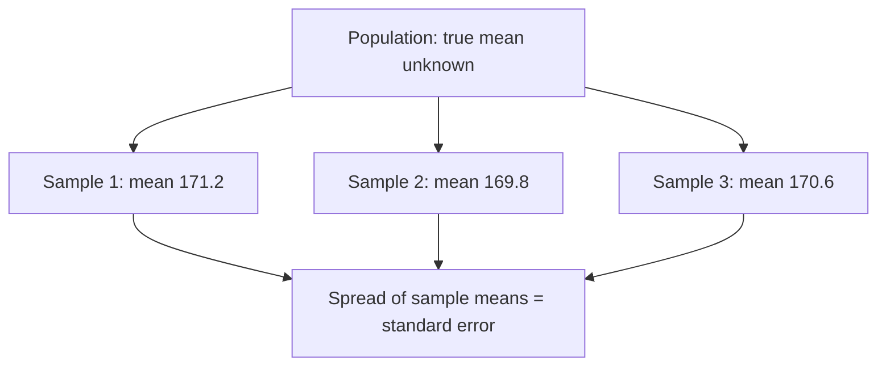

# Samples and populations

**Prerequisites:** [Variance and standard deviation](05-variance-and-standard-deviation.md).

@@IMG@@

Researchers almost never study everyone they care about. They study a **sample** and use it to draw conclusions about a **population**. Every statistical result in a paper is, at bottom, an inference from the sample to the population, and both the logic and the pitfalls of that inference are worth understanding.

## Population, sample and parameter

- The **population** is the whole group the question is about: all adults with type 2 diabetes in Canada, all children born in Denmark in a decade.
- The **sample** is the subset actually studied.
- A **parameter** is a true value in the population (the real average blood pressure of all Canadian adults), usually unknown.
- A **statistic** or **estimate** is the corresponding value computed from the sample.

Statistics is the art of estimating parameters from samples and saying how far off you might be.

## Random sampling

If every member of the population has a known chance of being chosen, the sample is a **probability sample**, and the simplest kind is a **simple random sample**. Random sampling does not guarantee the sample looks like the population, but it guarantees that differences arise only from chance, and chance can be quantified.

Many studies cannot sample randomly. Clinical trials enrol volunteers who meet eligibility rules at participating hospitals; psychology experiments have often used undergraduate students. In 2010, Joseph Henrich, Steven Heine and Ara Norenzayan argued in *Behavioral and Brain Sciences* that much psychological research rests on samples from Western, Educated, Industrialized, Rich and Democratic (**WEIRD**) societies, which are unusual by global standards. Non-random samples raise questions of **external validity**: does the result apply to people unlike those studied?

## Sampling error

Even a perfect random sample will not exactly match the population. If you draw several random samples of 100 adults and compute each one's mean height, the means will differ a little from each other and from the true mean. That variation is **sampling error**. It is not a mistake; it is the unavoidable consequence of looking at part instead of the whole.

(The numbers in the diagram are illustrative.)

## The sampling distribution

Imagine repeating a study an enormous number of times and plotting all the sample means. That imaginary distribution is the **sampling distribution**. Thanks to the [central limit theorem](03-distributions.md), it is approximately normal, centred on the true parameter, with a spread equal to the **standard error** (SD ÷ √n).

This imaginary distribution is the key to frequentist statistics. A [confidence interval](07-standard-error-and-confidence-intervals.md) and a [p-value](08-hypothesis-tests-and-p-values.md) are both statements about what would happen across these hypothetical repeated studies.

## Sample size and the law of large numbers

The **law of large numbers** says that as a sample grows, its average gets closer to the population average. Because the standard error is SD ÷ √n, precision improves with the square root of the sample size: to halve the standard error, you need four times as many people. This is why large studies are expensive and why small studies produce such variable results.

Daniel Kahneman and Amos Tversky called the common failure to appreciate this the "belief in the law of small numbers": people, including researchers, expect small samples to resemble the population far more closely than they do. A striking pattern in a small study (a cluster of cancers in a town, an impressive effect in 20 patients) is often just noise.

## Bias is different from sampling error

Sampling error shrinks as samples grow. **Bias** does not. If you survey people about exercise by phoning landlines in the afternoon, you will over-represent retirees, and surveying a million of them will not fix it; you will just get a very precise wrong answer. The 1936 *Literary Digest* poll, which predicted that Alf Landon would beat Franklin Roosevelt from millions of returned ballots drawn largely from telephone directories and car registrations, is the textbook example.

Large datasets ("big data") reduce sampling error but can carry large biases. See [selection bias](../04-causation/04-selection-bias.md).

## Key ideas

- A sample is used to estimate parameters of a population.
- Random sampling makes differences between sample and population a matter of quantifiable chance.
- Sampling error is the natural variation between samples; its size is the standard error.
- Precision improves with the square root of the sample size.
- Bias does not shrink with sample size: a huge biased sample is precisely wrong.

## Where this leads

- Next: [Standard error and confidence intervals](07-standard-error-and-confidence-intervals.md)
- Related: [Selection bias](../04-causation/04-selection-bias.md)
