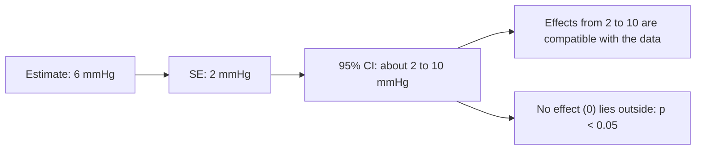

# Standard error and confidence intervals

**Prerequisites:** [Samples and populations](06-samples-and-populations.md).

@@IMG@@

A study never tells you the true effect. It gives you an **estimate** plus a measure of how uncertain that estimate is. The most useful way to express that uncertainty is the **confidence interval**, and learning to read it properly will tell you more about a study than its p-value.

## From standard error to interval

The **standard error** (SE) is the standard deviation of the sampling distribution: it says how much the estimate would bounce around if the study were repeated many times. Because that sampling distribution is approximately normal, about 95% of repeated estimates fall within 1.96 SEs of the true value. Turning this around gives the **95% confidence interval**:

> estimate ± 1.96 × SE

If a trial finds that a drug lowers systolic blood pressure by an average of 6 mmHg more than placebo, with SE 2 mmHg, the 95% CI is roughly 6 ± 3.9, or about 2 to 10 mmHg.

## What a confidence interval means

The precise frequentist meaning is subtle: if you repeated the study many times and calculated a 95% interval each time, **95% of those intervals would contain the true value**. Any single interval either contains it or does not; you do not know which.

In practice, you can read a 95% CI as the **range of effect sizes reasonably compatible with the data**, given the study's assumptions. Some statisticians, such as Sander Greenland, prefer the term **compatibility interval** for this reason. Values near the centre are more compatible than values near the edges, and values outside the interval are not ruled out absolutely, only less compatible.

## Reading intervals in practice

Ask three questions of every confidence interval:

1. **Where is it centred?** That is the best single estimate.
2. **How wide is it?** Wide intervals mean imprecision, usually from small samples or rare events. An interval of "relative risk 0.5 to 2.0" says the treatment could halve or double the risk; the study has not told you much.
3. **What values does it include?** Does it include no effect (0 for differences, 1 for ratios)? Does it include effects large enough to matter? Does it exclude effects that would be important?

A useful classification, in the spirit of Douglas Altman's teaching:

| Interval | Interpretation |
|---|---|
| Narrow, excludes no effect, effect large enough to matter | Clear evidence of a meaningful effect |
| Narrow, excludes no effect, but all values tiny | Real but probably unimportant effect |
| Narrow, centred on no effect | Good evidence of little or no effect |
| Wide, includes both no effect and large effects | Inconclusive: the study was too small |

The last row is critical. "No statistically significant difference" with a wide interval is **absence of evidence, not evidence of absence**, a phrase popularised by Altman and Martin Bland in a 1995 *BMJ* note.

## Intervals for ratios

For relative risks, odds ratios and hazard ratios (see [relative and absolute risk](12-relative-and-absolute-risk.md) and [odds and hazard ratios](19-odds-ratios-and-hazard-ratios.md)), intervals are calculated on a logarithmic scale and are therefore **asymmetric**: an estimate of 1.5 might have a CI of 1.1 to 2.0. The line of no effect is 1, not 0. On [forest plots](../05-anatomy-of-a-paper/07-forest-plots.md), ratio scales are drawn logarithmically so the intervals look symmetric.

## Confidence intervals and p-values

A 95% CI and a two-sided p-value at the 0.05 level are two views of the same calculation. If the 95% CI excludes the no-effect value, p < 0.05; if it includes it, p > 0.05. The interval is more informative because it shows the size and precision of the effect, not just a yes/no verdict. The International Committee of Medical Journal Editors and many statisticians recommend reporting effect estimates with confidence intervals rather than relying on p-values alone.

## Other levels and other intervals

Intervals can be 90%, 99% or any level; higher confidence means wider intervals. Bayesian analyses report **credible intervals**, which do have the intuitive meaning "there is a 95% probability the true value lies here, given the model and prior". Do not confuse either with a **prediction interval**, which describes where a *new individual's* value (or a new study's result) is likely to fall and is much wider.

## Key ideas

- The standard error measures how much an estimate would vary across repeated studies.
- A 95% CI is roughly the estimate ± 2 SE: the range of effects compatible with the data.
- Read the centre, the width and which values are included or excluded.
- A wide interval that includes no effect is inconclusive, not proof of no effect.
- Ratio intervals are asymmetric and centred on 1.

## Where this leads

- Next: [Hypothesis tests and p-values](08-hypothesis-tests-and-p-values.md)
- Practice: [Reading forest plots](../05-anatomy-of-a-paper/07-forest-plots.md)
