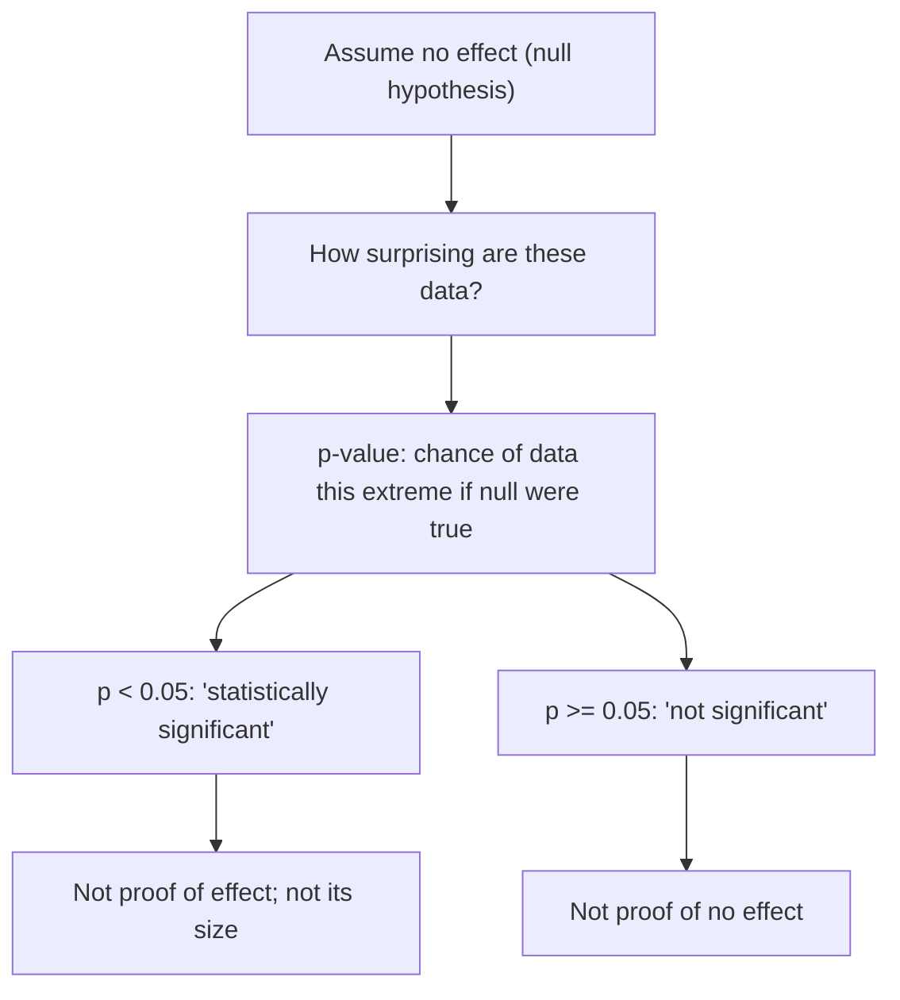

# Hypothesis tests and p-values

**Prerequisites:** [Standard error and confidence intervals](07-standard-error-and-confidence-intervals.md).

@@IMG@@

The p-value is the most reported and most misunderstood number in science. This lesson explains what it actually measures. The next lesson, [misreading p-values](09-misreading-p-values.md), catalogues the ways it is misused.

## The logic of a significance test

A hypothesis test works by contradiction, a little like a criminal trial that presumes innocence:

1. State a **null hypothesis** (H₀), usually "no effect": the drug and placebo have the same average effect.
2. State an **alternative hypothesis** (H₁): they differ.
3. Collect data and compute a **test statistic** that measures how far the data are from what H₀ predicts, relative to the noise (for example, the difference divided by its standard error).
4. Compute the **p-value**: the probability, *assuming the null hypothesis and all the model's assumptions are true*, of getting a test statistic at least as extreme as the one observed.
5. If the p-value is below a pre-chosen threshold (the **significance level**, α, conventionally 0.05), "reject the null" and call the result **statistically significant**.

## A worked example

Suppose a trial finds that 40% of patients improve on a new drug and 30% on placebo, with 200 patients per group. If the drug truly had no effect, how often would random allocation alone produce a gap of 10 percentage points or more? A standard calculation (a chi-squared test or a test of two proportions) gives a p-value of about 0.04. So a gap this large would arise by chance alone in about 4% of such trials if the drug did nothing. By convention, that is "significant".

## Where 0.05 came from

The threshold is a convention, not a law of nature. Ronald Fisher's influential *Statistical Methods for Research Workers* (1925) treated p = 0.05 as a convenient point for judging whether a result deserved attention, though Fisher himself saw the p-value as a continuous measure of evidence. Jerzy Neyman and Egon Pearson developed a different framework built around fixed error rates and decisions. Modern practice mixes the two in a way that neither side fully endorsed, which is one root of the confusion.

## Two kinds of error

A test can go wrong in two ways:

| | Null actually true | Null actually false |
|---|---|---|
| Reject null ("significant") | **Type I error** (false positive), probability α | Correct |
| Don't reject null | Correct | **Type II error** (false negative), probability β |

The significance level α (usually 0.05) is the false-positive rate *when the null is true*. The probability of correctly detecting a real effect, 1 − β, is the [power](10-statistical-power.md) of the study. Small studies have low power and miss real effects often.

## One-sided and two-sided tests

A **two-sided** test asks whether the groups differ in either direction; a **one-sided** test asks only about one direction. A one-sided p-value is half the two-sided one, so switching to one-sided testing after seeing the data is an easy way to turn p = 0.08 into p = 0.04. Two-sided tests are the norm in medicine; a one-sided test should be justified in advance.

## What the p-value is not

The American Statistical Association's 2016 statement on p-values, written by Ronald Wasserstein and Nicole Lazar with a panel of statisticians, set out six principles. In paraphrase:

1. P-values can indicate how incompatible the data are with a specified statistical model.
2. They do **not** measure the probability that the hypothesis is true, or the probability that the data were produced by chance alone.
3. Scientific conclusions and policy decisions should not be based only on whether a p-value passes a threshold.
4. Proper inference requires full reporting and transparency.
5. A p-value does not measure the size of an effect or the importance of a result.
6. By itself, a p-value does not provide a good measure of evidence regarding a model or hypothesis.

Each of these is unpacked in the [next lesson](09-misreading-p-values.md).

## Common tests you will see named

- **t-test:** compares two means.
- **Chi-squared test** or **Fisher's exact test:** compares proportions in categories.
- **ANOVA:** compares several means.
- **Log-rank test:** compares survival curves.
- **Mann-Whitney U** and **Wilcoxon** tests: non-parametric alternatives that compare ranks instead of means, useful for skewed data.

You do not need to know the formulas. You need to know that each produces a p-value under certain assumptions, and that if the assumptions are badly wrong, so is the p-value.

## Key ideas

- A p-value is the probability of data at least this extreme, assuming the null hypothesis and the model are true.
- "Significant" means p fell below an arbitrary threshold, conventionally 0.05.
- Type I errors are false positives; Type II errors are false negatives.
- The p-value does not give the probability that the hypothesis is true or the size of the effect.
- The ASA's 2016 statement is the standard short guide to its limits.

## Where this leads

- Next: [Misreading p-values](09-misreading-p-values.md)
- Then: [Statistical power](10-statistical-power.md)
