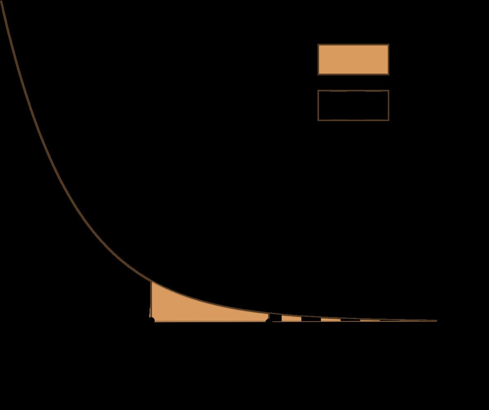
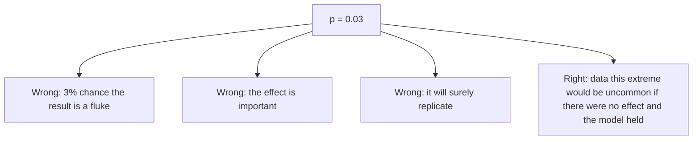

# Misreading p-values

**Prerequisites:** [Hypothesis tests and p-values](08-hypothesis-tests-and-p-values.md).

*The relationship between a p-value and the chosen significance level (alpha). Credit: Erzbischof. License: [CC BY-SA 3.0](https://creativecommons.org/licenses/by-sa/3.0). Source: [File:P value vs alpha error.svg](https://commons.wikimedia.org/wiki/File:P_value_vs_alpha_error.svg).*

Surveys of researchers and textbooks have found that misinterpretations of p-values are widespread even among scientists. In 2016 Sander Greenland and colleagues published a guide in the *European Journal of Epidemiology* listing 25 common misinterpretations of p-values, confidence intervals and power. This lesson covers the ones that matter most for readers.

## Misreading 1: "p = 0.03 means there is a 3% chance the result is due to chance"

This is the most common error. The p-value is calculated *assuming* the null hypothesis is true, so it cannot also be the probability that the null is true. The probability that a "significant" finding is a false positive depends on how plausible the hypothesis was to begin with and on the study's power, which the p-value does not include. For a long-shot hypothesis tested in a small study, a p-value of 0.03 can easily correspond to a high chance that the finding is false. See [base rates and Bayes' theorem](14-base-rates-and-bayes-theorem.md).

## Misreading 2: "Significant means important"

With a large enough sample, trivially small effects become statistically significant. A study of a million people might find that a supplement lowers blood pressure by 0.3 mmHg with p < 0.001. The effect is real, in the sense of being unlikely to be zero, but clinically meaningless. Always look at the [effect size](11-effect-sizes.md) and its [confidence interval](07-standard-error-and-confidence-intervals.md).

## Misreading 3: "Not significant means no effect"

A p-value above 0.05 means the data are *compatible* with no effect, not that no effect exists. Small studies often miss real effects. Check the confidence interval: if it includes both zero and large benefits or harms, the study is simply inconclusive. In 2019, Valentin Amrhein, Sander Greenland and Blakeley McShane published a comment in *Nature*, "Scientists rise up against statistical significance", endorsed by more than 800 signatories, arguing that this mistake is so common that the "significant / not significant" dichotomy should be abandoned.

## Misreading 4: "The difference between significant and non-significant is itself significant"

Suppose a drug reduces symptoms in men (p = 0.02) but not significantly in women (p = 0.20). It is tempting to say "the drug works in men but not women". But the two results may not differ from each other at all. To claim a difference between groups you must test the difference directly, an **interaction test**. Andrew Gelman and Hal Stern made the point in a 2006 paper titled "The difference between 'significant' and 'not significant' is not itself statistically significant". It underlies many false subgroup claims; see [subgroups](../09-from-lab-to-headline/04-subgroups-and-secondary-analyses.md).

## Misreading 5: "p = 0.049 and p = 0.051 are fundamentally different"

These two results carry almost identical evidence. Treating 0.05 as a cliff encourages researchers to nudge results across it ([p-hacking](../06-research-integrity/04-p-hacking.md)) and readers to over-interpret results just below it. Studies of the distribution of published p-values in several fields have found more results just under 0.05 than would be expected, a pattern consistent with such nudging.

## Misreading 6: "A small p-value means the result will replicate"

A single p-value of 0.04 gives limited assurance that a repeat study will also find p < 0.05, especially if the original study was small. The [replication crisis](../06-research-integrity/07-the-replication-crisis.md) showed this vividly: in the Open Science Collaboration's 2015 project, 97% of 100 original psychology studies reported significant results, but only 36% of the replications did.

## What to do instead

Proposed reforms fall into a few camps:

- **Use a stricter threshold.** In 2018, Daniel Benjamin and 71 co-authors proposed in *Nature Human Behaviour* that new discoveries require p < 0.005, with results between 0.005 and 0.05 called "suggestive".
- **Abandon thresholds.** Amrhein and colleagues, and the ASA's later discussions, urge reporting exact p-values and intervals and interpreting them in context, without bright lines.
- **Report effect sizes and intervals** first, and treat the p-value as a secondary summary.
- **Use Bayesian methods** that directly estimate how much the data should shift belief.
- **Pre-register** hypotheses and analyses, so that p-values mean what they claim to mean ([preregistration](../06-research-integrity/01-preregistration.md)).

As a reader, you can adopt the practical version of all of these: look at the size of the effect and its interval, ask how plausible the hypothesis was beforehand, and ask whether the analysis was fixed in advance.

## Key ideas

- The p-value is not the probability that the result is due to chance or that the hypothesis is false.
- Significant is not the same as important; not significant is not the same as no effect.
- Comparing a significant and a non-significant result is not a test of difference.
- Results near 0.05 carry similar evidence on either side.
- Read effect sizes and confidence intervals first.

## Where this leads

- Next: [Statistical power](10-statistical-power.md)
- Related: [P-hacking and researcher degrees of freedom](../06-research-integrity/04-p-hacking.md)
