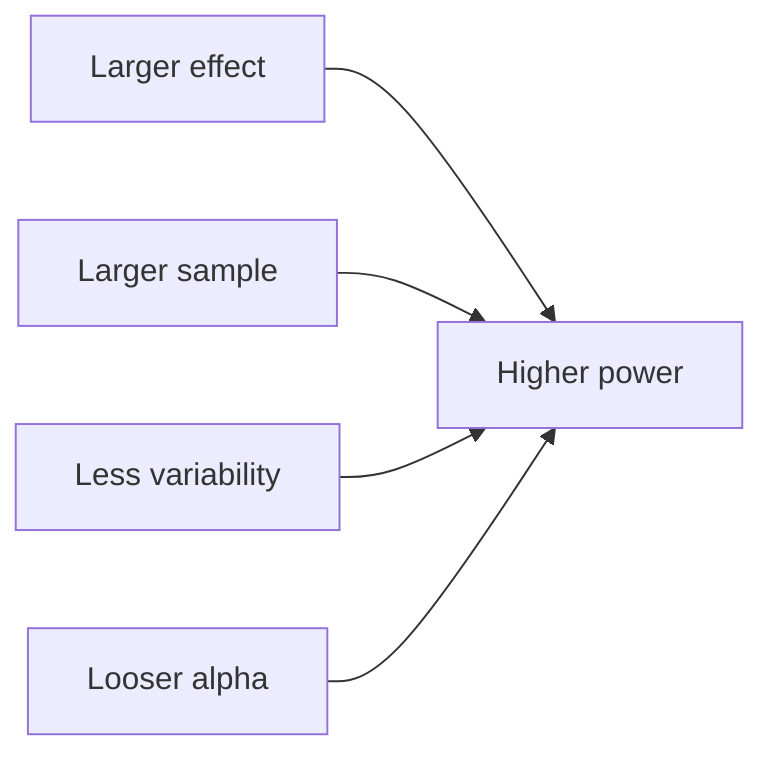

# Statistical power

**Prerequisites:** [Misreading p-values](09-misreading-p-values.md).

@@IMG@@

A study that is too small is like a dim torch in a big room: if it finds nothing, you cannot conclude the room is empty. **Statistical power** measures how bright the torch is, and low power turns out to cause problems not only for null results but for positive ones too.

## Definition

The **power** of a study is the probability that it will detect an effect (get p < α) *if an effect of a specified size really exists*. Power depends on four things:

1. **Effect size:** bigger effects are easier to detect.
2. **Sample size:** more participants means less noise.
3. **Variability:** the more individuals vary, the harder an effect is to see.
4. **Significance level (α):** a stricter threshold lowers power.

By convention, trials are designed to have 80% or 90% power to detect the smallest effect that would be clinically important. A trial with 80% power still misses a real effect one time in five.

## Sample size calculations

Before a trial begins, its designers should do a **sample size calculation**: given the expected event rate in the control group, the smallest worthwhile effect, the chosen α and the desired power, how many participants are needed? This calculation belongs in the protocol and the [methods section](../05-anatomy-of-a-paper/04-methods.md). Things to check:

- Was the assumed effect realistic, or optimistically large (which makes the required sample look smaller)?
- Did the trial actually recruit the planned number?
- Were the observed event rates close to those assumed? If events were rarer than expected, power will have been lower than planned.

## Low power and null results

An underpowered study that finds "no significant difference" tells you very little. Its confidence interval will usually be wide enough to include both no effect and important effects. Many small trials declared a treatment "ineffective" when they simply could not have detected a plausible benefit. Pooling such trials in a [meta-analysis](../03-study-designs/15-meta-analysis.md) is one remedy.

## Low power and positive results: the winner's curse

The less obvious problem is that low power also makes **positive** results less trustworthy, in two ways.

First, among significant results, a smaller share are true when power is low. The calculation, set out in John Ioannidis's 2005 essay "Why most published research findings are false" and developed by Katherine Button and colleagues in 2013, works like this: the proportion of significant findings that are real (the **positive predictive value**) depends on power, the α level and how many tested hypotheses are true to begin with. Lower power means fewer true positives relative to the fixed false-positive rate.

Second, when a small study does reach significance, its estimate of the effect is likely to be **exaggerated**. Only results that happen to overshoot the true effect by a lot clear the significance bar in a small sample. This is called the **winner's curse** or **effect size inflation**. Andrew Gelman and John Carlin named the related risks **Type M** (magnitude) and **Type S** (sign) errors: a significant result from an underpowered study can overstate the effect several-fold or even get its direction wrong.

## How low is power in practice?

Button and colleagues' 2013 paper in *Nature Reviews Neuroscience*, "Power failure", analysed 49 meta-analyses covering 730 primary studies and estimated that the median statistical power of neuroscience studies was about 21%. A later reanalysis argued that power varied widely between subfields, but the general conclusion, that many studies in several fields are badly underpowered, is widely accepted. Jacob Cohen had made a similar point about psychology as early as 1962.

## What this means for readers

- Be cautious about dramatic effects from small studies; expect later, larger studies to find smaller effects.
- Treat non-significant results from small studies as inconclusive.
- Look for the sample size calculation and whether it was met.
- Prefer findings that have been replicated in adequately powered studies.

## Key ideas

- Power is the chance of detecting a real effect of a given size.
- It rises with effect size and sample size and falls with variability and stricter α.
- Underpowered null results are inconclusive.
- Underpowered positive results are more likely to be false and, when true, exaggerated (the winner's curse).
- Median power in some fields has been estimated to be very low.

## Where this leads

- Next: [Effect sizes](11-effect-sizes.md)
- Related: [The replication crisis](../06-research-integrity/07-the-replication-crisis.md)
