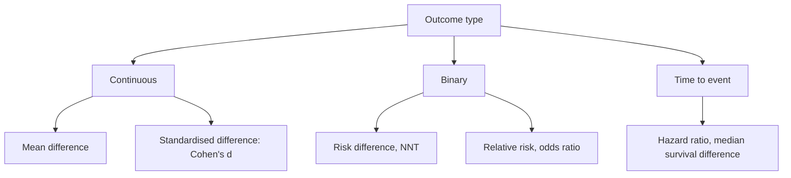

# Effect sizes

**Prerequisites:** [[statistical-power|Statistical power]].

@@IMG@@

The p-value asks whether there is an effect. The more useful question is **how big is it?** An **effect size** is a number that answers that question. Learning the main effect sizes, and what counts as large or small for each, is essential for reading any results section.

## Raw (unstandardised) effect sizes

The simplest effect size is a difference in natural units:

- "The drug lowered systolic blood pressure by 6 mmHg more than placebo."
- "Children in the programme scored 4 points higher on a 100-point reading test."
- "Patients on the new regimen lived a median of 2.1 months longer."

Raw effect sizes are the easiest to interpret if you know the scale. You can ask a clinician or patient whether 6 mmHg matters. They should almost always be reported, with their [[standard-error-and-confidence-intervals|confidence intervals]].

## Standardised mean differences

When studies use different scales for the same idea (several depression questionnaires, for instance), researchers convert differences into **standard deviation units**. The most common is **Cohen's d**: the difference in means divided by the pooled standard deviation. Hedges' g is a version corrected for small samples.

Jacob Cohen suggested rough benchmarks of 0.2 for "small", 0.5 for "medium" and 0.8 for "large", while warning that they were arbitrary and that context should decide. A d of 0.2 on mortality would be enormous; on a mood questionnaire, modest.

One way to make d intuitive: with d = 0.5 and normal distributions, the average person in the treated group scores higher than about 69% of the control group.

## Correlation

The **correlation coefficient** (Pearson's r) ranges from −1 to +1 and measures how closely two variables follow a straight-line relationship. Zero means no linear relationship. **r²** is the share of variation in one variable "explained" by the other in a simple linear model: r = 0.3 means r² = 0.09, about 9%. Correlations say nothing on their own about cause ([[correlation-and-causation|correlation and causation]]).

## Effect sizes for binary outcomes

When the outcome is yes/no (died, had a stroke, got infected), the main effect sizes are:

- **Risk difference** (absolute risk reduction): risk in the control group minus risk in the treated group.
- **Relative risk** (risk ratio): risk in treated divided by risk in control.
- **Odds ratio**: the ratio of the odds.
- **Hazard ratio**: the ratio of event rates over time, from survival analysis.
- **Number needed to treat**: 1 divided by the risk difference.

These are so important, and so easily misused, that each has its own lesson: [[relative-and-absolute-risk|relative and absolute risk]], [[number-needed-to-treat|number needed to treat]] and [[odds-ratios-and-hazard-ratios|odds ratios and hazard ratios]].

## Minimal clinically important difference

For many outcomes, researchers have tried to define a **minimal clinically important difference** (MCID): the smallest change patients would notice and value. If a pain treatment improves scores by less than the MCID, it may be statistically significant but not worth having. Ask whether the paper discusses what size of effect would matter, and whether the observed effect reaches it.

## Effect sizes shrink

Two patterns make early effect sizes unreliable. Small studies that reach significance tend to overestimate effects (the **winner's curse**, from [[statistical-power|the previous lesson]]), and later, larger studies usually find smaller effects. In the Open Science Collaboration's 2015 replication project, the mean effect size in replications was about half that of the original studies. A sensible reader mentally discounts dramatic effects from small early studies.

## Absolute numbers beat adjectives

Papers and press releases often describe effects with adjectives: "dramatic", "significant", "strong". Replace them with numbers. "Significantly reduced risk" might mean from 2% to 1.9% or from 40% to 10%. The number tells you which.

## Key ideas

- Effect sizes measure how big an effect is; p-values do not.
- Report raw differences in natural units when the scale is meaningful.
- Standardised mean differences (Cohen's d) put different scales on a common footing; benchmarks are only rough guides.
- Binary outcomes use risk differences, relative risks, odds ratios, hazard ratios and NNT.
- Early, small-study effect sizes tend to shrink on replication.

## Where this leads

- Next: [[relative-and-absolute-risk|Relative and absolute risk]]
