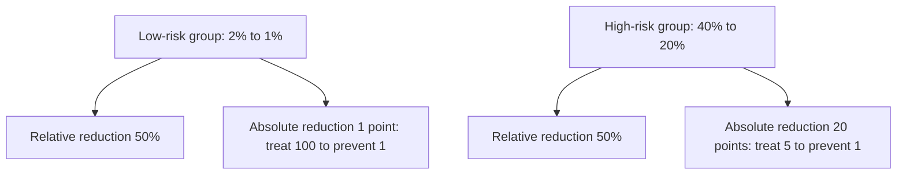

# Relative and absolute risk

**Prerequisites:** [[effect-sizes|Effect sizes]].

@@IMG@@

"New drug cuts heart attack risk by 50%!" sounds impressive. Whether it is depends on a number the headline leaves out: how common heart attacks were in the first place. The distinction between **relative** and **absolute** risk is probably the most practically useful idea in this whole course.

## Definitions

Suppose that over five years, 2 in 100 people on placebo have a heart attack and 1 in 100 people on a drug do.

- **Absolute risk** in each group: 2% (control) and 1% (treated).
- **Absolute risk reduction (ARR)**, or risk difference: 2% − 1% = 1 percentage point.
- **Relative risk (RR)**, or risk ratio: 1% ÷ 2% = 0.5.
- **Relative risk reduction (RRR)**: 1 − RR = 50%.

The same result can be reported as "halves the risk" or as "reduces risk by one percentage point". Both are true. They feel completely different.

Now suppose a different population at high risk: 40 in 100 on placebo and 20 in 100 on the drug. The RRR is still 50%, but the ARR is now 20 percentage points, twenty times larger. **Relative effects are often fairly stable across populations; absolute effects depend on baseline risk.** That is why the same drug can be well worth taking for high-risk people and barely worth it for low-risk people.

## Why relative numbers dominate headlines

Relative risks are bigger numbers, so they make better headlines and better marketing. Research by Gerd Gigerenzer and others has found that patients and doctors judge treatments as more effective when results are presented as relative risk reductions than when the same results are given in absolute terms. Many experts in risk communication, including Gigerenzer and colleagues in their 2007 review "Helping doctors and patients make sense of health statistics", recommend always giving absolute risks, ideally as natural frequencies.

The same applies to harms. "Pill doubles the risk of blood clots" sounds alarming. If the baseline risk is 1 in 10,000 per year and it becomes 2 in 10,000, the absolute increase is 1 in 10,000. A well-known British example is the 1995 "pill scare", when a warning that third-generation contraceptive pills roughly doubled the risk of venous thrombosis compared with older pills was widely reported in relative terms; studies afterwards linked the scare to a rise in unplanned pregnancies and abortions in England and Wales. (The doubling was relative to an already low absolute risk.)

## Mismatched framing

A particularly misleading practice is **mismatched framing**: reporting benefits as relative risks and harms as absolute risks (or vice versa), so that benefits look large and harms look small. A 2014 BMJ study of press releases found exaggeration common; the [[press-releases-and-science-journalism|press releases lesson]] covers this. When you read a paper, put benefits and harms on the same absolute scale before weighing them.

## Percent versus percentage points

A change from 2% to 1% is a decrease of **one percentage point** and a decrease of **50 percent**. Writers often blur the two. "Risk fell by 1%" is ambiguous; ask which they mean.

## Over what time, in whom?

Absolute risks only make sense with a **time frame** and a **population**: "1% over five years in adults aged 50 to 70 with high cholesterol". A lifetime risk, an annual risk and a five-year risk can differ enormously. Check that the comparison groups and time periods are the same before comparing numbers across studies.

## Relative risk greater than 1

When RR is above 1, the exposure increases risk: RR = 1.3 means 30% higher risk *relative to* the baseline. Epidemiologists sometimes treat small relative risks (say, below 2) from observational studies with extra caution, because modest amounts of [[confounding|confounding]] or bias can produce them. That is a rule of thumb, not a law: some real effects are small, and the [[bradford-hill-criteria|Bradford Hill criteria]] treat strength of association as only one consideration.

## Questions to ask

1. What was the absolute risk in the control group?
2. What was it in the treated group?
3. What is the difference in percentage points, and over what period?
4. Are benefits and harms on the same scale?
5. How does my own baseline risk compare with the study population's?

## Key ideas

- Relative risk compares risks as a ratio; absolute risk reduction is the difference.
- The same relative effect means very different absolute benefits at different baseline risks.
- Headlines favour relative numbers because they are larger.
- Watch for mismatched framing of benefits and harms.
- Absolute risks need a time frame and a population.

## Where this leads

- Next: [[number-needed-to-treat|Number needed to treat and to harm]]
