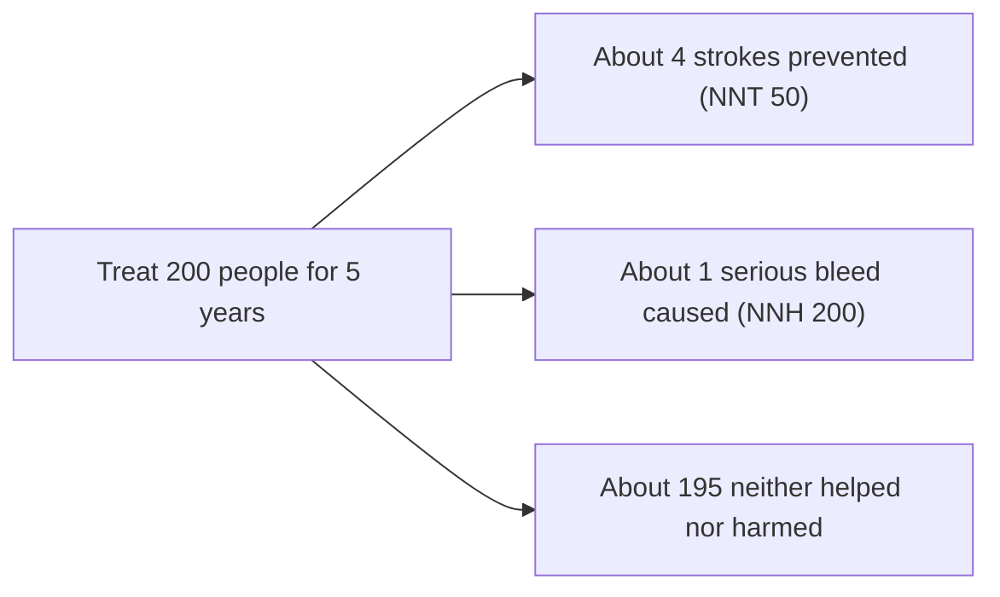

# Number needed to treat and to harm

**Prerequisites:** [[relative-and-absolute-risk|Relative and absolute risk]].

@@IMG@@

Absolute risk reductions are honest but abstract: "a 1.5 percentage point reduction" is hard to picture. The **number needed to treat** turns them into something concrete: how many people must take a treatment for one of them to benefit.

## Definition

The **number needed to treat (NNT)** is the reciprocal of the absolute risk reduction:

> NNT = 1 ÷ ARR

If a drug reduces five-year stroke risk from 4% to 2%, the ARR is 0.02, and the NNT is 1 ÷ 0.02 = 50. On average, 50 people must take the drug for five years to prevent one stroke. The other 49 either would not have had a stroke anyway or have one despite the drug. The concept was introduced by Andreas Laupacis, David Sackett and Robin Roberts in a 1988 paper in the *New England Journal of Medicine*.

The **number needed to harm (NNH)** is the same idea for adverse effects: 1 divided by the absolute risk increase. If the same drug causes serious bleeding in 1% of users over five years compared with 0.5% on placebo, the absolute increase is 0.005 and the NNH is 200.

Put side by side: treat 50 people to prevent one stroke, and cause one serious bleed for every 200 treated. That trade-off is far easier to discuss than a relative risk reduction of 50% and a relative risk increase of 100%.

(Illustrative numbers.)

## Reading NNTs well

- **Always attach a time frame and an outcome.** "NNT 50 over five years to prevent one stroke" is meaningful; "NNT 50" alone is not.
- **NNTs depend on baseline risk.** Because ARR does, so does NNT. A statin might have an NNT in the dozens to prevent a cardiovascular event over five years in people with existing heart disease, and in the hundreds for people at low risk. A single NNT from one trial applies to people like those in that trial.
- **Lower is better for NNT; higher is better for NNH.** An NNT of 1 would mean everyone benefits; NNTs for preventive treatments are often much larger.
- **NNTs have confidence intervals.** They are awkward because, when the ARR's interval includes zero, the NNT's interval runs to infinity and back round to "number needed to harm". Good papers report the ARR's interval as well.
- **Compare like with like.** NNTs for different outcomes, durations or populations cannot be ranked against each other.

## What NNT does and does not tell you

The NNT is an average over a group. It does not say that exactly one person in 50 benefits in a predictable way, and it cannot identify who. It also counts only the outcome specified; a drug might have an NNT of 50 for preventing stroke but no effect on overall mortality.

NNT also says nothing on its own about whether a treatment is worth it. That depends on how serious the outcome is, the harms, the cost and the patient's values. A vaccine or drug with an NNT in the thousands can still be worthwhile if the outcome prevented is severe and the harms are rare, especially for infectious diseases where protecting one person also protects others. Conversely, a treatment with a low NNT may be unattractive if its side effects are frequent.

## Converting relative risks for your own situation

If you know a treatment's relative risk reduction and can estimate your own baseline risk, you can approximate your personal NNT:

1. Estimate your baseline risk over the period (say 10% over 10 years, from a validated risk calculator).
2. Multiply by the relative risk reduction (say 25%): ARR ≈ 2.5 percentage points.
3. NNT ≈ 1 ÷ 0.025 = 40.

This assumes the relative effect is the same for you as for trial participants, which is a reasonable starting point but not guaranteed.

## NNT in practice

Several projects publish NNTs in plain language for common treatments; the site TheNNT.com, started by emergency physicians, is one example. Such summaries are useful starting points, but check the source trials, as they simplify. Regulators and guideline bodies increasingly present absolute benefits and harms alongside relative ones, and the [[cochrane-and-grade|GRADE]] "summary of findings" tables used in Cochrane reviews show absolute effects per 1,000 people.

## Key ideas

- NNT = 1 ÷ absolute risk reduction; NNH = 1 ÷ absolute risk increase.
- Always state the outcome, the time frame and the population.
- NNT rises as baseline risk falls.
- NNT and NNH side by side make benefit-harm trade-offs concrete.
- NNT alone does not decide whether a treatment is worthwhile.

## Where this leads

- Next: [[base-rates-and-bayes-theorem|Base rates and Bayes' theorem]]
