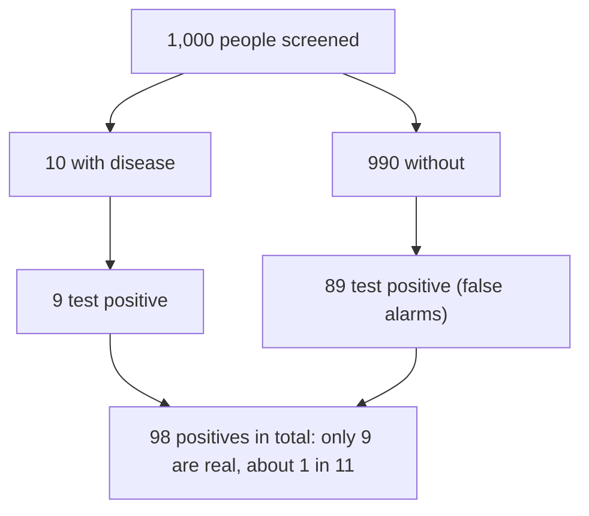

# Base rates and Bayes' theorem

**Prerequisites:** [Number needed to treat and to harm](13-number-needed-to-treat.md) and [Probability](02-probability.md).

@@IMG@@

How likely is a claim to be true *after* you see some evidence? It depends heavily on how likely it was *before*. This simple idea, formalised in **Bayes' theorem**, explains why most positive screening tests can be wrong, why surprising findings deserve extra scrutiny, and why many published results fail to replicate.

## The theorem

Bayes' theorem is named after Thomas Bayes (c. 1701–1761), an English Presbyterian minister whose essay on the subject was published after his death by Richard Price in 1763. Pierre-Simon Laplace developed the idea much further. In words:

> Updated belief = prior belief × how well the evidence fits the claim, compared with how well it fits the alternatives.

In symbols, for a hypothesis H and evidence E:

> P(H | E) = P(E | H) × P(H) ÷ P(E)

- **P(H)** is the **prior**: how plausible H was before the evidence.
- **P(E | H)** is the **likelihood**: how probable the evidence is if H is true.
- **P(H | E)** is the **posterior**: how plausible H is after the evidence.

An easier form uses odds: **posterior odds = prior odds × likelihood ratio**, where the likelihood ratio is P(E | H) ÷ P(E | not H).

## Base rates: the screening example

The **base rate** is how common something is in the population: the prior. Ignoring it is called **base-rate neglect**.

Take a screening test (illustrative numbers): the disease affects 1% of people screened; the test detects 90% of cases (sensitivity); and it wrongly flags 9% of healthy people (false-positive rate). Out of 1,000 people:

- 10 have the disease; 9 test positive.
- 990 do not; about 89 test positive.
- So about 98 people test positive, and only 9 of them have the disease: roughly **1 in 11**.

In surveys reported by Gigerenzer and colleagues, many doctors given such a problem in percentage form estimated the chance far too high. Given as natural frequencies, as above, most answered correctly. The test is the same; the base rate is what makes the difference. That is why screening programmes target groups where the disease is more common, and why a positive screen is usually followed by a more specific test.

## Base rates for hypotheses

The same logic applies to research findings. Think of a "statistically significant" result as a positive test for "this hypothesis is true". Its reliability depends on:

- the **prior**: what share of hypotheses tested in this field are actually true;
- the **power**: how often true hypotheses produce significant results;
- the **false-positive rate**: α, usually 0.05, plus any inflation from flexible analysis.

Suppose a field tests many long-shot hypotheses, of which only 1 in 10 is true, with studies of 50% power and α = 0.05. Of 1,000 hypotheses, 100 are true and yield 50 significant results; 900 are false and yield 45 false positives. So nearly half of the "significant" findings, 45 of 95, are false. This is the core of John Ioannidis's 2005 essay in *PLOS Medicine*, "Why most published research findings are false", which argued that low priors, low power, bias and flexible analyses can make false findings the majority in some fields. The essay's exact percentages depend on its assumptions and have been debated, but the logic is standard Bayesian reasoning.

## Extraordinary claims

A practical corollary, often associated with Carl Sagan's phrase "extraordinary claims require extraordinary evidence" (versions of the idea go back to Laplace and Hume), is that a surprising claim with a low prior needs much stronger evidence than a plausible one to become believable. In 2011 the social psychologist Daryl Bem published experiments in a leading journal reporting evidence of precognition, using standard methods and p-values. Because the prior probability of precognition is very low, many readers concluded that the paper revealed more about the weakness of standard methods than about psychic ability, and it became one trigger for the [replication crisis](../06-research-integrity/07-the-replication-crisis.md).

## Using Bayesian thinking without formulas

- Ask how plausible the claim was before this study, given mechanisms and earlier evidence.
- Ask how much more likely these results are if the claim is true than if it is false.
- Expect surprising findings from small studies to shrink or vanish on replication.
- Update gradually: one study rarely moves a well-established conclusion very far.

## Key ideas

- Bayes' theorem combines prior plausibility with the strength of new evidence.
- Base-rate neglect makes positive screening tests look more conclusive than they are.
- Natural frequencies make Bayesian problems easy.
- The share of significant findings that are true depends on priors, power and bias.
- Extraordinary claims need extraordinary evidence.

## Where this leads

- Next: [Sensitivity, specificity and screening](15-sensitivity-and-specificity.md)
- Related: [The replication crisis](../06-research-integrity/07-the-replication-crisis.md)
