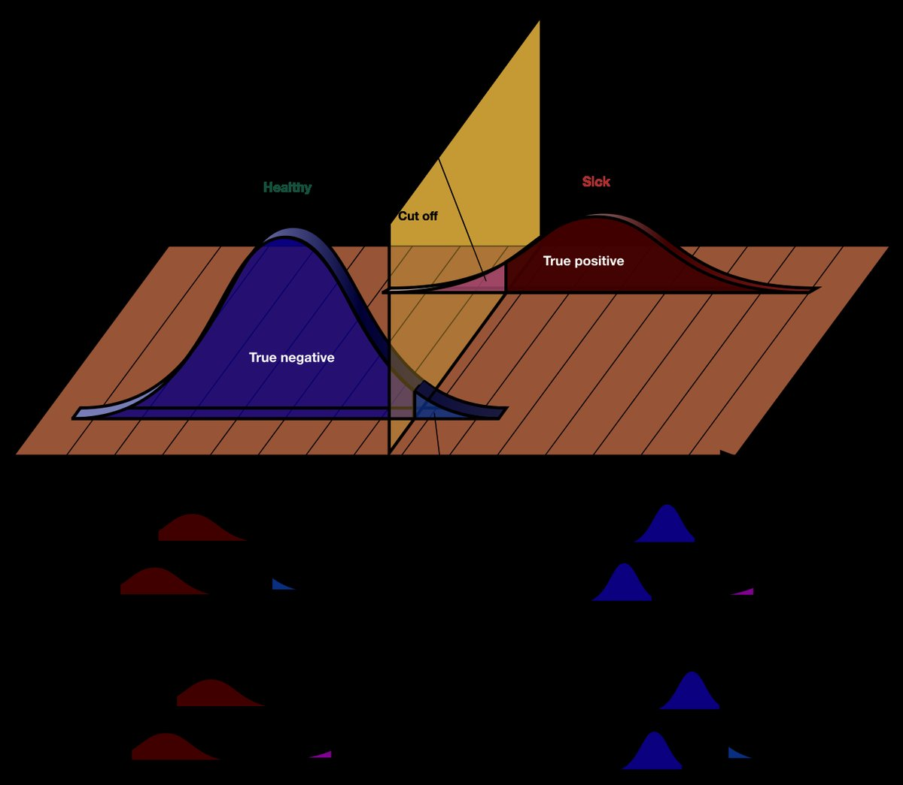
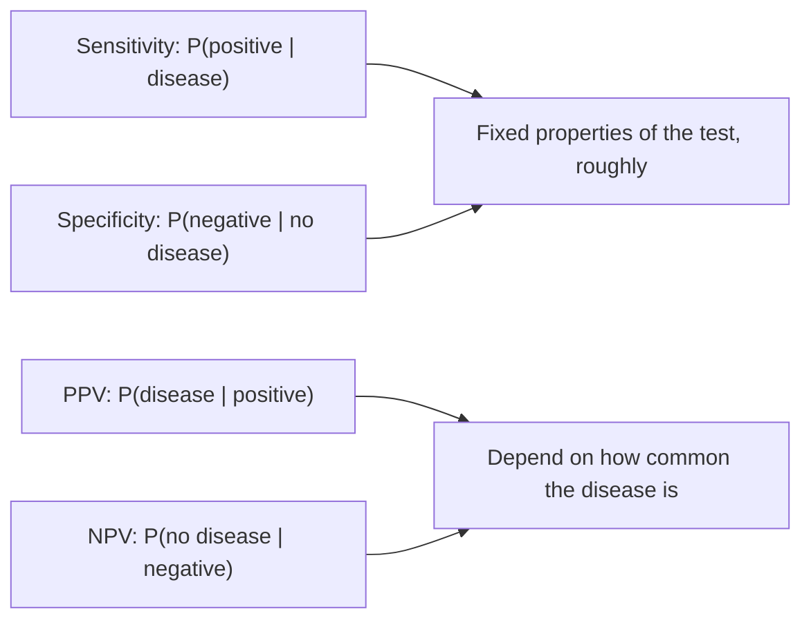

# Sensitivity, specificity and screening

**Prerequisites:** [Base rates and Bayes' theorem](14-base-rates-and-bayes-theorem.md).

*Sensitivity, specificity and predictive values from a two-by-two table of test results. Credit: Original by Luigi Albert Maria. License: [CC BY-SA 4.0](https://creativecommons.org/licenses/by-sa/4.0). Source: [File:PPV, NPV, Sensitivity and Specificity.svg](https://commons.wikimedia.org/wiki/File:PPV,_NPV,_Sensitivity_and_Specificity.svg).*

Diagnostic and screening tests are everywhere in medical research: blood tests, scans, rapid antigen tests, questionnaires for depression. Papers about them use a small set of terms that let you work out how useful a test really is.

## The two-by-two table

Every test result for a person falls into one of four boxes:

| | Has the condition | Does not |
|---|---|---|
| Test positive | **True positive (TP)** | **False positive (FP)** |
| Test negative | **False negative (FN)** | **True negative (TN)** |

From this table come the key measures:

- **Sensitivity** = TP ÷ (TP + FN): of people who have the condition, the share the test catches. A highly sensitive test rarely misses cases.
- **Specificity** = TN ÷ (TN + FP): of people without the condition, the share the test correctly clears. A highly specific test rarely raises false alarms.
- **Positive predictive value (PPV)** = TP ÷ (TP + FP): of people who test positive, the share who really have it.
- **Negative predictive value (NPV)** = TN ÷ (TN + FN): of people who test negative, the share who really do not.

Mnemonics used by clinicians: **SnNout** (a highly *S*e*n*sitive test, when *N*egative, rules *out*) and **SpPin** (a highly *Sp*ecific test, when *P*ositive, rules *in*).

## Predictive values depend on prevalence

Sensitivity and specificity are properties of the test (though they can vary between populations). PPV and NPV are not: they depend on **prevalence**, the base rate. The same test that is very reliable in a specialist clinic, where many patients have the disease, will produce mostly false positives in population screening, where few do. This is [Bayes' theorem](14-base-rates-and-bayes-theorem.md) in action.

A paper reporting only "the test was 95% accurate" is not telling you enough. Accuracy, (TP + TN) ÷ everyone, can be high simply because most people do not have the condition: a "test" that calls everyone negative is 99% accurate for a disease with 1% prevalence.

## Thresholds and trade-offs

Many tests produce a number (a blood level, a score) and a cut-off decides positive or negative. Lowering the cut-off catches more cases (higher sensitivity) but flags more healthy people (lower specificity). A **receiver operating characteristic (ROC) curve** plots sensitivity against 1 − specificity across all cut-offs. The **area under the curve** (AUC, or c-statistic) summarises discrimination: 0.5 is a coin toss, 1.0 is perfect. AUCs are also used to describe prediction models.

**Likelihood ratios** combine sensitivity and specificity into one number per result: LR+ = sensitivity ÷ (1 − specificity). They plug directly into the odds form of Bayes' theorem.

## Screening has its own problems

Screening healthy people is different from testing someone with symptoms, and its benefits are harder to show than they look. Three biases make screened patients look better off even if screening does nothing; they are covered in [time-related biases](../04-causation/08-time-related-biases.md):

- **Lead-time bias:** finding a disease earlier makes survival from diagnosis longer even if death occurs at the same time.
- **Length bias:** screening preferentially finds slow-growing disease, which has a better prognosis anyway.
- **Overdiagnosis:** screening finds abnormalities that would never have caused symptoms in the person's lifetime. Treating them causes harm without benefit.

For this reason, the strongest evidence for screening comes from randomised trials that compare **mortality from the disease (or overall)** between invited and uninvited groups, not survival from diagnosis. In 1968 the World Health Organization published James Wilson and Gunnar Jungner's principles for screening, which still frame the debate: the condition should be an important problem, there should be an accepted treatment, a suitable test, and so on.

## Reading a diagnostic accuracy study

Questions to ask:

- Was the test compared against a good **reference standard** ("gold standard")?
- Did everyone get the reference standard, or only those who tested positive (**verification bias**)?
- Were the people studied like those in whom the test will be used (**spectrum bias**)? Tests look better when comparing very sick patients with very healthy volunteers.
- Were those interpreting the test blinded to the reference result?

The reporting guideline for such studies is STARD; see [reporting checklists](../05-anatomy-of-a-paper/12-reporting-checklists.md).

## Key ideas

- Sensitivity catches cases; specificity avoids false alarms.
- PPV and NPV depend on prevalence; a good test can give mostly false positives in low-risk populations.
- "Accuracy" alone can be meaningless for rare conditions.
- Cut-offs trade sensitivity against specificity; ROC curves show the trade-off.
- Screening benefits should be judged by mortality in randomised trials, because of lead-time, length bias and overdiagnosis.

## Where this leads

- Next: [Multiple comparisons](16-multiple-comparisons.md)
- Related: [Time-related biases](../04-causation/08-time-related-biases.md)
