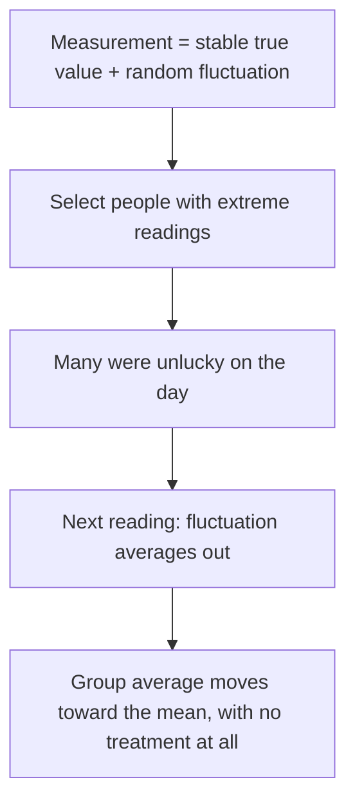

# Regression to the mean

**Prerequisites:** [[multiple-comparisons|Multiple comparisons]].

@@IMG@@

People tend to seek treatment when they feel worst, schools get special help after their worst year, and athletes appear on magazine covers after their best season. In each case, the next measurement is likely to be closer to average, whether or not anything was done. This is **regression to the mean**, and it fools patients, doctors, policymakers and researchers alike.

## Where the idea came from

Francis Galton (1822–1911) noticed in the 1880s that very tall parents tended to have children who were tall but, on average, less extreme than their parents, and very short parents had children less short than themselves. He called it "regression towards mediocrity" in an 1886 paper on hereditary stature. The children were not becoming more average as a group; the population's spread of heights stayed similar from generation to generation. Rather, any single extreme measurement is partly due to factors that are not repeated.

## Why it happens

Any measurement mixes a stable component (a person's true average blood pressure) with a fluctuating one (today's stress, the time of day, measurement error). When you select people *because* their measurement was extreme, you are selecting many whose fluctuating component happened to push them to the extreme. On re-measurement, that component is unlikely to be as extreme again, so the average of the selected group moves back toward the population mean.

Regression to the mean is strongest when measurements are noisy (low reliability) and when selection is based on extreme values.

## Examples in research

- **Before-and-after studies.** Patients enrolled because of high blood pressure, high pain scores or a recent flare of symptoms will, on average, improve on re-measurement. An uncontrolled study will credit the treatment.
- **Speed cameras and accident blackspots.** Cameras are often installed at sites after an unusually bad run of crashes. Crashes then fall, partly because the bad run was partly chance. Evaluations need to account for this.
- **Underperforming schools or hospitals.** Institutions singled out after a bad year tend to improve the next year anyway.
- **The "Sports Illustrated cover jinx".** Athletes featured after an exceptional season often have a less exceptional next one.

Daniel Kahneman describes an Israeli flight instructor who believed that praising good landings made pilots worse and criticising bad ones made them better. The pattern he saw was regression to the mean: an exceptionally good landing is usually followed by a more ordinary one, whatever the instructor says.

## Regression to the mean and the placebo effect

Part of what is called the "placebo effect" in trials is really regression to the mean plus the natural course of illness: people enrolled at a bad moment get better on their own. A 2001 systematic review by Asbjørn Hróbjartsson and Peter Gøtzsche in the *New England Journal of Medicine*, comparing placebo with no-treatment groups across trials, found little evidence that placebos had powerful clinical effects in general, apart from possible small effects on subjective outcomes such as pain. Whatever the size of true placebo effects, the comparison with a control group is what protects a trial from mistaking regression for benefit.

## How to guard against it

- **Use a control group.** Randomised controls regress to the mean just as much as treated patients, so the difference between groups removes it.
- **Measure more than once at baseline** and use the average, or select people on one measurement and use a different one as the baseline.
- **Be wary of selection on extremes** in any before-and-after comparison.

## Key ideas

- Extreme measurements tend to be followed by less extreme ones, without any intervention.
- It happens because measurements mix stable values with random fluctuation.
- Uncontrolled before-and-after studies routinely mistake it for a treatment effect.
- Part of the apparent placebo response is regression and natural recovery.
- Randomised control groups cancel it out.

## Where this leads

- Next: [[regression-and-adjustment|Regression models and adjustment]]
- Related: [[randomised-controlled-trials|Randomised controlled trials]]
