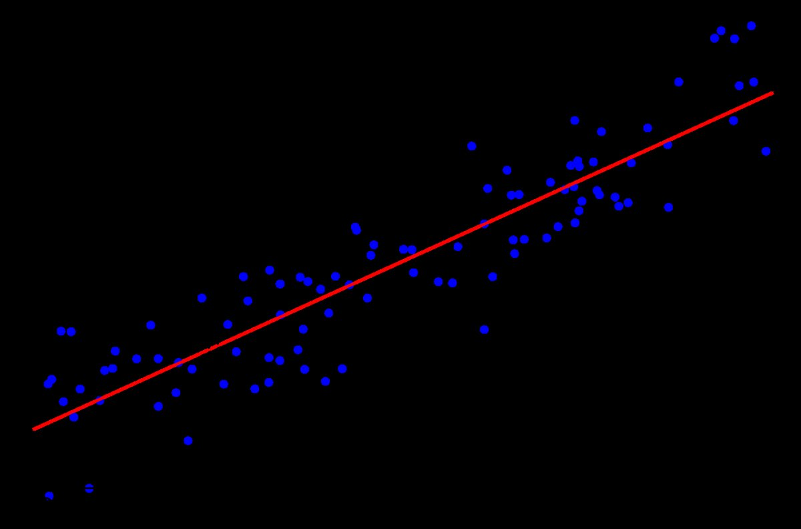
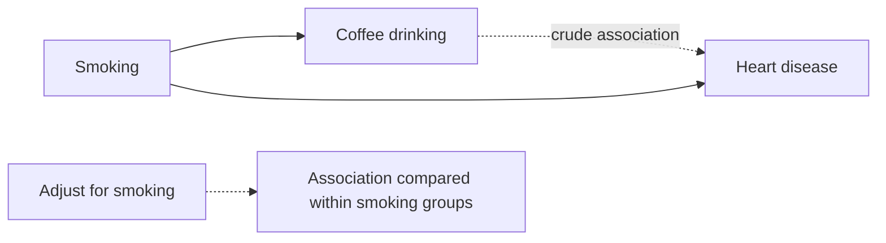

# Regression models and adjustment

**Prerequisites:** [Regression to the mean](17-regression-to-the-mean.md) and [Effect sizes](11-effect-sizes.md).

*A fitted linear regression line through scattered data points. Credit: Sewaqu. License: Public domain. Source: [File:Linear regression.svg](https://commons.wikimedia.org/wiki/File:Linear_regression.svg).*

Almost every observational study, and many trials, report results "adjusted for" age, sex, smoking and other factors. The tool doing the adjusting is a **regression model**. You do not need to fit one yourself, but you need to know what adjustment can and cannot do.

## The basic idea

A **regression model** describes how an outcome changes with one or more predictor variables. The simplest is **linear regression** with one predictor: it fits the straight line that best describes how, say, blood pressure rises with age. The line's **slope** (the **coefficient**) says how much the outcome changes, on average, per unit of the predictor: "systolic pressure rises by 0.5 mmHg per year of age" (illustrative).

**Multiple regression** includes several predictors at once. Each coefficient then estimates the association between that predictor and the outcome *holding the others constant*. This is what "adjusted for" means.

Different outcome types need different models:

| Outcome | Model | Effect reported |
|---|---|---|
| Continuous (blood pressure) | Linear regression | Mean difference per unit |
| Binary (stroke yes/no) | Logistic regression | Odds ratio |
| Count or rate (infections) | Poisson or negative binomial regression | Rate ratio |
| Time to event (survival) | Cox proportional hazards regression | Hazard ratio |

See [odds ratios and hazard ratios](19-odds-ratios-and-hazard-ratios.md) for how to read the last three.

## Why adjust?

Suppose coffee drinkers appear to have more heart disease. But coffee drinkers in some datasets are also more likely to smoke. Smoking could explain the association: it is a [confounder](../04-causation/02-confounding.md). By including smoking in the model, researchers estimate the coffee-heart disease association among people with the same smoking status. If the association shrinks toward zero after adjustment, smoking was doing much of the work.

Comparing **crude** (unadjusted) and **adjusted** estimates is informative. A large change tells you confounding by the measured variables was substantial, which should make you wonder about unmeasured ones too.

## What adjustment cannot do

Adjustment is powerful but limited, and papers often present it as more decisive than it is.

1. **It only handles what was measured.** Unmeasured confounders, such as health consciousness, income or frailty, remain. This **residual confounding** is the central weakness of observational research.
2. **It only handles what was measured well.** If smoking is recorded crudely ("ever/never"), adjusting for it leaves much confounding behind.
3. **The model form matters.** Assuming a straight-line relationship when the real one is curved leaves bias.
4. **Adjusting for the wrong things can create bias.** Adjusting for a variable on the causal pathway (a **mediator**) removes part of the real effect; adjusting for a common effect of exposure and outcome (a **collider**) can create a spurious association. [Causal diagrams](../04-causation/10-causal-diagrams.md) explain how to tell which variables to adjust for.
5. **Too many variables for too few events** makes models unstable. A rough rule of thumb in logistic regression has been at least ten outcome events per predictor, though statisticians debate the exact number.

## Propensity scores

A **propensity score** is the predicted probability that a person received the exposure, given their measured characteristics. Researchers can match, weight or stratify on it so that exposed and unexposed groups look alike on measured variables. It is a convenient way to adjust for many covariates, but it shares the basic limitation of regression: it cannot balance what was not measured. Only randomisation does that.

## Overfitting and prediction models

Regression is also used to build **prediction models**, such as cardiovascular risk calculators. A model fitted to one dataset will usually perform worse on new data, because it has partly fitted noise (**overfitting**). Good prediction papers report **external validation** on independent data. The reporting guideline for them is TRIPOD.

## Reading a regression table

- Identify the outcome, the main exposure and the effect measure.
- Find the crude and adjusted estimates and their confidence intervals.
- Read the list of adjustment variables. Are obvious confounders missing? Are any of them mediators or colliders?
- Ask what important variables could not be measured.
- Treat coefficients for covariates (the "Table 2 fallacy", as Daniel Westreich and Sander Greenland called it in 2013) with caution: a model built to estimate one exposure's effect does not give valid causal estimates for every other variable in it.

## Key ideas

- Regression models relate an outcome to predictors; "adjusted" means holding other measured variables constant.
- Model type follows outcome type: linear, logistic, Poisson, Cox.
- Adjustment cannot remove unmeasured or poorly measured confounding.
- Adjusting for mediators or colliders can introduce bias.
- Propensity scores balance measured variables only.

## Where this leads

- Next: [Odds ratios and hazard ratios](19-odds-ratios-and-hazard-ratios.md)
- Deeper: [Confounding](../04-causation/02-confounding.md) and [Causal diagrams](../04-causation/10-causal-diagrams.md)
