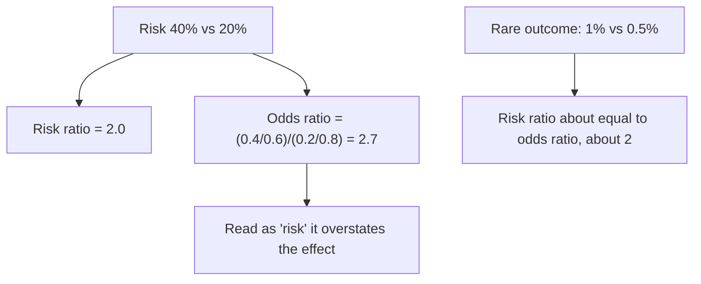

# Odds ratios and hazard ratios

**Prerequisites:** [Regression models and adjustment](18-regression-and-adjustment.md) and [Relative and absolute risk](12-relative-and-absolute-risk.md).

@@IMG@@

Medical papers report relative effects in three main forms: the **risk ratio**, the **odds ratio** and the **hazard ratio**. They look alike (a number around 1, with a confidence interval) but are not the same, and treating them as interchangeable can exaggerate effects.

## Odds versus risk

The **risk** (probability) of an event is events ÷ everyone. The **odds** are events ÷ non-events.

- 20 of 100 people have a stroke: risk = 20/100 = 0.20; odds = 20/80 = 0.25.
- 50 of 100: risk = 0.5; odds = 50/50 = 1.
- 90 of 100: risk = 0.9; odds = 90/10 = 9.

For rare events, risk and odds are nearly equal (1 in 100: risk 0.010, odds 0.0101). For common events they diverge sharply. Odds are familiar from betting: "4 to 1 against" means odds of 1/4.

## The odds ratio

The **odds ratio** (OR) is the odds in one group divided by the odds in another. Odds ratios appear for two main reasons:

1. **Case-control studies** start from people with and without the disease, so they cannot estimate risks directly, but they can estimate odds ratios. See [case-control studies](../03-study-designs/05-case-control-studies.md).
2. **Logistic regression**, the standard model for binary outcomes, produces odds ratios.

When the outcome is rare (a common rule of thumb is under about 10%), the OR approximates the risk ratio. When the outcome is common, **the OR is further from 1 than the risk ratio**. If the risk is 40% in one group and 20% in another, the risk ratio is 2.0 but the odds ratio is (0.4/0.6) ÷ (0.2/0.8) ≈ 2.7. Reporting such an OR as "2.7 times the risk" overstates the effect. A 1998 paper in the *BMJ* by Huw Davies, Iain Crombie and Manouche Tavakoli and many later commentaries have warned about this.

## The hazard ratio

Many studies follow people over time and record *when* events happen, not just whether. The natural measure is the **hazard**: the instantaneous rate of the event among those still at risk. The **hazard ratio** (HR) compares hazards between groups and usually comes from a **Cox proportional hazards model**, introduced by David Cox in 1972.

An HR of 0.75 means that, at any given time, people in the treated group experience the event at about three-quarters the rate of the control group. It is *not* the same as "25% fewer people had the event by the end", though for modest event rates the two are often close.

The Cox model assumes **proportional hazards**: the ratio stays roughly constant over time. If a treatment helps early but not later, or causes early harm and later benefit (as some surgeries do), a single HR misrepresents what happened. Look at the [Kaplan-Meier curves](../05-anatomy-of-a-paper/08-kaplan-meier-curves.md): if they cross, the proportional hazards assumption is doubtful.

## Rate ratios

Some studies count events per **person-time** ("cases per 100,000 person-years"). The ratio of two such rates is the **rate ratio** or **incidence rate ratio**. It is common in vaccine and drug safety studies that compare rates in exposed and unexposed periods, such as [self-controlled case series](../03-study-designs/11-self-controlled-case-series.md).

## Reading any ratio

1. **Which ratio is it?** Risk, odds, hazard or rate.
2. **Which way round?** Is it treated versus control or control versus treated? An HR of 0.5 and one of 2.0 can describe the same result.
3. **What is the confidence interval?** Does it include 1?
4. **What is the baseline?** Convert to absolute numbers wherever possible ([relative and absolute risk](12-relative-and-absolute-risk.md)). A hazard ratio of 0.5 for an event that strikes 1 in 1,000 people is a very different matter from one for an event striking 1 in 5.
5. **Adjusted or crude?** And for what?

## Ratios on log scales

Because ratios are multiplicative (an OR of 2 is as far above 1 as 0.5 is below it), they are analysed and plotted on logarithmic scales. On a [forest plot](../05-anatomy-of-a-paper/07-forest-plots.md), the x-axis is usually logarithmic, so 0.5 and 2.0 sit at equal distances from 1.

## Key ideas

- Odds are events ÷ non-events; risks are events ÷ everyone.
- Odds ratios approximate risk ratios only for rare outcomes; for common outcomes they exaggerate.
- Hazard ratios compare event rates over time and assume they are proportional.
- Rate ratios compare events per person-time.
- Always translate ratios into absolute numbers using the baseline risk.

## Where this leads

- Next section: [Study designs and the evidence hierarchy](../03-study-designs/README.md)
- Practice: [Forest plots](../05-anatomy-of-a-paper/07-forest-plots.md), [Kaplan-Meier curves](../05-anatomy-of-a-paper/08-kaplan-meier-curves.md)
