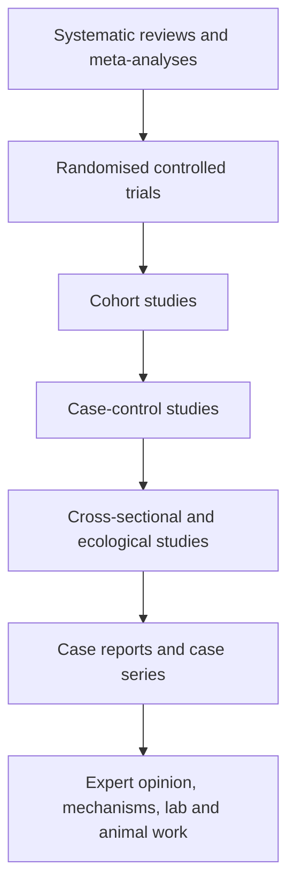

# The evidence hierarchy

**Prerequisites:** [[odds-ratios-and-hazard-ratios|Odds ratios and hazard ratios]] and [[observation-measurement-and-experiment|Observation, measurement and experiment]].

@@IMG@@

Not all studies are equally good at answering every question. The **evidence hierarchy**, often drawn as a pyramid, ranks study designs by how well they protect against bias when the question is whether something *causes* something else. It is a useful first map, provided you remember what it leaves out.

## The classic pyramid

From weakest to strongest for questions about the effects of treatments:

1. **Expert opinion, mechanistic reasoning, laboratory and animal studies**
2. **Case reports and case series**: descriptions of individual patients ([[case-reports-and-case-series|lesson]])
3. **Ecological and cross-sectional studies**: comparisons of populations or snapshots ([[ecological-studies|ecological]], [[cross-sectional-studies|cross-sectional]])
4. **Case-control studies**: comparing people with and without an outcome ([[case-control-studies|lesson]])
5. **Cohort studies**: following exposed and unexposed people forward ([[cohort-studies|lesson]])
6. **Randomised controlled trials** ([[randomised-controlled-trials|lesson]])
7. **Systematic reviews and meta-analyses** of the above, especially of RCTs ([[systematic-reviews|systematic reviews]], [[meta-analysis|meta-analysis]])

The reasoning is that each step up adds protection against a source of error: a comparison group, then a time order, then randomisation, then pooling across many studies.

The modern hierarchy grew out of the **evidence-based medicine** movement. Archie Cochrane's 1972 book *Effectiveness and Efficiency* argued that health services should rely on randomised trials. In the early 1990s a group at McMaster University in Hamilton, Ontario, led by Gordon Guyatt and David Sackett, popularised the term "evidence-based medicine" in a 1992 *JAMA* article.

## What the pyramid gets right

For questions about whether an intervention works, randomisation really is a huge advantage, because it balances unknown as well as known confounders. Repeatedly, treatments that looked beneficial in observational studies failed in trials. The [[hormone-replacement-therapy-and-the-whi|hormone replacement therapy]] story and the beta-carotene and vitamin E trials of the 1990s are classic examples.

## What the pyramid gets wrong

Treat the hierarchy as a rule of thumb, not a ranking you can apply mechanically:

- **Design is not quality.** A badly run RCT, with poor concealment of allocation, heavy dropout or a switched outcome, can be worse than a careful cohort study. The [[cochrane-and-grade|GRADE]] system explicitly lets evidence be downgraded or upgraded from its starting level.
- **Different questions need different designs.** For rare or long-term harms, large observational studies and surveillance systems are often the *only* evidence, because trials are too small and short. For diagnostic accuracy, prognosis, or how common a disease is, the hierarchy looks different.
- **Some questions cannot ethically be randomised.** Nobody will randomise people to smoke. The case against tobacco was built on observational studies, mechanism and convergence ([[tobacco-industry-research|tobacco case study]]).
- **Very large effects need less.** The 2003 *BMJ* spoof by Gordon Smith and Jill Pell, "Parachute use to prevent death and major trauma related to gravitational challenge: systematic review of randomised controlled trials", found no RCTs of parachutes and wryly suggested that advocates of evidence-based medicine volunteer for one. The point: when effects are dramatic and mechanisms obvious, demanding an RCT is unreasonable.
- **Meta-analyses inherit the flaws of their inputs.** Pooling biased studies produces a precise biased answer.

Some writers therefore draw the pyramid with wavy lines between levels, or replace it with a framework that rates each body of evidence on its own merits, as GRADE does.

## Matching design to question

| Question | Best primary designs |
|---|---|
| Does treatment X work? | RCTs, systematic reviews of RCTs |
| Does exposure X cause disease Y? (can't randomise) | Cohort and case-control studies, natural experiments |
| Does X cause a rare harm? | Large cohort studies, case-control, self-controlled case series, surveillance |
| How common is Y? | Cross-sectional surveys of representative samples |
| How accurate is test T? | Diagnostic accuracy studies against a reference standard |
| What is it like to live with Y? | Qualitative research (interviews, focus groups) |
| Is this a new phenomenon? | Case reports and case series |

## Key ideas

- The evidence hierarchy ranks designs by protection against bias for causal questions.
- Randomisation and systematic pooling put RCTs and meta-analyses at the top.
- Quality within a design matters as much as the design itself.
- Rare harms, unethical exposures and dramatic effects need other kinds of evidence.
- Match the design to the question.

## Where this leads

- Next: [[case-reports-and-case-series|Case reports and case series]]
- Synthesis: [[cochrane-and-grade|Cochrane and GRADE]]
