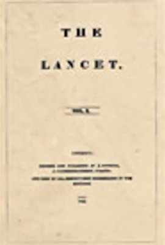
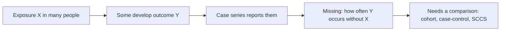

# Case reports and case series

**Prerequisites:** [The evidence hierarchy](01-the-evidence-hierarchy.md).

*The first issue of The Lancet (1823); medical journals have long published case reports. Credit: The Lancet. License: Public domain. Source: [File:The Lancet first issue.jpg](https://commons.wikimedia.org/wiki/File:The_Lancet_first_issue.jpg).*

A **case report** describes a single patient; a **case series** describes several patients with a similar condition, exposure or outcome. They sit near the bottom of the evidence hierarchy for causal questions, yet they have launched some of the most important discoveries in medicine. Knowing what they can and cannot show is essential, because they are also the most common source of health scares.

## What they are good for

- **Spotting new diseases.** In June 1981 the US Centers for Disease Control and Prevention's *Morbidity and Mortality Weekly Report* described five young gay men in Los Angeles with *Pneumocystis* pneumonia, an infection normally seen in people with severely weakened immune systems. It was the first published report of what became known as AIDS.
- **Spotting new harms.** In 1961 the Australian obstetrician William McBride wrote a short letter to *The Lancet* reporting congenital abnormalities in babies whose mothers had taken thalidomide; the German paediatrician Widukind Lenz raised the same alarm around the same time. Thalidomide was withdrawn, and the disaster reshaped drug regulation worldwide.
- **Describing rare conditions** that will never be common enough for large studies.
- **Generating hypotheses** to be tested in better-designed studies.

## What they cannot do

Case reports and case series have **no comparison group**. They tell you that some people with exposure X developed outcome Y. They cannot tell you whether people *without* X develop Y just as often. If an outcome is common, many people will develop it after any exposure purely by coincidence.

Suppose a vaccine is given to millions of children at the age when the first signs of a developmental condition commonly become noticeable. Some children will be diagnosed shortly after vaccination by chance alone. A case series of such children, however moving, cannot distinguish coincidence from cause. That is exactly the weakness of the 1998 *Lancet* paper by Andrew Wakefield and colleagues, a case series of 12 children, later retracted; see the [Wakefield case study](../10-case-studies/07-wakefield-1998.md).

## Temporal association is not causation

The pattern "it happened after, therefore it happened because" has a Latin name: *post hoc ergo propter hoc*. Case reports invite it. The question to ask is always: **how often would this outcome occur in this many people over this period anyway?** That expected number, the **background rate**, is the comparison case series lack. Safety surveillance systems compare observed reports with expected background rates for exactly this reason; see [passive surveillance](13-passive-surveillance-and-pharmacovigilance.md).

## Selection and reporting

Case series are also prone to selection. Clinicians write up the striking cases they see; patients who seek out a particular specialist because they already suspect a cause may be over-represented; and referrals to a researcher known for a hypothesis may be skewed toward cases that fit it. Reporting is often incomplete: what was the denominator, how were cases identified, were any excluded?

The CARE guidelines (2013) set out what a case report should include, and many journals ask authors to follow them; see [reporting checklists](../05-anatomy-of-a-paper/12-reporting-checklists.md).

## How a signal is followed up

A case report or cluster of reports is the beginning of an investigation, not the end. Typical next steps are:

1. Check surveillance databases for similar reports.
2. Compare the number of observed cases with the number expected from background rates.
3. Run a [case-control study](05-case-control-studies.md), a [cohort study](06-cohort-studies.md) or a [self-controlled case series](11-self-controlled-case-series.md) using large linked databases.
4. Look for a plausible mechanism.

Thalidomide's harms were confirmed this way. Many other alarms raised by case reports have not been confirmed.

## Key ideas

- Case reports and series describe patients without a comparison group.
- They are invaluable for detecting new diseases and harms and for generating hypotheses.
- They cannot establish causation, because they lack a background rate.
- "After, therefore because" is the fallacy they invite.
- Signals from case reports must be tested in controlled designs.

## Where this leads

- Next: [Ecological studies](03-ecological-studies.md)
- Case study: [Wakefield 1998](../10-case-studies/07-wakefield-1998.md)
