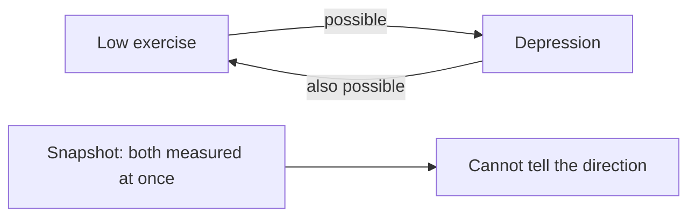

# Cross-sectional studies

**Prerequisites:** [Ecological studies](03-ecological-studies.md).

@@IMG@@

A **cross-sectional study** measures exposures and outcomes in a group of individuals at a single point in time, like a snapshot. National health surveys, polls about health behaviours and studies that measure blood pressure and salt intake in the same people on the same day are all cross-sectional. They are the right tool for asking *how common* something is, and a weak tool for asking *what causes* it.

## What they measure

The key quantity is **prevalence**: the proportion of a population that has a condition at a given time. "About 1 in 10 adults has diabetes" is a prevalence statement. Prevalence differs from **incidence**, the rate of *new* cases over a period. A chronic condition with a long duration can have high prevalence even with low incidence, because people live with it for years.

> Prevalence ≈ incidence × average duration (in a stable population)

This relationship matters. A treatment that keeps people alive longer with a disease, without curing it, *raises* prevalence.

Examples of large cross-sectional surveys include the Canadian Community Health Survey run by Statistics Canada and the US National Health and Nutrition Examination Survey (NHANES), which combines interviews with physical examinations and lab tests.

## Strengths

- **Fast and relatively cheap**: no follow-up is needed.
- **Good for prevalence** and for planning services.
- **Can be representative** if the sample is drawn properly, which allows estimates for a whole population.
- **Many variables at once**, useful for generating hypotheses.

## The main weakness: which came first?

Because exposure and outcome are measured at the same time, a cross-sectional study usually cannot tell which came first. If people with depression exercise less, is it because lack of exercise contributes to depression, or because depression saps the motivation to exercise? Both directions are plausible. This is [reverse causation](../04-causation/03-reverse-causation.md).

Some exposures do not change over time (genotype, sex, year of birth), so their direction is clear. For most lifestyle and health variables, it is not.

## Prevalence-incidence bias

Cross-sectional studies capture people who *currently* have a condition. People who died quickly or recovered quickly are missing. If an exposure affects survival rather than onset, a snapshot can mislead. This is sometimes called **Neyman bias** or prevalence-incidence bias. For example, a factor that makes a disease rapidly fatal will look *protective* in a prevalence survey, because exposed cases die before they can be counted.

## Survey problems

Many cross-sectional studies rely on surveys, which bring their own issues:

- **Non-response:** if only 30% of people sampled respond, are they typical?
- **Question wording and order** can shift answers substantially.
- **Social desirability:** people under-report drinking, smoking and drug use, and over-report exercise and voting.
- **Recall:** "How often did you eat red meat in the past year?" is hard to answer accurately.

Good survey papers report response rates, use weighting to correct for known differences between respondents and the population, and use validated questionnaires.

## Serial cross-sectional surveys

Repeating the same survey in new samples every year (**serial cross-sectional** or **repeated cross-sectional** surveys) tracks changes in prevalence over time. It is how smoking rates, obesity rates and vaccination coverage are monitored. It still cannot tell you what happens to any individual over time; for that you need a [cohort study](06-cohort-studies.md).

## Seroprevalence studies

A special cross-sectional design measures antibodies in blood samples to estimate how many people have been infected by a pathogen, including those who never had symptoms. Seroprevalence studies were widely used during the COVID-19 pandemic. Their accuracy depends on the test's [sensitivity and specificity](../02-statistics/15-sensitivity-and-specificity.md) (in low-prevalence settings, false positives can dominate) and on whether those tested represent the population.

## Key ideas

- Cross-sectional studies are snapshots measuring exposure and outcome at the same time.
- They are the right design for prevalence.
- Prevalence reflects both incidence and duration.
- They usually cannot establish which came first, inviting reverse causation.
- Survey non-response, wording and recall can all bias results.

## Where this leads

- Next: [Case-control studies](05-case-control-studies.md)
- Related: [Reverse causation](../04-causation/03-reverse-causation.md)
