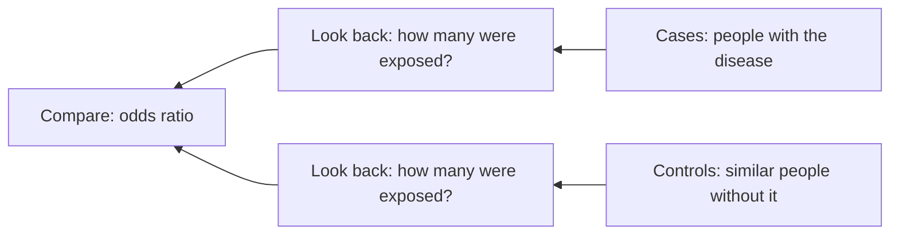

# Case-control studies

**Prerequisites:** [Cross-sectional studies](04-cross-sectional-studies.md) and [Odds ratios and hazard ratios](../02-statistics/19-odds-ratios-and-hazard-ratios.md).

@@IMG@@

Suppose you want to know whether something causes a rare disease. Following thousands of people for decades until a handful get sick would be slow and expensive. A **case-control study** works backwards instead: it starts with people who already have the disease (**cases**), finds comparable people who do not (**controls**), and compares how often each group was exposed in the past.

## The landmark example

In 1950 Richard Doll and Austin Bradford Hill published "Smoking and carcinoma of the lung" in the *British Medical Journal*. They interviewed patients with lung cancer in London hospitals and matched each with a patient of the same sex and similar age admitted for another condition. Of 649 men with lung cancer, 647 were smokers and 2 were non-smokers; among the 649 male controls, 622 smoked and 27 did not. Heavier smoking was associated with greater risk. In the same year, Ernst Wynder and Evarts Graham published a similar study in *JAMA*. These studies, followed by cohort studies such as Doll and Hill's British Doctors Study, built the case against tobacco; see the [worked example](../11-practice/07-worked-example-a-case-control-study.md).

## What the design estimates

Because researchers choose how many cases and controls to include, the study cannot measure the risk of disease in exposed and unexposed people directly. It can measure the **odds of exposure** among cases and controls, and the ratio of these, the **odds ratio**, mathematically equals the odds ratio for disease. For rare diseases, the odds ratio approximates the relative risk ([odds ratios and hazard ratios](../02-statistics/19-odds-ratios-and-hazard-ratios.md)).

## Strengths

- **Efficient for rare outcomes**: you need only enough cases, not a huge cohort.
- **Fast**: no waiting for outcomes to occur.
- **Several exposures** can be examined for one outcome.
- **Good for outbreak investigations**: public health teams routinely compare what sick and well people ate or did.

## Weaknesses

### Selecting controls

The hardest part is choosing controls. They should come from the same population that produced the cases, so that if they had developed the disease, they would have been cases in the study. Hospital controls may have diseases linked to the exposure (Doll and Hill's controls included patients with conditions that, as later learned, are also smoking-related, which would *weaken* the association). Community controls may differ in willingness to participate. Badly chosen controls are a classic source of [selection bias](../04-causation/04-selection-bias.md).

### Recall bias

Cases often search their memories harder for possible causes than controls do. A parent whose child has a birth defect may recall medications in pregnancy more thoroughly than a parent whose child is healthy, creating an apparent association. Using records collected *before* the outcome (prescription databases, medical charts) avoids this. See [measurement and recall bias](../04-causation/07-measurement-and-recall-bias.md).

### Confounding

As with all observational designs, cases and controls can differ in ways that also affect the outcome. **Matching** controls to cases on age, sex and other factors helps, but matched factors can no longer be studied, and over-matching on variables linked to exposure can bias results toward the null.

## Nested case-control studies

A **nested case-control study** draws both cases and controls from within an existing cohort, often using data recorded before anyone got sick. This avoids recall bias and makes control selection cleaner. It is widely used in drug safety research with large health databases. David Graham and colleagues' 2005 *Lancet* study of the painkiller rofecoxib (Vioxx), using Kaiser Permanente data in California, was a nested case-control study; see the [Vioxx case study](../10-case-studies/05-vioxx.md).

## Test-negative designs

A variation used to estimate vaccine effectiveness, especially for influenza and COVID-19, is the **test-negative design**. Among people who seek care with symptoms and are tested, those who test positive are cases and those who test negative are controls. Because both groups sought care and got tested, differences in healthcare-seeking behaviour are reduced. Its validity depends on assumptions, for example that vaccination does not affect the chance of being tested.

## Questions to ask

- How were cases defined and identified?
- Where did the controls come from, and would they have been cases if they had the disease?
- How was exposure measured: memory or records made beforehand?
- What was matched or adjusted for?
- Is there a dose-response pattern?

## Key ideas

- Case-control studies start from the outcome and look back at exposures.
- They are efficient for rare diseases and outbreaks.
- They estimate odds ratios, which approximate relative risks for rare outcomes.
- Control selection and recall bias are the main threats.
- Nested and test-negative designs reduce some of these threats.

## Where this leads

- Next: [Cohort studies](06-cohort-studies.md)
- Worked example: [Doll and Hill 1950](../11-practice/07-worked-example-a-case-control-study.md)
