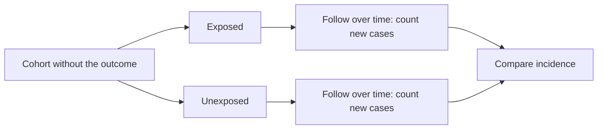

# Cohort studies

**Prerequisites:** [Case-control studies](05-case-control-studies.md).

@@IMG@@

A **cohort study** identifies a group of people, records their exposures, and follows them over time to see who develops which outcomes. Because exposure is measured *before* the outcome, cohort studies get the time order right, which makes them the strongest common observational design for causal questions.

## How they work

1. Assemble a cohort: a group of people without the outcome at the start.
2. Measure exposures (smoking, diet, medications, vaccination) and other characteristics.
3. Follow everyone over time and record outcomes.
4. Compare the incidence of outcomes in exposed and unexposed people, usually as relative risks, rate ratios or [hazard ratios](../02-statistics/19-odds-ratios-and-hazard-ratios.md), adjusted for confounders.

## Prospective and retrospective

- In a **prospective** cohort, researchers recruit people now and follow them into the future. The Framingham Heart Study, begun in Framingham, Massachusetts, in 1948, is the classic example: it helped establish high blood pressure, high cholesterol and smoking as risk factors for heart disease. Doll and Hill's British Doctors Study, started in 1951, followed tens of thousands of British doctors for about fifty years and documented the effects of smoking on mortality.
- In a **retrospective** (historical) cohort, researchers use records already collected: national registries, insurance claims or electronic health records. Exposure and outcome have both already happened, but the analysis still follows people forward from exposure in time. Nordic countries, with linked national registries, are a major source of such studies; the Danish nationwide study of MMR vaccination and autism by Anders Hviid and colleagues (2019), which included 657,461 children, is an example and is the subject of a [worked example](../11-practice/04-worked-example-a-cohort-study.md).

## Strengths

- **Correct time order**: exposure is recorded before the outcome.
- **Multiple outcomes** can be studied for one exposure.
- **Absolute risks and incidence** can be calculated directly.
- **Large registry cohorts** can detect rare outcomes and long-term effects that trials cannot.
- **Less recall bias**, because exposure is recorded before anyone knows the outcome.

## Weaknesses

### Confounding

Exposed and unexposed people choose, or are chosen for, their exposures, and they differ in other ways. People who take vitamin supplements, exercise or get preventive care tend to be healthier in many respects (the [healthy user effect](../04-causation/06-healthy-user-bias.md)). Adjustment helps only for measured confounders; see [regression and adjustment](../02-statistics/18-regression-and-adjustment.md) and [confounding](../04-causation/02-confounding.md).

### Loss to follow-up

Over years, people move, drop out or stop responding. If those lost differ in both exposure and outcome, the results are biased. Good cohort papers report how many were lost and compare them with those who stayed.

### Exposure measurement and change

Exposures recorded once at baseline (a food questionnaire in 1990) may change over decades. Many large nutritional cohorts rely on self-reported food frequency questionnaires, which are known to be imprecise.

### Time-related biases

Cohort analyses using health records can fall into subtle traps such as **immortal time bias**, where the way follow-up is counted guarantees that one group cannot have the outcome for some period; see [time-related biases](../04-causation/08-time-related-biases.md).

### Cost and time

Prospective cohorts are expensive and slow; answers may take decades.

## Famous cohorts

Beyond Framingham and the British Doctors Study, important cohorts include the Nurses' Health Study (started in 1976), whose observational findings on hormone replacement therapy were later challenged by a trial ([case study](../10-case-studies/04-hormone-replacement-therapy-and-the-whi.md)); the UK Biobank, which recruited about half a million adults from 2006 to 2010; and birth cohorts that follow children from before birth.

## Questions to ask

- How was the cohort assembled, and who does it represent?
- How were exposure and outcome measured, and by whom?
- How complete was follow-up?
- What confounders were adjusted for, and what important ones might be missing?
- Are absolute risks reported, not just ratios?
- Is there a dose-response relationship?

## Key ideas

- Cohort studies follow people from exposure to outcome.
- They can be prospective or use historical records.
- They get the time order right and can study many outcomes and rare long-term effects.
- Confounding and loss to follow-up are their main weaknesses.
- Registry cohorts allow very large, nationwide studies.

## Where this leads

- Next: [Randomised controlled trials](07-randomised-controlled-trials.md)
- Worked example: [The Danish MMR cohort](../11-practice/04-worked-example-a-cohort-study.md)
