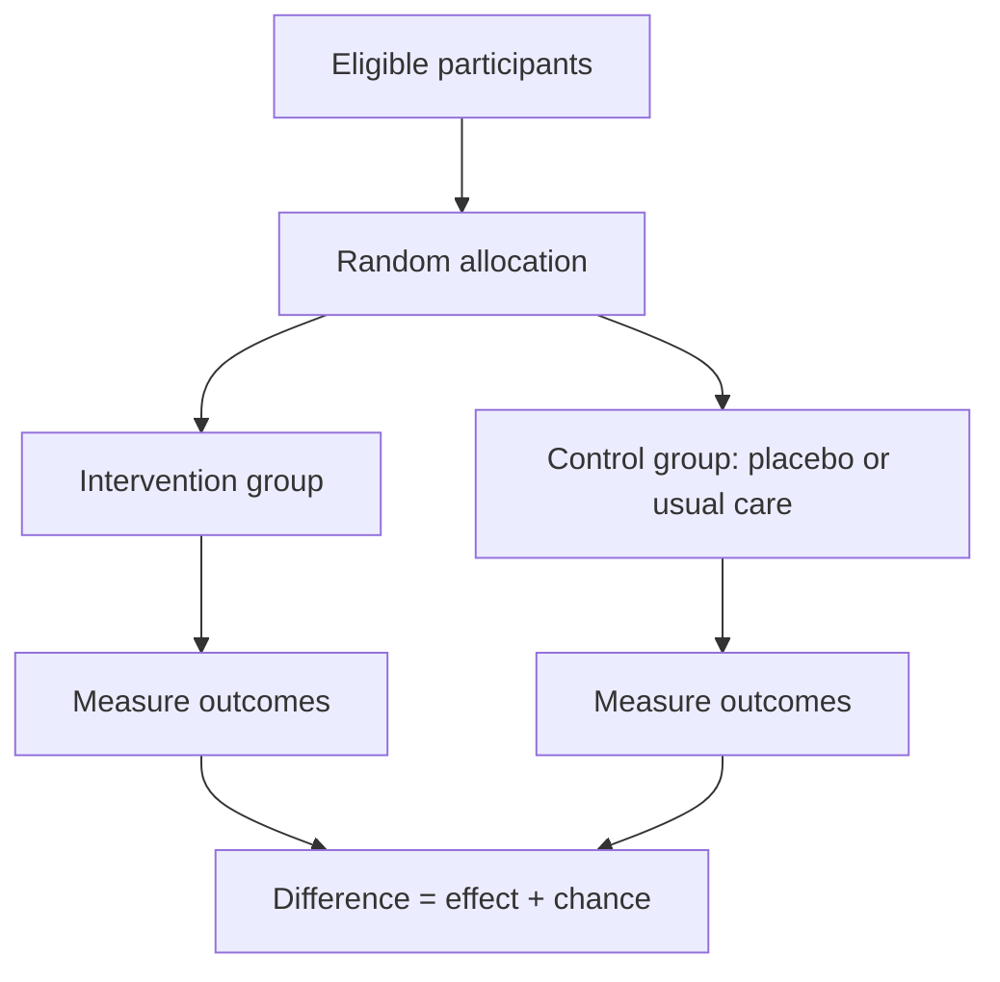

# Randomised controlled trials

**Prerequisites:** [[cohort-studies|Cohort studies]] and [[observation-measurement-and-experiment|Observation, measurement and experiment]].

@@IMG@@

In a **randomised controlled trial** (RCT), participants are assigned by chance to receive either the intervention being tested or a comparison. Because chance, not choice, decides who gets what, the groups are alike on average in every way except the intervention. That makes the RCT the most reliable common design for testing whether a treatment works.

## Why randomise?

In observational studies, the people who receive a treatment differ systematically from those who do not: doctors give new drugs to some patients and not others for reasons, and patients choose treatments based on their circumstances. These differences confound the comparison ([[confounding|confounding]]).

Randomisation breaks the link between patient characteristics and treatment. With enough participants, randomised groups will be similar in age, sex, severity, genetics, motivation and every other factor, **including factors no one thought to measure**. Any remaining difference in outcomes is due either to the treatment or to chance, and statistics can estimate the role of chance.

## A brief history

Ronald Fisher developed randomisation for agricultural experiments at Rothamsted in England in the 1920s. The Medical Research Council's trial of streptomycin for pulmonary tuberculosis, published in the *BMJ* in 1948 with Austin Bradford Hill as statistician, is usually cited as the first modern randomised trial in medicine. Among the largest trials ever was the 1954 field trial of Jonas Salk's polio vaccine, which involved well over a million children and included a placebo-controlled component.

## Key elements of a good RCT

- **Proper randomisation:** a truly random sequence, generated by computer or random number tables, not alternation, birth dates or clinician choice.
- **Allocation concealment:** those enrolling participants must not know the next assignment, or they can steer patients. See [[blinding-placebos-and-allocation-concealment|blinding, placebos and allocation concealment]].
- **Blinding:** where possible, participants, clinicians and outcome assessors do not know who got what.
- **Pre-specified primary outcome** and analysis plan, registered in advance ([[trial-registries|trial registries]]).
- **Adequate sample size** to detect a meaningful effect ([[statistical-power|power]]).
- **Complete follow-up** and analysis of everyone randomised ([[intention-to-treat-and-per-protocol|intention to treat]]).

## Phases and comparators

Drug trials are classified as phase 1 (safety and dose), phase 2 (early efficacy), phase 3 (large confirmatory trials) and phase 4 (after approval). The comparison group might receive:

- a **placebo** (an inactive look-alike), which isolates the drug's specific effect;
- the **standard treatment**, which answers the more practical question "is it better than what we already use?";
- **no treatment** or **usual care**.

A trial can be designed to show **superiority** (the new treatment is better), **non-inferiority** (it is not unacceptably worse, perhaps because it is cheaper or safer) or **equivalence**. Non-inferiority trials depend on a pre-set margin, and a generous margin can make an inferior treatment look acceptable.

## Variants

- **Cluster randomised trials** randomise groups (schools, villages, clinics) rather than individuals, useful when interventions act on groups.
- **Factorial trials** test two interventions at once (A, B, both, neither).
- **Pragmatic trials** test interventions in ordinary practice with broad eligibility; **explanatory trials** test them under ideal conditions.
- **Crossover trials**, where each participant receives both treatments in turn ([[crossover-trials|lesson]]).
- **Adaptive and platform trials**, which modify arms as evidence accumulates. The UK RECOVERY platform trial of COVID-19 treatments, launched in 2020, showed that the steroid dexamethasone reduced deaths in hospitalised patients needing oxygen and that hydroxychloroquine did not help.

## Limitations

RCTs are powerful but not perfect:

- **Generalisability:** trial participants are often younger, healthier and more adherent than real-world patients.
- **Size and duration:** trials are usually too small and short to detect rare or long-term harms.
- **Ethics and feasibility:** many important exposures cannot be randomised.
- **Execution:** poor concealment, unblinding, dropout and outcome switching can undermine them.
- **Who runs them:** most drug trials are funded by manufacturers, which raises issues covered in [[how-funding-shapes-results|how funding shapes results]].

## Key ideas

- RCTs assign treatments by chance, balancing known and unknown factors.
- Randomisation, concealment, blinding and pre-specification are the pillars of a good trial.
- Comparators (placebo, standard care) and aims (superiority, non-inferiority) shape what a trial can show.
- Cluster, factorial, pragmatic and platform designs adapt the idea to different questions.
- RCTs can still be too small, too short, unrepresentative or badly run.

## Where this leads

- Next: [[blinding-placebos-and-allocation-concealment|Blinding, placebos and allocation concealment]]
- Worked example: [[worked-example-a-randomised-trial|PREDIMED]]
