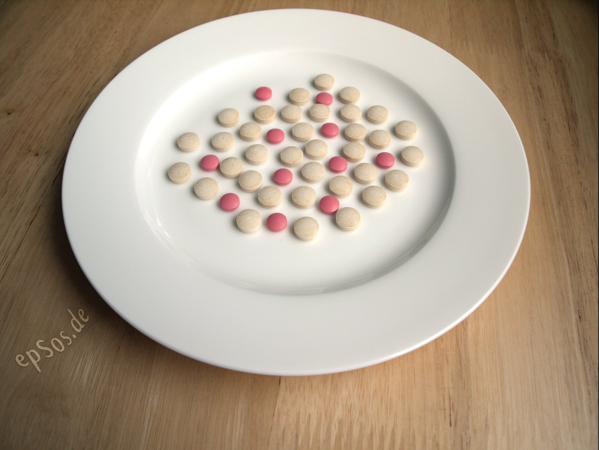
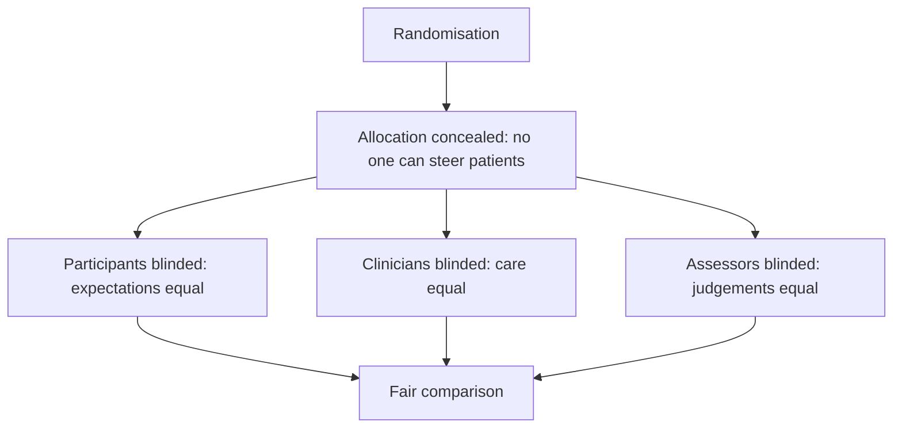

# Blinding, placebos and allocation concealment

**Prerequisites:** [Randomised controlled trials](07-randomised-controlled-trials.md).

*Tablets of the kind used in trials, where a placebo is made to look identical to the active drug. Credit: epSos .de. License: [CC BY 2.0](https://creativecommons.org/licenses/by/2.0). Source: [File:Medicine Drug Pills on Plate.png](https://commons.wikimedia.org/wiki/File:Medicine_Drug_Pills_on_Plate.png).*

Randomisation creates comparable groups at the start of a trial. Three further safeguards keep them comparable: **allocation concealment**, which protects the randomisation itself; **blinding**, which protects against people behaving or judging differently once they know who got what; and the **placebo**, which makes blinding possible.

## Allocation concealment

**Allocation concealment** means that the person enrolling a participant cannot know or predict which group that participant will be assigned to. If they can, they may consciously or unconsciously steer sicker patients away from the new treatment, undoing the randomisation.

Methods that fail include alternating assignments, assigning by day of the week or date of birth, and sealed envelopes that can be held up to the light. Robust methods include central telephone or web-based randomisation services and sequentially numbered, opaque, sealed envelopes with strict procedures.

Concealment is distinct from blinding. It is about the moment of assignment, and it is possible in every trial, even when blinding is not (you cannot blind a surgeon to the operation they perform, but you can conceal the next assignment until the patient is enrolled). Studies of collections of trials, beginning with Kenneth Schulz and colleagues in *JAMA* in 1995, found that trials with inadequate concealment tended to report larger treatment effects.

## Blinding

**Blinding** (also called masking) means that some or all of those involved do not know who received which intervention. The groups that can be blinded include:

- **participants**, whose expectations can affect symptoms, adherence and reporting;
- **clinicians**, who might treat patients differently or pay more attention to one group;
- **outcome assessors**, who might judge borderline outcomes differently;
- **data analysts**, who might make analysis choices differently.

"Double-blind" traditionally means participants and investigators are blinded, but the term is used inconsistently. Good papers state exactly who was blinded and how.

### Why blinding matters

Blinding matters most for **subjective outcomes** such as pain, mood, fatigue or quality of life, and for outcomes that require judgement, such as "clinical improvement" or the cause of a death. It matters least for hard outcomes like all-cause mortality. Meta-research studies have found that trials without blinding tend to exaggerate effects on subjective outcomes.

### Checking blinding

Blinding can fail. Side effects can reveal who is on an active drug; a placebo may taste different. Some trials ask participants at the end to guess their group, though interpreting the answers is debated. If a drug has obvious side effects and the outcome is subjective, consider whether unblinding could explain part of the result.

## Placebos

A **placebo** is an inactive intervention designed to be indistinguishable from the active one: a sugar pill, a saline injection, a sham procedure. It lets the trial separate the specific effect of the treatment from everything else that happens to participants: natural recovery, [regression to the mean](../02-statistics/17-regression-to-the-mean.md), extra attention, and expectation effects.

**Sham surgery** trials have overturned several procedures. For example, a 2002 trial by J. Bruce Moseley and colleagues in the *New England Journal of Medicine* compared arthroscopic knee surgery for osteoarthritis with a sham procedure involving skin incisions only, and found no better outcomes with the real surgery.

**Active placebos** mimic a drug's side effects without its intended action, to protect blinding.

### Placebos and ethics

Placebo controls are generally considered unethical when an effective treatment exists and withholding it could cause serious harm. The Declaration of Helsinki allows placebo use in limited circumstances. In such cases trials compare a new treatment with the existing one instead. Placebo choice has also been debated in vaccine research: some trials use another vaccine or an adjuvant-containing injection as the comparator rather than saline, for reasons of ethics or blinding. Critics argue this can mask adverse events common to both arms, and defenders argue it is appropriate for the question being asked. A careful reader checks exactly what the control group received and what question that comparison answers.

### "The placebo effect"

The improvement seen in placebo groups is often called the placebo effect, but much of it is natural recovery and regression to the mean rather than a psychological effect of the placebo itself. Studies comparing placebo with no treatment are needed to separate the two.

## Key ideas

- Allocation concealment prevents anyone steering patients at enrolment; it is always possible.
- Blinding of participants, clinicians and assessors protects against biased behaviour and judgement.
- Blinding matters most for subjective or judgement-based outcomes.
- Placebos make blinding possible and separate specific effects from everything else.
- Always check exactly what the control group received.

## Where this leads

- Next: [Intention to treat and per-protocol analysis](09-intention-to-treat-and-per-protocol.md)
- Related: [CONSORT](../05-anatomy-of-a-paper/12-reporting-checklists.md) for how trials should report these details
