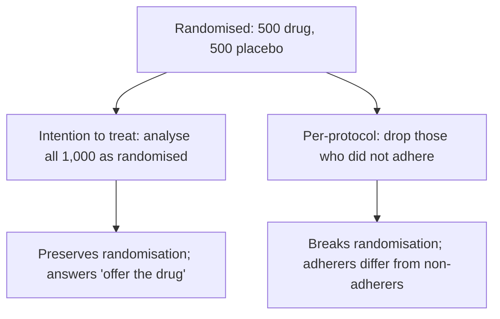

# Intention to treat and per-protocol analysis

**Prerequisites:** [[blinding-placebos-and-allocation-concealment|Blinding, placebos and allocation concealment]].

@@IMG@@

In real trials, not everyone does what they were assigned to do. Some stop taking the pill; some in the control group get the treatment elsewhere; some drop out entirely. How a trial handles these people can change its answer, and the choice is a frequent source of quiet bias.

## Intention to treat

An **intention-to-treat (ITT)** analysis compares participants according to the group they were **randomised** to, whatever they actually did. If you were assigned the new drug and stopped after a week, you are still counted in the drug group.

ITT can seem odd: why count people who did not take the treatment? The answer is that ITT **preserves randomisation**. The reasons people stop taking a treatment (side effects, feeling better, feeling worse, chaotic lives) are often related to their outcomes. Removing them breaks the balance that randomisation created, reintroducing [[confounding|confounding]].

ITT answers a practical question: what happens when you offer this treatment to patients like these? Because some will not take it, the ITT effect is usually somewhat smaller than the effect in perfect adherers. That makes ITT conservative for superiority trials, which is one reason regulators and journals prefer it.

## Per-protocol and as-treated

- A **per-protocol** analysis includes only participants who followed the protocol closely enough (took most of their doses, attended visits).
- An **as-treated** analysis groups participants by what they actually received, regardless of assignment.

Both can answer interesting questions, especially about efficacy in adherent patients, but both risk bias because the people excluded or reclassified are not random.

## The Coronary Drug Project lesson

A classic illustration comes from the Coronary Drug Project, a large US trial of cholesterol-lowering drugs after heart attacks, run in the 1960s and 1970s. Among men taking the drug clofibrate, those who took at least 80% of their pills had much lower five-year mortality than those who took less. But the same pattern appeared in the **placebo** group: good adherers to *placebo* also had much lower mortality. Adherence itself marked healthier, more conscientious people. The investigators reported this in the *New England Journal of Medicine* in 1980. It is a vivid demonstration of the [[healthy-user-bias|healthy adherer effect]] and of why per-protocol comparisons mislead.

## Non-inferiority trials

In a [[randomised-controlled-trials|non-inferiority trial]], the aim is to show that a new treatment is not unacceptably worse. Here ITT can be *anti-conservative*: non-adherence in both arms makes them look more similar, which helps show "no difference". Guidelines therefore recommend reporting both ITT and per-protocol analyses for non-inferiority trials and checking that they agree.

## Missing outcome data

ITT requires outcome data on everyone randomised, but some participants are lost. Researchers must then make assumptions:

- **Complete case analysis** uses only those with data, which is biased if dropouts differ.
- **Last observation carried forward** (LOCF) assumes a participant's last measurement stays the same, which is often unrealistic and now discouraged.
- **Multiple imputation** fills in missing values using statistical models based on observed data, under explicit assumptions.
- **Sensitivity analyses** test whether conclusions change under different assumptions about the missing people.

Large or unequal dropout is a warning sign. A trial where 30% of one arm and 10% of the other dropped out needs very careful interpretation, whatever the analysis.

## "Modified intention to treat"

Many papers report a **modified ITT** analysis, excluding some randomised participants (for example, those who never received a dose, or who were found ineligible). Sometimes this is reasonable; sometimes it is used to remove inconvenient patients. A 2010 study by Isabelle Boutron and colleagues in *JAMA* found "spin" common in reports of trials with non-significant primary outcomes, and methodologists have raised similar concerns about inconsistent "modified ITT" definitions. Check the [[reporting-checklists|CONSORT flow diagram]]: how many were randomised, how many were analysed, and why do the numbers differ?

## Key ideas

- Intention to treat analyses everyone as randomised and preserves the benefits of randomisation.
- Per-protocol and as-treated analyses exclude or reclassify people non-randomly.
- In the Coronary Drug Project, good adherers to placebo also had much lower mortality.
- For non-inferiority trials, report both ITT and per-protocol.
- Check the flow diagram for how many randomised participants were actually analysed.

## Where this leads

- Next: [[crossover-trials|Crossover trials]]
- Related: [[healthy-user-bias|Healthy user and adherer bias]]
