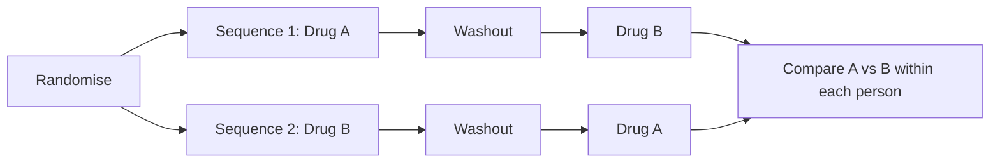

# Crossover trials

**Prerequisites:** [Intention to treat and per-protocol analysis](09-intention-to-treat-and-per-protocol.md).

@@IMG@@

In an ordinary ("parallel-group") trial, each participant gets one treatment, and outcomes are compared between different people. In a **crossover trial**, each participant receives **both** treatments, one after the other, in random order. Each person acts as their own control.

## How it works

1. Participants are randomised to a sequence: A then B, or B then A.
2. They receive the first treatment for a set period and outcomes are measured.
3. A **washout period** follows, long enough for the first treatment's effects to wear off.
4. They switch to the second treatment and outcomes are measured again.
5. The analysis compares each person's outcome on A with their outcome on B.

## Why it is efficient

People vary enormously. In a parallel trial, that between-person variation adds noise to the comparison. In a crossover trial, differences between people cancel out, because each is compared with themselves. The result is that crossover trials can often reach the same [power](../02-statistics/10-statistical-power.md) with far fewer participants, sometimes a fraction of the number.

## When crossover designs suit

Crossover trials work well when:

- the condition is **chronic and stable**, so the participant is in similar health in both periods (for example, stable high blood pressure, chronic pain, asthma);
- the treatment's effect is **reversible and short-lived**, so it disappears during washout;
- outcomes can be measured **quickly** within each period.

They are widely used in early drug studies, including **bioequivalence** studies comparing a generic drug with the brand-name version, and in studies of diets and supplements over short periods.

## When they do not

They are unsuitable when:

- the treatment **cures** the condition or changes it permanently (you cannot cross over from a curative surgery);
- the condition **progresses** or fluctuates a lot over time;
- the outcome is **death** or another irreversible event;
- effects **persist** long after treatment stops.

## Specific pitfalls

### Carryover

If the first treatment's effect lingers into the second period, the comparison is contaminated. This **carryover effect** is the main threat to a crossover trial. Adequate washout periods, based on how long the drug stays in the body and how long its effects last, are the main defence. Statistical tests for carryover exist but have low power.

### Period effects

Participants' condition may change between periods for reasons unrelated to treatment, such as seasons, natural progression or increasing familiarity with the study. Randomising the order balances this across sequences, and the analysis can estimate it.

### Dropout

Because each participant must complete two or more periods, dropout before the second period is costly: those participants contribute little. High dropout can also introduce bias if reasons are related to the first treatment.

## N-of-1 trials

An extreme version is the **n-of-1 trial**, a crossover experiment in a single patient, often with several alternating periods and blinding. It is used to decide whether a treatment works for that individual, for example whether a particular drug really helps a patient's chronic pain. Several n-of-1 trials can be pooled.

## Reading a crossover trial

- Was the order randomised?
- Was the washout long enough, and is it justified?
- Was carryover assessed?
- Was the analysis paired (within-person), as it should be?
- How many participants completed both periods?

## Key ideas

- In a crossover trial, each participant receives both treatments in random order.
- Within-person comparison removes between-person variation, so fewer participants are needed.
- It suits stable chronic conditions and short-acting, reversible treatments.
- Carryover and period effects are the main threats.
- N-of-1 trials apply the idea to a single patient.

## Where this leads

- Next: [The self-controlled case series](11-self-controlled-case-series.md), which applies the "own control" idea to observational data
