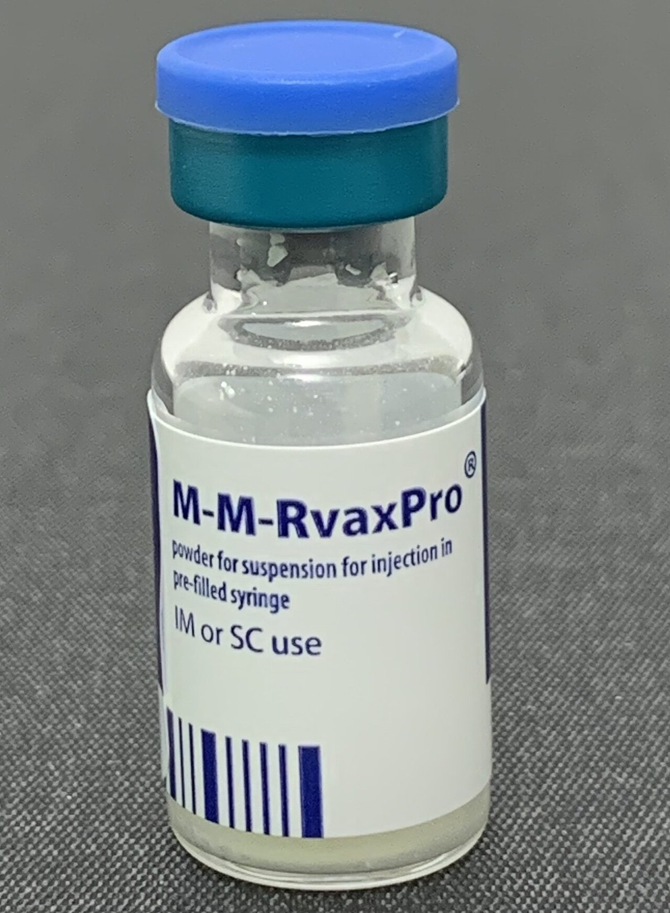
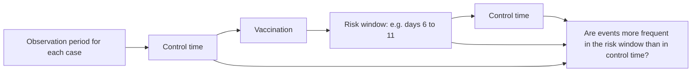

# The self-controlled case series

**Prerequisites:** [Crossover trials](10-crossover-trials.md) and [Case reports and case series](02-case-reports-and-case-series.md).

*MMR vaccine; self-controlled case series have been used to study timing of adverse events after MMR. Credit: Whispyhistory. License: [CC BY-SA 4.0](https://creativecommons.org/licenses/by-sa/4.0). Source: [File:MMR vaccine.jpg](https://commons.wikimedia.org/wiki/File:MMR_vaccine.jpg).*

The **self-controlled case series** (SCCS) is a clever observational design that borrows the crossover trial's best idea, using each person as their own control, and applies it to people who have already had the outcome. It is one of the main tools used to study whether vaccines and drugs cause acute adverse events, so it is worth understanding in some detail.

## The basic idea

Instead of comparing different people, the SCCS compares **different time periods within the same people**. It asks: among people who had the event (say, a seizure), did the events cluster in a **risk window** shortly after exposure (say, days 6 to 11 after a vaccine dose), compared with other times (the **control** or baseline periods)?

Only cases are needed: people who experienced the event at least once during an observation period. The analysis estimates the **relative incidence** (a rate ratio) of the event in the risk window versus control periods.

## Why it is powerful

Because each person is compared with themselves, **all fixed characteristics are automatically controlled**: genetics, sex, socioeconomic status, underlying health, health-seeking behaviour, and anything else that does not change over the observation period, whether measured or not. That removes a whole class of confounding that plagues cohort and case-control studies, including the [healthy vaccinee effect](../04-causation/06-healthy-user-bias.md).

The method was developed by the statistician Paddy Farrington in the mid-1990s, initially for vaccine safety. An early application, published in *The Lancet* in 1995 by Farrington, Elizabeth Miller and colleagues, studied hospital admissions after MMR and other vaccines in England and confirmed known associations, such as febrile convulsions in the second week after MMR an increase in idiopathic thrombocytopenic purpura (a low platelet count) after MMR, and aseptic meningitis linked to the Urabe mumps strain, which had been withdrawn from UK use in 1992. It also found that passive reporting had greatly underestimated some of these risks. In 1999 Brent Taylor, Elizabeth Miller and colleagues used a case-series analysis among the methods in a *Lancet* study of MMR and autism, finding no clustering of autism onset after vaccination.

## Assumptions

The design depends on several assumptions, and a careful paper discusses each:

1. **Events are independent or recurrent.** For recurrent events, one event should not change the chance of the next. For a non-recurrent event (such as a first diagnosis), the event should be rare.
2. **The event does not affect subsequent exposure.** If having a seizure makes doctors postpone vaccination, events will be under-represented after vaccination, biasing results. Variants of the method handle this by, for example, starting observation at exposure, or using a "pre-exposure" window.
3. **The event does not shorten observation.** If the event is often fatal, the standard method can be biased; extensions exist for this case.
4. **Time-varying confounders are handled.** Age and season change during observation and can affect both exposure timing and event rates. SCCS analyses usually adjust for age groups and calendar time.

## Choosing the risk window

The risk window must be chosen on biological grounds, before looking at the data. If it is too narrow, a real effect may be missed; too wide, and it dilutes the effect. If it is chosen after seeing when events occurred, the analysis becomes a [multiple comparisons](../02-statistics/16-multiple-comparisons.md) exercise. Good SCCS studies specify windows in advance and report sensitivity analyses with alternative windows.

## What it is not suited for

- **Gradual or long-delayed outcomes** whose onset date is uncertain (some chronic conditions), because the method needs a reasonably precise event date.
- **Outcomes in people who were never exposed**, since unexposed cases contribute only to estimating age and season effects.
- **Effects on overall disease burden** rather than timing.

## Related self-controlled designs

- The **case-crossover design** compares each case's exposure just before the event with their exposure at earlier reference times. It is used for transient exposures with immediate effects, such as heavy exertion or alcohol before an injury.
- The **self-controlled risk interval** design compares a risk window with a control window in exposed people only, a simplified approach widely used in vaccine safety monitoring systems.

## Key ideas

- The SCCS compares event rates in risk windows and control periods within the same people.
- Only cases are needed, and all fixed characteristics are automatically controlled.
- It was developed for vaccine safety and is central to studying acute adverse events.
- Key assumptions concern how events affect later exposure and observation.
- Risk windows must be pre-specified on biological grounds.

## Where this leads

- Next: [Natural experiments and quasi-experiments](12-natural-experiments-and-quasi-experiments.md)
- Related: [Passive surveillance and pharmacovigilance](13-passive-surveillance-and-pharmacovigilance.md)
