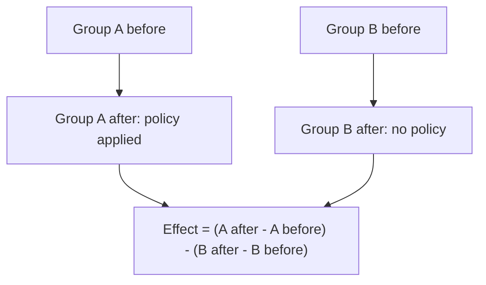

# Natural experiments and quasi-experiments

**Prerequisites:** [The self-controlled case series](11-self-controlled-case-series.md) and [Confounding](../04-causation/02-confounding.md) (helpful but not essential).

@@IMG@@

When randomisation is impossible, researchers look for situations where the world itself has done something close to randomising: a policy that applied to one place but not its neighbour, a lottery, an arbitrary cut-off, or a quirk of genetics. These **natural experiments** and **quasi-experimental designs** sit between ordinary observational studies and trials. Economists have used them heavily, and they are increasingly common in health research.

## The original natural experiment

John Snow's cholera work in 1854 contained more than the famous Broad Street pump map. In south London, two water companies supplied intermingled households on the same streets: the Southwark and Vauxhall Company drew water from a sewage-contaminated stretch of the Thames, while the Lambeth Company had moved its intake upstream. Households had not chosen their supplier on health grounds, so the comparison was almost like a randomised one. Snow found cholera deaths far higher in households supplied by Southwark and Vauxhall. He called it a "grand experiment".

## Main quasi-experimental designs

### Difference-in-differences

Compare the change over time in a group affected by a policy with the change in a similar unaffected group. If both groups were trending similarly before the policy (the **parallel trends** assumption), the difference between their changes estimates the policy's effect. David Card and Alan Krueger's 1994 study of fast-food employment after New Jersey raised its minimum wage, compared with neighbouring Pennsylvania, is a famous economics example.

### Regression discontinuity

When eligibility depends on a sharp cut-off (an age threshold, a test score, a birth date), people just above and just below the cut-off are very similar except for eligibility. Comparing them estimates the effect near the threshold.

### Interrupted time series

Track an outcome over many time points before and after an intervention. A sudden change in level or trend at the intervention, not explained by prior trends, suggests an effect. Seasonal patterns, other simultaneous changes and changes in data recording are the main threats.

### Instrumental variables

An **instrument** is a variable that affects whether people receive an exposure but has no other route to the outcome. Distance to a specialised hospital, a physician's prescribing preference, or a lottery can serve. The validity of the result depends entirely on that "no other route" assumption, which is often hard to verify.

### Lotteries

Sometimes access is literally allocated by lottery. In 2008 the US state of Oregon used a lottery to allocate places in its Medicaid programme, creating the Oregon Health Insurance Experiment, a genuine randomised comparison of having or not having public health insurance.

## Mendelian randomisation

Genes are allocated randomly at conception (within families), which makes some genetic variants natural instruments. If a variant raises a person's lifelong cholesterol level and has no other relevant effects, comparing people with and without it gives an estimate of cholesterol's effect on heart disease that is largely free of lifestyle confounding. This approach, **Mendelian randomisation**, was developed in epidemiology by George Davey Smith and Shah Ebrahim, among others, in the early 2000s. Its key weakness is **pleiotropy**: a gene may affect the outcome through other pathways.

## Historical natural experiments

The Dutch "Hunger Winter" famine of 1944–45, when a German blockade cut food supplies to the western Netherlands, created a sharply defined period of maternal starvation. Studies following children who were in the womb at the time have been used to examine how prenatal nutrition affects later health.

## Strengths and limits

Natural experiments can provide much stronger causal evidence than ordinary associations, especially for policies and population-level exposures that could never be randomised. But each design rests on an assumption (parallel trends, no manipulation around the cut-off, a valid instrument) that must be argued, not assumed. Good papers test these assumptions as far as they can, for example by showing that pre-policy trends really were parallel. Results also often apply only to a particular group, such as people near the cut-off.

## Key ideas

- Natural experiments exploit situations where exposure is assigned almost at random.
- Difference-in-differences, regression discontinuity, interrupted time series and instrumental variables are the main tools.
- Mendelian randomisation uses genetic variants as natural instruments.
- Each method depends on an assumption that must be justified and tested.
- These designs are especially valuable for policies and exposures that cannot be randomised.

## Where this leads

- Next: [Passive surveillance and pharmacovigilance](13-passive-surveillance-and-pharmacovigilance.md)
- Related: [Causal diagrams](../04-causation/10-causal-diagrams.md)
