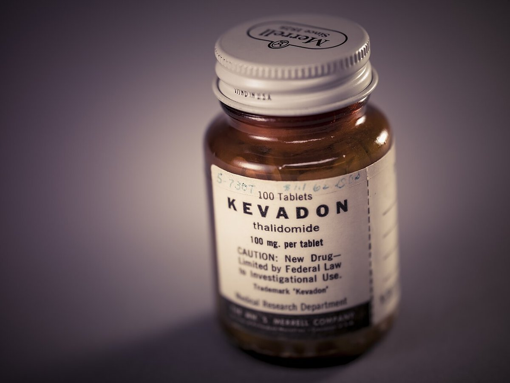
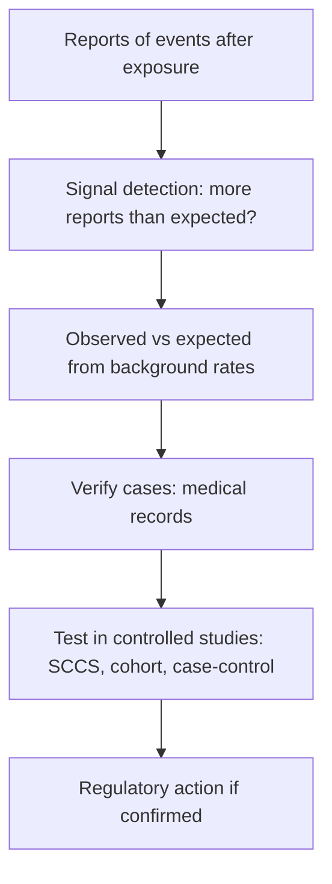

# Passive surveillance and pharmacovigilance

**Prerequisites:** [Case reports and case series](02-case-reports-and-case-series.md) and [The self-controlled case series](11-self-controlled-case-series.md).

*A 1960 package of Kevadon (thalidomide); the thalidomide disaster led to modern drug safety monitoring. Credit: The U.S. Food and Drug Administration. License: Public domain. Source: [File:Kevadon (thalidomide), 1960.jpg](https://commons.wikimedia.org/wiki/File:Kevadon_(thalidomide),_1960.jpg).*

Clinical trials involve thousands of people at most; an approved drug or vaccine may be used by hundreds of millions. Rare harms, those affecting one person in tens or hundreds of thousands, can only be found after approval. **Pharmacovigilance** is the science of detecting, assessing and preventing such harms. Its raw material often includes reports from **passive surveillance** systems, which are widely cited in public debates and widely misread.

## Passive reporting systems

In a **passive** (spontaneous) reporting system, anyone (doctors, pharmacists, manufacturers and often patients) can report a health problem that occurred after a medicine or vaccine. Examples include:

- the UK's **Yellow Card scheme**, launched in 1964 after the thalidomide disaster;
- the US **Vaccine Adverse Event Reporting System (VAERS)**, run jointly by the Centers for Disease Control and Prevention and the Food and Drug Administration since 1990, and the FDA Adverse Event Reporting System (FAERS) for drugs;
- Canada's **Canada Vigilance Program** for drugs and the **Canadian Adverse Events Following Immunization Surveillance System (CAEFISS)** for vaccines;
- the World Health Organization's global database, **VigiBase**, maintained by the Uppsala Monitoring Centre in Sweden.

## What these reports can and cannot show

A report says that an event happened **after** an exposure. It does not establish that the exposure **caused** it. VAERS's own public data pages carry a disclaimer to this effect. The limitations are built into the design:

- **No denominator** in the raw data: the system counts reports, not how many people were exposed.
- **No comparison group**: there is no count of how often the same event happens in unexposed people.
- **Under-reporting**: many real adverse events, especially mild ones, are never reported.
- **Stimulated reporting**: media attention, litigation or public concern can cause surges in reports. A rise in reports following publicity, sometimes called "notoriety bias", does not by itself indicate a rise in harms.
- **Variable quality**: reports range from detailed clinical records to brief notes with no confirmation of diagnosis; duplicates occur.

Counting raw reports and presenting them as deaths or injuries caused by a product is therefore a misuse of the data, whichever side does it. Equally, dismissing a cluster of reports without investigation would defeat the point of the system.

## What they are good for: signal detection

The purpose of passive systems is to generate **signals**, hypotheses that a product may cause a particular harm. Statistical tools compare the proportion of reports mentioning a given event for one product against the proportion for all other products (**disproportionality analysis**), or compare the number of reports with the number expected from background rates (**observed-to-expected analysis**).

A famous success: in 1999, reports to VAERS of intussusception (a bowel obstruction) in infants who had received RotaShield, a newly licensed rotavirus vaccine, prompted investigation. Controlled studies confirmed the association, and the manufacturer withdrew the vaccine later that year. Later rotavirus vaccines were tested in much larger trials designed to detect this risk.

## Active surveillance

Because passive data are so limited, regulators also run **active surveillance**, which uses linked health records covering defined populations, so denominators and comparison groups are available. Examples include the US **Vaccine Safety Datalink** (a collaboration between the CDC and integrated health care organisations, begun in 1990) and the FDA's **Sentinel** system for drugs. Nordic national registries serve a similar role. These systems allow designs like the [self-controlled case series](11-self-controlled-case-series.md) and cohort studies to test signals quickly.

## Reading claims based on surveillance data

When you see a claim like "thousands of deaths reported after product X":

1. What system is it, and is it passive or active?
2. How many people were exposed (the denominator)?
3. How many such events would be expected by chance in that many people over that period?
4. Were reports verified against medical records?
5. Have controlled studies tested the signal, and what did they find?

Regulators publish their assessments of major signals, and these are a better starting point than raw counts.

## Key ideas

- Pharmacovigilance detects harms too rare for trials to find.
- Passive systems such as VAERS, the Yellow Card scheme and CAEFISS collect reports of events after exposure.
- Reports do not establish causation: there is no denominator, no comparison group, under-reporting and stimulated reporting.
- Their role is to generate signals, tested by observed-versus-expected analyses and controlled studies.
- Active surveillance with linked records provides the denominators passive systems lack.

## Where this leads

- Next: [Systematic reviews](14-systematic-reviews.md)
- Related: [Case reports](02-case-reports-and-case-series.md), [The Vioxx case study](../10-case-studies/05-vioxx.md)
