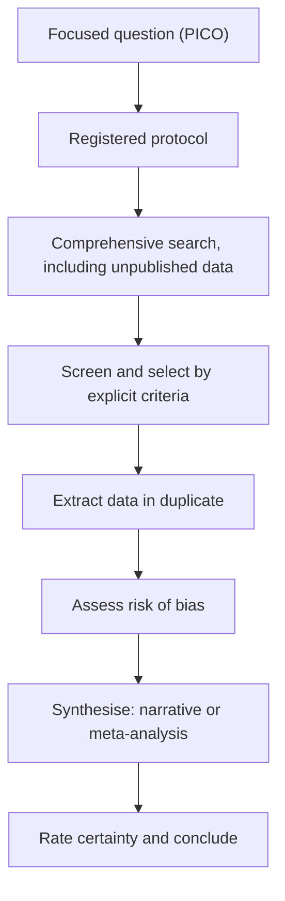

# Systematic reviews

**Prerequisites:** [The evidence hierarchy](01-the-evidence-hierarchy.md) and [Passive surveillance and pharmacovigilance](13-passive-surveillance-and-pharmacovigilance.md).

@@IMG@@

On almost any question worth asking, there is more than one study, and they rarely agree perfectly. A **systematic review** collects all the relevant studies on a clearly defined question, using explicit and reproducible methods, appraises them, and summarises what they show. It is the main defence against cherry-picking.

## Narrative versus systematic reviews

A traditional **narrative review** is an expert's summary of a field. It can be valuable, but the author chooses which studies to discuss, and readers cannot tell what was left out or why. Two experts with different views can write narrative reviews that reach opposite conclusions from the same literature.

A **systematic review** replaces that discretion with a protocol:

1. **A focused question**, often framed as **PICO**: Population, Intervention (or exposure), Comparison, Outcome. For example: in adults with type 2 diabetes (P), does drug X (I) compared with placebo (C) reduce cardiovascular events (O)?
2. **A pre-registered protocol** describing the methods, ideally in a public register such as **PROSPERO**, the international prospective register of systematic reviews launched in 2011 by the University of York's Centre for Reviews and Dissemination.
3. **A comprehensive search** of several databases (such as MEDLINE via PubMed, Embase and the Cochrane Central Register of Controlled Trials), plus trial registries, regulatory documents, conference abstracts and reference lists, to find unpublished as well as published studies.
4. **Explicit eligibility criteria**, applied by two reviewers independently.
5. **Data extraction** by two reviewers independently, on standard forms.
6. **Risk of bias assessment** of each included study using structured tools, such as the Cochrane risk-of-bias tool (RoB 2) for randomised trials or ROBINS-I for non-randomised studies.
7. **Synthesis**, either narrative or statistical ([meta-analysis](15-meta-analysis.md)).
8. **Assessment of the certainty of the evidence**, often with [GRADE](16-cochrane-and-grade.md).

## Why it matters

In 1992, Elliott Antman, Joseph Lau and colleagues published an analysis in *JAMA* showing that a **cumulative meta-analysis** of trials of clot-busting drugs after heart attack would have shown a clear benefit years before many textbooks and expert reviews recommended the treatment, while some reviews continued to recommend treatments that trials had shown to be ineffective or harmful. Narrative expert opinion had lagged behind the evidence. This kind of finding helped drive the growth of systematic reviews and of the [Cochrane Collaboration](16-cochrane-and-grade.md).

## The PRISMA flow diagram

Systematic reviews report how studies were found and selected in a **PRISMA flow diagram**: how many records the searches found, how many were screened, how many full texts were assessed, how many were excluded and why, and how many were included. PRISMA (Preferred Reporting Items for Systematic reviews and Meta-Analyses) was first published in 2009 and updated as PRISMA 2020. See [reporting checklists](../05-anatomy-of-a-paper/12-reporting-checklists.md).

## Limits and abuses

A systematic review is only as good as its inputs and its execution:

- **Garbage in, garbage out.** Pooling biased studies does not remove bias.
- **Publication bias.** If negative studies were never published, even a thorough search may miss them ([publication bias](../06-research-integrity/06-publication-bias.md)). Regulatory documents and trial registries help.
- **Question framing.** Narrow or oddly chosen eligibility criteria can include or exclude decisive studies. Two systematic reviews on the "same" question can reach different conclusions because they asked slightly different questions.
- **Conflicts of interest.** Reviews have authors and funders too. Studies of reviews in several fields have found that reviews with industry ties were more likely to reach conclusions favourable to the sponsor.
- **Redundancy.** In a 2016 paper in the *Milbank Quarterly*, John Ioannidis argued that systematic reviews and meta-analyses had become mass-produced, and that many were redundant, misleading or conflicted.
- **Out of date.** Reviews age quickly. Check the search date. "Living" systematic reviews, updated continuously, were used during the COVID-19 pandemic.

## Other kinds of review

- **Scoping reviews** map what research exists on a broad topic without detailed appraisal.
- **Rapid reviews** shorten some steps to deliver answers quickly, with more risk of error.
- **Umbrella reviews** summarise multiple systematic reviews.
- **Individual participant data (IPD) meta-analyses** obtain the raw data from each trial, allowing more consistent analysis.

## Questions to ask

- Was the question clear and the protocol registered?
- Was the search comprehensive, including unpublished data?
- Were selection and extraction done in duplicate?
- How was risk of bias assessed, and how did it affect the conclusions?
- When was the search run?
- Who funded the review, and do the authors have conflicts?

## Key ideas

- Systematic reviews use explicit, reproducible methods to find and appraise all relevant studies.
- They protect against cherry-picking that narrative reviews allow.
- Key features: PICO question, registered protocol, comprehensive search, duplicate screening, risk-of-bias assessment.
- They inherit the biases of their inputs and can be redundant, outdated or conflicted.
- PRISMA describes how they should be reported.

## Where this leads

- Next: [Meta-analysis](15-meta-analysis.md)
