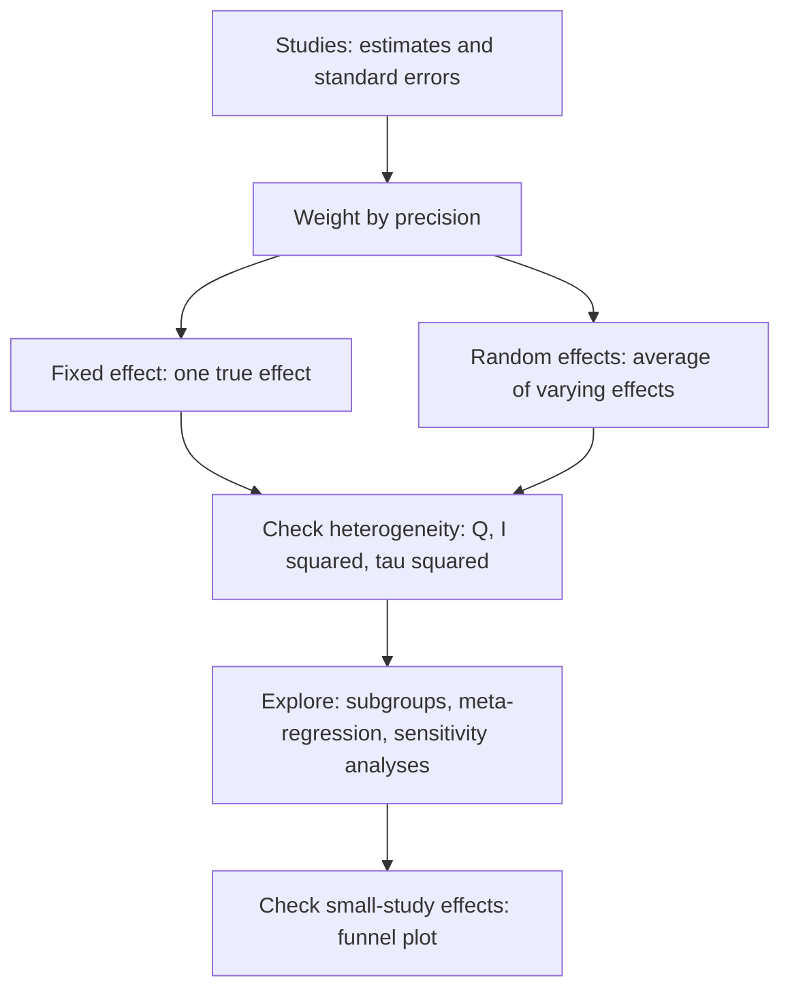

# Meta-analysis

**Prerequisites:** [[systematic-reviews|Systematic reviews]] and [[standard-error-and-confidence-intervals|Standard error and confidence intervals]].

@@IMG@@

A **meta-analysis** is the statistical combination of results from several studies into a single summary estimate. Done well, it gives a more precise answer than any individual study. Done badly, it gives a precise wrong answer that looks authoritative. The term was coined by the psychologist Gene Glass in 1976.

## How pooling works

Each study provides an effect estimate (a risk ratio, a mean difference) and its standard error. A meta-analysis calculates a **weighted average**, giving more weight to more precise studies (usually larger ones). The most common weighting is **inverse-variance**: each study's weight is 1 divided by the square of its standard error. The result is a pooled estimate with a narrower confidence interval than any single study.

Results are displayed in a [[forest-plots|forest plot]]: one line per study showing its estimate and interval, and a diamond at the bottom for the pooled result.

## Fixed-effect and random-effects models

There are two broad approaches:

- A **fixed-effect** model assumes all studies estimate the *same* true effect, and differences between them are due only to chance.
- A **random-effects** model assumes the true effect *varies* between studies (because populations, doses and settings differ) and estimates the *average* of those true effects. It gives relatively more weight to small studies and produces wider intervals. The DerSimonian-Laird method (1986) is a long-standard approach.

Neither is automatically right. If studies differ a lot, a single pooled number may not be meaningful at all.

## Heterogeneity

**Heterogeneity** is variation in results between studies beyond what chance would produce. It is measured by:

- **Cochran's Q** test, which has low power when there are few studies;
- the **I² statistic**, introduced by Julian Higgins and Simon Thompson in 2002, which estimates the percentage of variation due to real differences rather than chance. Rough guides treat about 25% as low, 50% as moderate and 75% as high;
- **tau² (τ²)**, the estimated variance of true effects in a random-effects model, and **prediction intervals**, which show the range in which the effect in a new setting would likely fall.

High heterogeneity is a reason to ask *why* results differ, through **subgroup analysis** or **meta-regression** (relating effects to study characteristics such as dose or year), with the usual caveats about [[multiple-comparisons|multiple comparisons]].

## Sensitivity analyses

A robust meta-analysis checks whether its conclusion depends on particular choices: excluding studies at high risk of bias, using a different model, removing one study at a time, or excluding industry-funded studies. If the result changes dramatically, it was fragile.

## Small-study effects and publication bias

If small studies show bigger effects than large ones, the cause may be [[publication-bias|publication bias]] (small negative studies never published), lower quality in small studies, or genuine differences. **Funnel plots** and statistical tests such as Egger's test (Matthias Egger and colleagues, *BMJ*, 1997) look for this asymmetry; see [[funnel-plots|funnel plots]].

## When meta-analyses and big trials disagree

In 1997 Jacques LeLorier and colleagues compared meta-analyses with later large randomised trials on the same questions in the *New England Journal of Medicine* and found that the meta-analyses frequently failed to predict the trials' results. A well-known case involved intravenous magnesium after heart attack: a 1993 meta-analysis of small trials suggested a large reduction in deaths, but the large ISIS-4 trial (1995) found no benefit. Discordance often traces back to small-study bias in the meta-analysis.

## Questions to ask

- Is the meta-analysis based on a proper systematic review?
- Are the studies similar enough to combine?
- How much heterogeneity is there, and is it explained?
- Fixed or random effects, and does it matter?
- Is the result driven by one large study, or by small, low-quality ones?
- Is there evidence of small-study effects?
- Do sensitivity analyses confirm the main result?

## Key ideas

- Meta-analysis pools studies into a weighted average, giving more weight to precise studies.
- Fixed-effect models assume one true effect; random-effects models assume a distribution of effects.
- Heterogeneity (Q, I², τ²) asks whether studies really agree.
- Sensitivity analyses test fragility; funnel plots test for small-study effects.
- Meta-analyses of many small trials have sometimes been contradicted by single large trials.

## Where this leads

- Next: [[cochrane-and-grade|Cochrane and GRADE]]
- Practice: [[forest-plots|Forest plots]], [[worked-example-a-meta-analysis|Worked example: a meta-analysis]]
