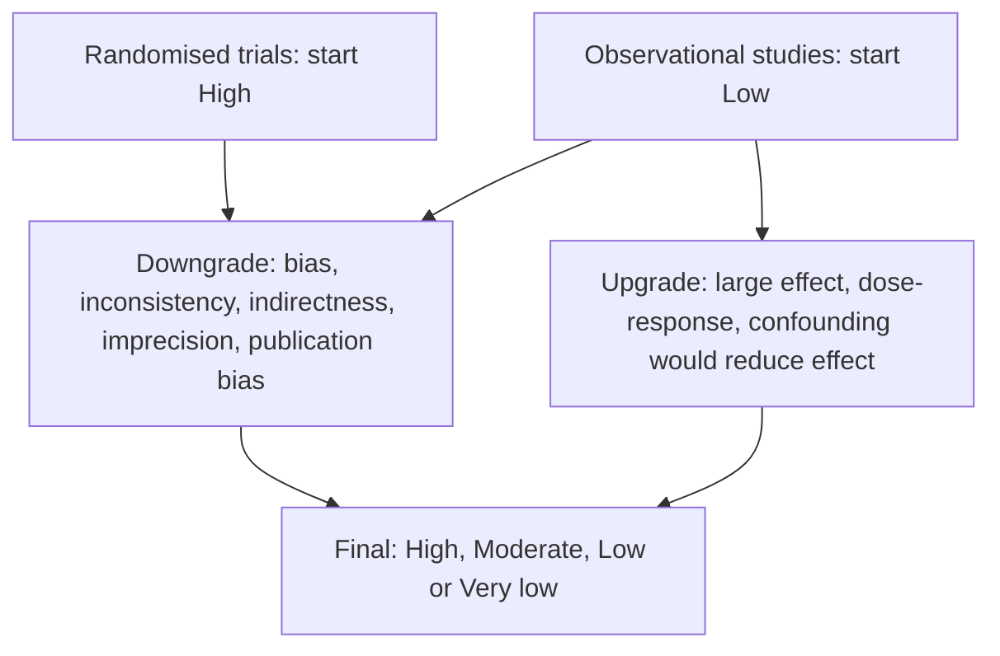

# Cochrane and GRADE

**Prerequisites:** [Meta-analysis](15-meta-analysis.md).

@@IMG@@

Two institutions dominate how medical evidence is synthesised and graded today: **Cochrane**, which produces systematic reviews, and the **GRADE** framework, which rates how certain a body of evidence is. You will see both cited in guidelines, news stories and arguments, so it pays to know what they are and how they work.

## Archie Cochrane and the Cochrane Collaboration

Archibald (Archie) Cochrane (1909–1988) was a Scottish physician and epidemiologist. His 1972 book *Effectiveness and Efficiency: Random Reflections on Health Services* argued that health services should rely on treatments proven effective in randomised trials. In 1979 he criticised medicine for not having organised a critical summary, by specialty and updated periodically, of all relevant randomised trials.

Inspired by this, Iain Chalmers and colleagues spent years compiling systematic reviews of trials in pregnancy and childbirth, and in 1993 the **Cochrane Collaboration** (now simply **Cochrane**) was founded in the UK as an international network to prepare and maintain systematic reviews. Its reviews are published in the **Cochrane Database of Systematic Reviews**, part of the Cochrane Library.

The Cochrane logo depicts a forest plot from a meta-analysis of trials of corticosteroids given to women about to give birth prematurely. The pooled result showed that the treatment reduced deaths among premature babies, a benefit that had been evident from trials years before it was widely adopted.

## What makes a Cochrane review distinctive

- **Published protocols** before the review begins.
- **Standard methods**, set out in the *Cochrane Handbook for Systematic Reviews of Interventions*.
- **Structured risk-of-bias assessment** (the RoB 2 tool for trials).
- **Plain-language summaries** for non-specialists.
- **Updating**, at least in principle, as new evidence appears.
- **Funding rules**: Cochrane does not accept commercial sponsorship of reviews, and has rules limiting authors' conflicts of interest.

## Cochrane is not beyond criticism

Cochrane reviews are generally well regarded, but they are human products and have been publicly contested. In 2018, Lars Jørgensen, Peter Gøtzsche and Tom Jefferson criticised Cochrane's review of HPV vaccines in *BMJ Evidence-Based Medicine*, arguing it had missed trials and underplayed harms; Cochrane's editors defended the review while acknowledging some points, and in the same year Gøtzsche, a co-founder, was expelled from Cochrane's Governing Board amid a broader dispute. In 2023, a Cochrane review on physical interventions against respiratory viruses (including masks) was widely cited as showing masks do not work; Cochrane's editor-in-chief, Karla Soares-Weiser, issued a statement that this was an inaccurate and misleading interpretation of a review whose evidence was inconclusive and which had examined interventions promoting mask use; the review's lead author, Tom Jefferson, publicly disagreed with parts of that statement. These episodes illustrate that reading the review itself, rather than headlines about it, is always necessary.

## GRADE

The **GRADE** approach (Grading of Recommendations Assessment, Development and Evaluation) was developed by an international working group beginning around 2000, led by Gordon Guyatt and others, and described in a widely cited 2008 *BMJ* series. It is now used by Cochrane, the World Health Organization and many guideline bodies.

GRADE rates the **certainty of evidence** for each outcome as one of four levels:

| Level | Meaning |
|---|---|
| **High** | Very confident the true effect is close to the estimate |
| **Moderate** | Moderately confident; the true effect is probably close but may differ substantially |
| **Low** | Limited confidence; the true effect may differ substantially |
| **Very low** | Very little confidence |

Evidence from RCTs **starts** at high, and from observational studies at low. It is then adjusted:

- **Downgraded** for risk of bias, inconsistency (heterogeneity), indirectness (the studies don't quite match the question), imprecision (wide intervals, few events) and publication bias.
- **Upgraded** (mainly observational evidence) for a large effect, a dose-response gradient, or when plausible confounding would have reduced the observed effect.

GRADE also separates **certainty of evidence** from **strength of recommendation**. A guideline panel can make a strong recommendation on low-certainty evidence (if the benefits clearly outweigh harms), or a weak one on high-certainty evidence (if benefits and harms are finely balanced or values vary).

## Summary of findings tables

Cochrane reviews and GRADE-based guidelines present **summary of findings** tables showing, for each main outcome, the absolute risk with and without the intervention per 1,000 people, the relative effect, the number of participants and studies, and the GRADE certainty. These tables are usually the fastest way to understand a review.

## Key ideas

- Cochrane, founded in 1993, produces protocol-driven systematic reviews without commercial sponsorship.
- Its reviews are influential but have been contested; read the review, not the headline.
- GRADE rates certainty of evidence per outcome as high, moderate, low or very low.
- Trials start high and observational studies low, then are downgraded or upgraded on explicit criteria.
- Certainty of evidence and strength of recommendation are separate judgements.

## Where this leads

- Next section: [Causation and bias](../04-causation/README.md), starting with [correlation and causation](../04-causation/01-correlation-and-causation.md)
