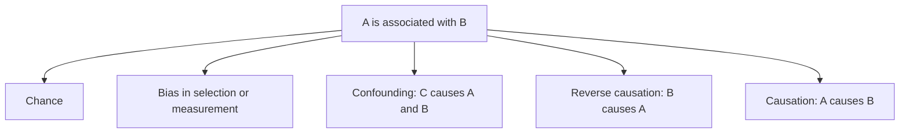

# Correlation and causation

**Prerequisites:** [Cochrane and GRADE](../03-study-designs/16-cochrane-and-grade.md) and [Effect sizes](../02-statistics/11-effect-sizes.md).

@@IMG@@

"Correlation does not imply causation" is one of the best-known phrases in science, and one of the least understood. It does not mean correlations are useless or that causation can never be inferred from them. It means a correlation has several possible explanations, and causation is only one of them. This section works through each alternative in turn.

## What a correlation is

Two variables are **correlated** (or **associated**) when knowing one tells you something about the other: taller people tend to weigh more; smokers get lung cancer more often. Associations can be measured with correlation coefficients, relative risks, odds ratios and other [effect sizes](../02-statistics/11-effect-sizes.md).

## Five explanations for any association

When A and B are associated, consider:

1. **Chance.** The association arose from random variation, especially with small samples or many comparisons. ([Multiple comparisons](../02-statistics/16-multiple-comparisons.md))
2. **Bias.** The way people were selected or measured created the association. ([Selection bias](04-selection-bias.md), [measurement bias](07-measurement-and-recall-bias.md))
3. **Confounding.** A third factor C causes both A and B. ([Confounding](02-confounding.md))
4. **Reverse causation.** B causes A, not the other way round. ([Reverse causation](03-reverse-causation.md))
5. **Causation.** A really does cause B, directly or through intermediate steps.

The skill in reading observational research is working through the first four before accepting the fifth.

## Spurious correlations

With enough variables, striking correlations appear by chance. Tyler Vigen's website and book *Spurious Correlations* (2015) collect absurd examples, such as close correlations over a decade between unrelated annual time series. Variables that both trend up or down over time are especially likely to correlate, because any two trends look alike. This is why time-series correlations need particular caution.

## What "causes" means in medicine

In health research, causes are usually **probabilistic**, not deterministic. Smoking causes lung cancer, but not every smoker gets lung cancer, and some non-smokers do. "A causes B" means that, other things equal, A raises the probability of B. Causes are also usually **one among many**: most diseases arise from combinations of genes, environments and chance. The epidemiologist Kenneth Rothman's "sufficient-component cause" model (1976) describes disease as resulting from any of several sets of component causes, each set sufficient on its own.

A useful formal idea is the **counterfactual**: A causes B in a person if B would not have happened (or would have been less likely) had A not occurred, everything else being the same. We can never observe both versions for the same person, which is the "fundamental problem of causal inference" described by the statistician Paul Holland in 1986. Randomised trials solve it on average by creating groups that are comparable; observational studies try to approximate that comparison. See [causal diagrams](10-causal-diagrams.md).

## Inferring causation without experiments

Many accepted causal facts, such as smoking causing lung cancer, asbestos causing mesothelioma, and the link between aspirin in children and Reye's syndrome, rest largely on observational evidence. Causal conclusions become reasonable when:

- the association is strong and consistent across many studies, populations and designs;
- chance, bias and confounding have been seriously addressed;
- the timing is right and reverse causation is implausible;
- there is a dose-response relationship and a plausible mechanism;
- natural experiments or other designs with different weaknesses agree.

These considerations were famously organised by Austin Bradford Hill in 1965; see [the Bradford Hill criteria](09-bradford-hill-criteria.md).

## The opposite mistake

"Correlation is not causation" can also be abused to dismiss inconvenient evidence. Tobacco companies used the argument for decades, insisting that the smoking-cancer link was "merely statistical" ([tobacco case study](../10-case-studies/01-tobacco-industry-research.md)). The right response to an association is not dismissal but investigation: which alternative explanation is plausible here, and has it been ruled out?

## Language to watch

Papers and news stories often slip causal language into associational findings: "X *boosts*", "X *protects against*", "X *leads to*". A 2014 study by Petroc Sumner and colleagues in the *BMJ* found that 33% of university press releases about health research contained exaggerated causal claims compared with the underlying paper. Look for "associated with", "linked to" and "predicts"; if a press release turns these into "causes", be suspicious.

## Key ideas

- An association can arise from chance, bias, confounding, reverse causation or causation.
- Medical causes are usually probabilistic and one among many.
- Causal inference is about counterfactuals: what would have happened otherwise.
- Strong, consistent, well-scrutinised observational evidence can justify causal conclusions.
- "Correlation is not causation" should prompt investigation, not dismissal.

## Where this leads

- Next: [Confounding](02-confounding.md)
