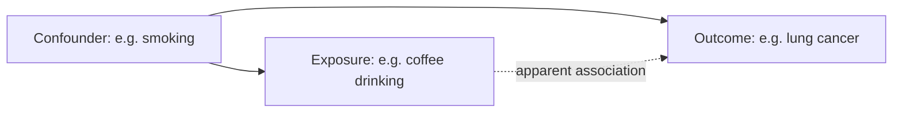

# Confounding

**Prerequisites:** [Correlation and causation](01-correlation-and-causation.md).

@@IMG@@

**Confounding** is the most important source of error in observational research. A confounder is a third factor that is associated with both the exposure and the outcome and distorts the apparent relationship between them. Learning to imagine plausible confounders is the core skill in reading any non-randomised study.

## The definition

A variable C confounds the relationship between exposure A and outcome B when:

1. C is associated with A;
2. C affects B (or is a marker for something that does);
3. C is **not** on the causal pathway from A to B (it is not a step through which A acts).

Classic example: coffee drinking was once associated with lung cancer in some studies. In many populations at the time, coffee drinkers were more likely to smoke. Smoking caused the cancer; coffee was guilty by association.

## Confounding by indication

In studies of medical treatments, the most important form is **confounding by indication**: people receive treatments *because* they are sick, or sicker. Patients prescribed a heart drug may have worse outcomes than those not prescribed it simply because they had more heart disease to begin with. The reverse also happens: doctors may withhold aggressive treatment from the frailest patients, making the treatment look better than it is. Only randomisation reliably breaks this link.

## Socioeconomic and lifestyle confounding

Income, education, occupation, diet, exercise, alcohol, smoking and access to healthcare are associated with almost every exposure and almost every health outcome. Studies of diet, supplements, screening, vaccines and many drugs must grapple with them. Because they are so intertwined and so hard to measure precisely, **residual confounding** after adjustment is common.

## Simpson's paradox

Confounding can even **reverse** an association. In **Simpson's paradox**, a relationship that holds in every subgroup reverses when the groups are combined. A famous medical example comes from a 1986 study of kidney stone treatments by C. R. Charig and colleagues in the *BMJ*: open surgery had higher success rates than a less invasive procedure for both small and large stones, yet the less invasive procedure looked better overall, because it had been used mostly for small stones, which are easier to treat. Stone size confounded the comparison.

A well-known social science example involved graduate admissions at the University of California, Berkeley in 1973: overall, men were admitted at a higher rate than women, but analysis by department, published by Peter Bickel and colleagues in *Science* in 1975, showed that women tended to apply to more competitive departments, and within departments there was no consistent bias against them.

## How researchers deal with confounding

At the **design** stage:

- **Randomisation** (in trials) balances all confounders on average.
- **Restriction**: study only one group (for example, only non-smokers), which removes confounding by that variable but limits generalisability.
- **Matching**: choose comparison subjects similar in key confounders.
- **Self-controlled designs** compare people with themselves ([SCCS](../03-study-designs/11-self-controlled-case-series.md)).
- **Natural experiments** and active comparators: compare two treatments for the same condition rather than treatment versus no treatment, so the groups are more alike.

At the **analysis** stage:

- **Stratification**: analyse within levels of the confounder.
- **Regression adjustment** and **propensity scores** ([regression and adjustment](../02-statistics/18-regression-and-adjustment.md)).

None of the analysis methods can handle confounders that were not measured.

## Sensitivity analysis for unmeasured confounding

A useful tool is to ask how strong an unmeasured confounder would have to be to explain away the result. In 2017 Tyler VanderWeele and Peng Ding proposed the **E-value**: the minimum strength of association, on the risk ratio scale, that an unmeasured confounder would need with both exposure and outcome to fully explain an observed association. A large E-value means only a very strong confounder could explain the result; a small one means modest confounding could. Earlier, in 1959, Jerome Cornfield and colleagues used a similar argument to show that a hidden factor explaining the smoking-lung cancer association would have to be implausibly strongly linked to smoking.

## Thinking up confounders

When you read an observational result, ask: **who gets this exposure, and why?** Then ask whether the same reasons could affect the outcome. People who choose organic food, take supplements, get flu shots, run marathons or drink moderately differ from those who do not in income, health consciousness, baseline health and more.

## Key ideas

- A confounder is associated with the exposure, affects the outcome and is not on the causal pathway.
- Confounding by indication is the central problem for observational studies of treatments.
- Simpson's paradox shows confounding can reverse associations.
- Design (randomisation, restriction, matching, self-control) and analysis (stratification, adjustment) address measured confounding.
- Unmeasured confounding remains; E-values and Cornfield's argument ask how strong it would need to be.

## Where this leads

- Next: [Reverse causation](03-reverse-causation.md)
- Related: [Causal diagrams](10-causal-diagrams.md)
