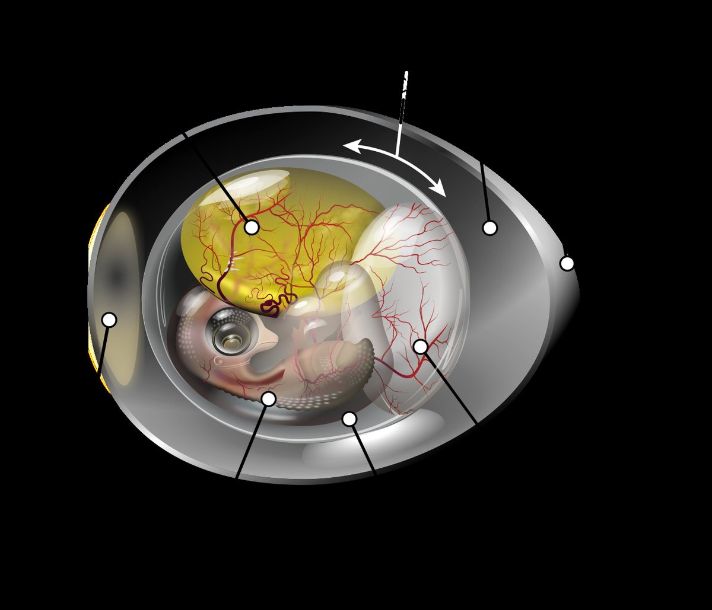
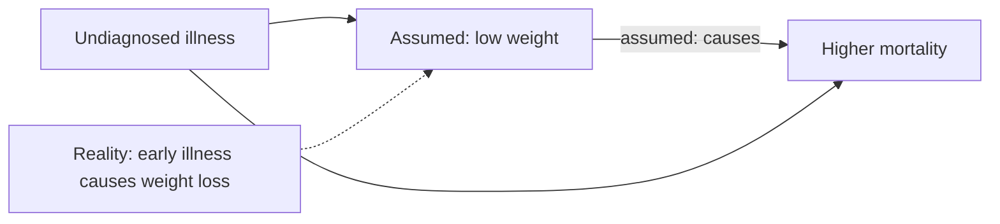

# Reverse causation

**Prerequisites:** [Confounding](02-confounding.md).

*Diagram of a chicken egg; 'which came first' is the folk version of the direction-of-causation question. Credit: KDS4444. License: [CC BY-SA 4.0](https://creativecommons.org/licenses/by-sa/4.0). Source: [File:Chicken egg diagram.svg](https://commons.wikimedia.org/wiki/File:Chicken_egg_diagram.svg).*

Sometimes an association runs the opposite way from the one assumed: the outcome, or an early stage of it, causes the exposure. This is **reverse causation** (also called **reverse causality**). It is especially common when the outcome develops slowly and its early, unnoticed stages change people's behaviour.

## The basic pattern

Researchers assume exposure A leads to outcome B. In fact, B (or something that precedes B) leads to A.

## Classic examples

### Weight and mortality

Many studies have found that people who are thin, by body mass index, have higher mortality than those of normal weight, and some have suggested that being slightly overweight is protective. Part of this pattern is reverse causation: serious illnesses such as cancer, heart failure and lung disease often cause weight loss before they are diagnosed, so the "thin" group includes people who are already sick. Smoking also lowers weight and raises mortality, adding confounding. Studies that exclude smokers and deaths in the first few years of follow-up generally find a weaker or absent advantage for overweight, though researchers continue to debate the size of the effect.

### Alcohol and the "sick quitter"

Moderate drinkers in many cohort studies appear healthier than non-drinkers, which was long cited as evidence that moderate drinking protects the heart. A major counter-argument, made by Gerry Shaper and colleagues in 1988 and developed since, is the **sick quitter** hypothesis: the "non-drinker" category often includes former drinkers who stopped because they became ill. When studies separate lifelong abstainers from former drinkers, the apparent benefit generally shrinks. Mendelian randomisation studies using genetic variants that affect alcohol metabolism have also tended to find no protective effect, though the debate is not fully closed.

### Activity and dementia

People who are less physically and socially active have higher rates of later dementia diagnosis. But dementia begins in the brain years or decades before diagnosis, and its early stages can reduce activity. Some long-term cohorts, such as the Whitehall II study of British civil servants, have reported that the association between physical activity and dementia weakens when activity is measured long before diagnosis, consistent with reverse causation explaining part of the shorter-term association.

## Where reverse causation hides

- **Cross-sectional studies**, where exposure and outcome are measured together ([cross-sectional studies](../03-study-designs/04-cross-sectional-studies.md)).
- **Short follow-up cohorts**, where early disease could already be affecting exposure at baseline.
- **Exposures that are responses to symptoms**, such as using painkillers, changing diet, or taking supplements after feeling unwell. This overlaps with confounding by indication and with **protopathic bias**, where a drug is prescribed for early symptoms of an undiagnosed disease, making the drug appear to cause it.

## Defences

- **Lag the exposure**: measure exposure well before the outcome, and exclude outcomes in the first years of follow-up.
- **Use exposures that cannot be caused by the outcome**, such as genetic variants (in Mendelian randomisation) or policies.
- **Look for dose-response over time**: if the association is strongest just before diagnosis and fades with longer lags, reverse causation is likely.
- **Trials**: randomisation fixes the time order.

## A reader's question

For every association, ask: **could the outcome, or its early stages, have caused the exposure?** If the outcome develops slowly and silently and the exposure is something people change when they feel unwell, the answer is often yes.

## Key ideas

- Reverse causation is when the outcome, or its early stages, causes the exposure.
- It is common for slowly developing diseases that change behaviour before diagnosis.
- Examples include weight and mortality, alcohol and the sick quitter, and activity and dementia.
- Protopathic bias is the drug-study version.
- Lagging exposures, excluding early events and using genetic or policy instruments help.

## Where this leads

- Next: [Selection bias](04-selection-bias.md)
