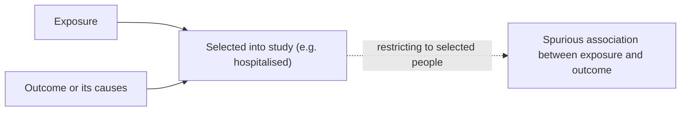

# Selection bias

**Prerequisites:** [[reverse-causation|Reverse causation]] and [[samples-and-populations|Samples and populations]].

@@IMG@@

**Selection bias** occurs when the way people get into a study, or into the analysis, distorts the relationship between exposure and outcome. Unlike confounding, which reflects real differences between groups in the world, selection bias is created by the study's own process of choosing whom to include.

## Two flavours

Epidemiologists distinguish:

- Selection that makes the **sample unrepresentative** of the population. This damages external validity: the result may not apply elsewhere. For instance, a trial that recruits only highly motivated volunteers.
- Selection that is related to **both exposure and outcome**. This damages internal validity: the association in the sample is wrong even for the people studied.

The second kind is more dangerous, and it can create associations that do not exist in the population at all.

## Collider bias

The formal explanation for the second kind is **collider bias**. A **collider** is a variable that is caused by two other variables. If you select on a collider (only study people with a certain value of it), you induce an association between its causes, even if they are unrelated.

### Berkson's bias

The classic case was described by the statistician Joseph Berkson in 1946. Among **hospital patients**, two unrelated diseases can appear associated, because having either disease increases the chance of being hospitalised. If you look only at hospitalised people, those without disease A must have *some* other reason to be there, which makes disease B more common among them.

### Everyday examples

- **Restaurants and location**: people sometimes observe that good restaurants in bad locations seem to have better food. Restaurants survive if their food is good *or* their location is good, so among surviving restaurants, food quality and location appear negatively associated.
- **COVID-19 studies**: early in the pandemic, some studies of hospitalised or tested patients reported surprising associations (for example, smokers appearing to be protected). Gareth Griffith and colleagues argued in *Nature Communications* in 2020 that collider bias from who got tested or hospitalised could explain such findings.

## Other forms

- **Volunteer bias**: people who volunteer for studies are typically healthier and more health-conscious than those who do not.
- **Non-response bias**: in surveys, those who respond may differ from those who do not.
- **Loss to follow-up**: if dropouts in a cohort or trial differ in both exposure and outcome, results are biased. This is selection *out of* the analysis.
- **Healthy worker effect**: employed people are healthier than the general population (illness can prevent employment), so occupational cohorts compared with the general population can make harmful jobs look safe.
- **Referral and detection bias**: specialist centres see unusual cases, and exposed people may be more likely to be tested and diagnosed.
- **Survivorship bias**: only those who survived some process are observed; see [[survivorship-bias|survivorship bias]].

## Index event bias

A modern variant is **index event bias**, also called the "obesity paradox" problem in some contexts. Studies restricted to people who have already had a disease (such as heart failure) sometimes find that risk factors for getting the disease (such as obesity) appear protective afterwards. Because everyone in the study has the disease, those without the usual risk factor must have gotten it through other, possibly more dangerous, causes.

## Defences

- Recruit from a clearly defined population, with high participation.
- In case-control studies, choose controls from the same population that produced the cases.
- Minimise and report loss to follow-up, and analyse its effect.
- Be careful about restricting analyses to people defined by a post-exposure event (hospitalised, tested, survived).
- Draw a [[causal-diagrams|causal diagram]] and check for colliders.

## Key ideas

- Selection bias arises from how people enter or leave a study or analysis.
- It can make samples unrepresentative or, worse, create false associations.
- Selecting on a collider (a common effect) induces spurious associations, as in Berkson's bias.
- Volunteer, non-response, loss-to-follow-up, healthy worker and index event biases are common forms.
- Large size does not fix selection bias.

## Where this leads

- Next: [[survivorship-bias|Survivorship bias]]
