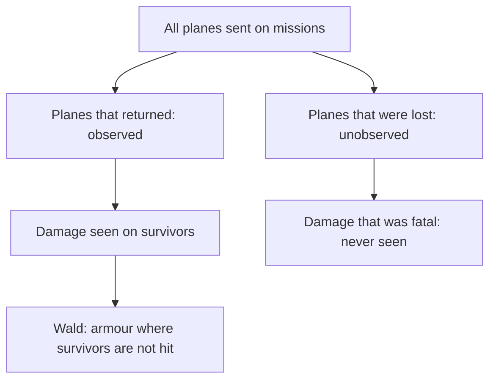

# Survivorship bias

**Prerequisites:** [Selection bias](04-selection-bias.md).

@@IMG@@

**Survivorship bias** is the error of drawing conclusions from the cases that made it through some selection process while ignoring those that did not. Because the failures are invisible, the survivors look more typical, more successful or more instructive than they really are.

## The bomber story

The most famous illustration involves the statistician Abraham Wald, who worked with the Statistical Research Group at Columbia University during the Second World War. The story usually told is that military analysts examined bombers returning from missions, noted where they had bullet holes, and proposed adding armour to those areas. Wald pointed out that the planes being examined were the ones that had **returned**. Holes in the places where returning planes were *not* damaged (such as the engines) suggested that planes hit there did not come back. The armour should go where the survivors had no holes.

Wald's actual work was a set of technical memoranda on estimating aircraft vulnerability from the damage on returning planes, later republished and discussed by statisticians. The popular version simplifies it, but the logic is sound and is the clearest picture of survivorship bias.

## In health research

Survivorship bias takes several forms in medical studies:

- **Prevalent users.** Studies that include people who have been taking a drug for some time (prevalent users) miss those who stopped early because of side effects or died. The survivors look as though they tolerate the drug well. The remedy is a **new-user design**, which follows people from when they start a treatment, a principle set out by Wayne Ray in a 2003 paper in the *American Journal of Epidemiology*.
- **Prevalent cases.** Cross-sectional studies of people currently living with a disease miss those who died quickly; see [prevalence-incidence bias](../03-study-designs/04-cross-sectional-studies.md).
- **Immortal time.** If people must survive long enough to receive a treatment, the treated group is guaranteed to have survived that period; see [time-related biases](08-time-related-biases.md).
- **Long-term follow-up of trials.** If only survivors are re-examined years later, comparisons between arms can be biased by who survived.

## Outside medicine

Survivorship bias is everywhere:

- **Investment funds**: performance databases that drop funds that closed (often because they did badly) overstate average returns. The finance course discusses this in its lessons on [portfolio theory](../../../../economics/finance/06-portfolio-theory/README.md).
- **Business advice**: studying successful companies to find the secrets of success ignores the failed companies that did the same things.
- **"They don't make them like they used to"**: old buildings, cars and tools that survive are the best-built ones; the shoddy ones are gone.
- **Lifestyle stories**: the 100-year-old who smoked daily is a survivor; the many smokers who died younger are not interviewed.

## How to spot it

Ask: **what process selected the cases I am looking at, and what happened to the ones that were filtered out?** If the selection depends on the outcome (surviving, succeeding, staying on treatment), the visible cases will mislead.

## Survivorship bias and publication

Published studies themselves are survivors. Studies that found nothing, or found something inconvenient, are less likely to be published ([publication bias](../06-research-integrity/06-publication-bias.md)). Reading only the published literature is, in a sense, examining only the planes that came back.

## Key ideas

- Survivorship bias comes from studying only cases that passed a selection process.
- Wald's bomber analysis is the classic illustration: the missing planes carry the key information.
- In medicine it appears as prevalent-user bias, prevalence-incidence bias and immortal time bias.
- New-user designs follow people from the start of treatment to avoid it.
- The published literature is itself a set of survivors.

## Where this leads

- Next: [The healthy user effect](06-healthy-user-bias.md)
- Related: [Publication bias](../06-research-integrity/06-publication-bias.md)
