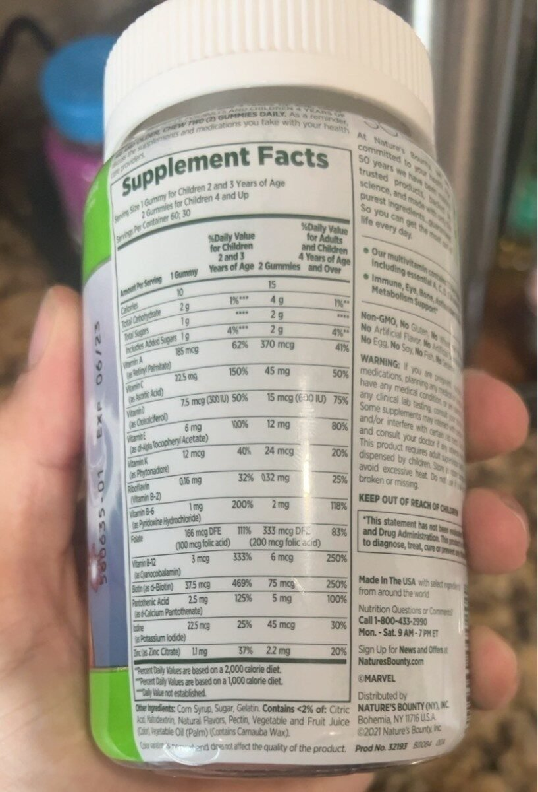
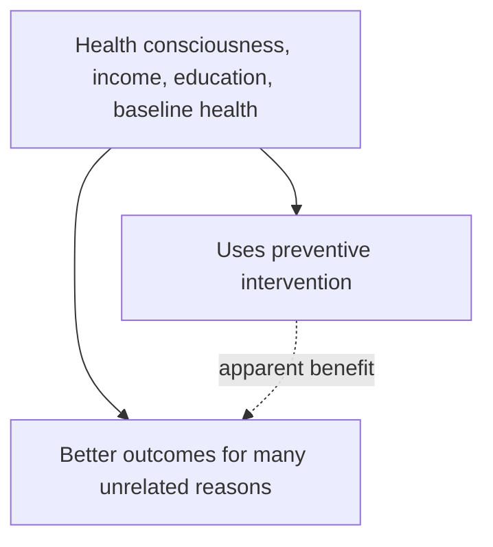

# The healthy user effect

**Prerequisites:** [Confounding](02-confounding.md) and [Survivorship bias](05-survivorship-bias.md).

*Multivitamin supplements; people who take them tend to differ in health habits from those who do not. Credit: MBilbao12. License: [CC BY-SA 4.0](https://creativecommons.org/licenses/by-sa/4.0). Source: [File:Multivitamin product.jpg](https://commons.wikimedia.org/wiki/File:Multivitamin_product.jpg).*

People who do one healthy thing tend to do many healthy things. People who take preventive medicines, get screened, get vaccinated, take supplements, stick to their prescriptions and attend check-ups are, on average, more health-conscious, better off and in better baseline health than those who do not. This cluster of differences, the **healthy user effect** (also called healthy user bias or healthy adherer bias), is a powerful confounder in observational studies of preventive interventions.

## The pattern

Because health consciousness is hard to measure, adjusting for income, education and a few lifestyle variables rarely removes it entirely.

## Evidence that it is real

### Adherence to placebo

The strongest evidence comes from trials themselves. In the Coronary Drug Project, men who took at least 80% of their **placebo** pills had much lower five-year mortality than men who took less, as reported in 1980 in the *New England Journal of Medicine* ([intention to treat](../03-study-designs/09-intention-to-treat-and-per-protocol.md)). Similar placebo-adherence effects have been reported in other trials. A sugar pill cannot lower mortality; adhering to it marks a different kind of person.

### Unrelated outcomes

Researchers have tested for the healthy user effect by checking whether an intervention appears to "protect" against outcomes it could not plausibly affect. For example, studies of statin users have found associations with lower rates of outcomes such as accidents and some infections, which point to healthier or more careful users rather than drug effects. William Shrank, Amanda Patrick and M. Alan Brookhart reviewed such evidence in a 2011 paper in the *Journal of General Internal Medicine*.

### Flu vaccine and mortality in older people

Observational studies reported that influenza vaccination in older adults was associated with large reductions in all-cause winter mortality. In 2006 Lisa Jackson and colleagues published a study in the *International Journal of Epidemiology* showing that the apparent mortality benefit was present even **before** influenza season began, when the vaccine could not have been working against flu. They concluded that much of the association reflected the healthy user effect, and that frail people near the end of life were less likely to be vaccinated. This does not mean influenza vaccines do not work; it means the size of their benefit cannot be read from such crude comparisons. Randomised trials, test-negative studies and other designs are used instead.

## The frailty side

The mirror image of the healthy user effect is that people who are very ill, frail or near death are less likely to receive preventive treatments. Doctors and families may decide not to bother with a vaccine or a cholesterol drug for someone with weeks to live. This makes non-users look sicker than they would otherwise be, exaggerating the apparent benefit of the intervention.

## Hormone replacement therapy

The best-known casualty of the healthy user effect is postmenopausal **hormone replacement therapy**. Observational studies, notably the Nurses' Health Study, found that women using HRT had lower rates of heart disease. Women who used HRT in those years tended to be wealthier, more educated and more health-conscious. When the Women's Health Initiative randomised trial reported in 2002, it found no heart benefit from combined estrogen-plus-progestin therapy and an increased risk of coronary heart disease. See the [HRT case study](../10-case-studies/04-hormone-replacement-therapy-and-the-whi.md).

## How studies try to address it

- **Active comparators**: compare users of one preventive drug with users of another, rather than with non-users, so both groups are "users".
- **New-user designs**: follow people from when they start, not long-term users.
- **Negative control outcomes**: check for "effects" on outcomes the intervention cannot plausibly affect. A spurious effect signals residual bias.
- **Negative control periods**: as in Jackson's study, check for effects in periods when the intervention cannot work.
- **Self-controlled designs** and **natural experiments**.
- **Trials**, when feasible.

## A balanced view

The healthy user effect can make useless interventions look beneficial, and it can exaggerate real benefits. It does not, by itself, show that a given intervention is useless; that requires better evidence. When the healthy user effect is a plausible explanation for an observational result, the honest conclusion is that the observational result cannot settle the question.

## Key ideas

- People who use preventive interventions differ systematically from those who do not.
- Adherers to placebo in trials have better outcomes, proving the effect is real.
- Negative control outcomes and periods can expose it, as in the flu vaccine mortality studies.
- HRT is the classic case where it misled observational research.
- Active comparators, new-user designs, negative controls and trials help.

## Where this leads

- Next: [Measurement and recall bias](07-measurement-and-recall-bias.md)
- Case study: [HRT and the WHI](../10-case-studies/04-hormone-replacement-therapy-and-the-whi.md)
