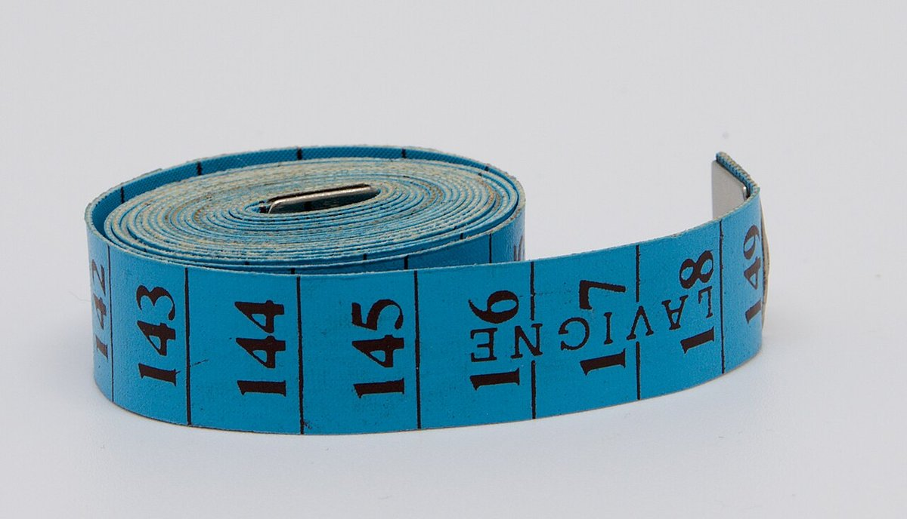
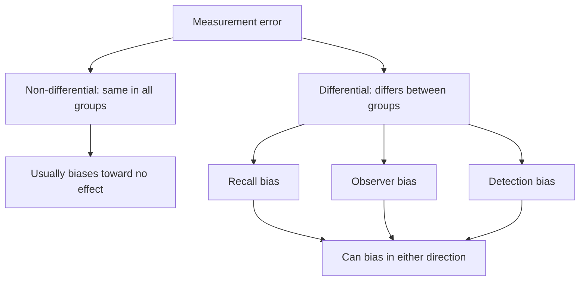

# Measurement and recall bias

**Prerequisites:** [The healthy user effect](06-healthy-user-bias.md) and [Observation, measurement and experiment](../01-foundations/03-observation-measurement-and-experiment.md).

*A tape measure; measurement error in exposures and outcomes can bias study results. Credit: Clément Bucco-Lechat. License: [CC BY-SA 3.0](https://creativecommons.org/licenses/by-sa/3.0). Source: [File:Blue tape measure.jpg](https://commons.wikimedia.org/wiki/File:Blue_tape_measure.jpg).*

Every study depends on measuring exposures and outcomes. When those measurements are wrong, the results can be wrong too. Errors in measurement are called **information bias** or **measurement bias**, and they come in two importantly different kinds.

## Non-differential misclassification

**Non-differential** error is the same in all groups being compared. For example, a food questionnaire might be equally imprecise for people who later get cancer and those who do not. For a simple binary exposure, this kind of error usually **biases the result toward no effect** (toward the null): it blurs the difference between groups. A study with very noisy exposure measurement may find a weak association even if the true one is strong.

This is the reason researchers sometimes say that a positive result *despite* imprecise measurement is reassuring. But the "toward the null" rule has exceptions (with more than two exposure categories, or when errors are correlated), so it is not a guarantee.

## Differential misclassification

**Differential** error differs between groups, and it can bias results in **either direction**, including creating associations that do not exist. The main types are:

### Recall bias

In [case-control studies](../03-study-designs/05-case-control-studies.md), cases often remember past exposures differently from controls. Mothers of babies with birth defects, for instance, may think harder about everything they took or did during pregnancy than mothers of healthy babies. The result can be an apparent association between a harmless exposure and the outcome. Using records made **before** the outcome (prescription databases, medical charts) is the main defence.

### Interviewer and observer bias

Interviewers who know a participant's case status may probe more deeply. Doctors who know which patients received a treatment may record outcomes differently. Blinding assessors is the defence ([blinding](../03-study-designs/08-blinding-placebos-and-allocation-concealment.md)).

### Detection and surveillance bias

Exposed people may be examined more closely, so their outcomes are found more often. Women taking hormone therapy might have more mammograms and so more breast cancers detected; people with a diagnosed disease may get more tests that turn up other conditions. The fix is to ensure that the outcome is sought with equal intensity in all groups.

### Social desirability and reporting bias

People under-report stigmatised behaviours and over-report virtuous ones. If the degree of misreporting differs between groups, results are biased.

## Measuring diet: a cautionary field

Nutritional epidemiology relies heavily on food frequency questionnaires, which ask people to estimate how often they ate dozens of foods over the past year. Validation studies comparing these with more objective measures have shown substantial error. Critics such as John Ioannidis have argued, for example in a 2018 *JAMA* viewpoint, that nutritional epidemiology needs radical reform; defenders argue that the methods are imperfect but have produced valid findings when combined with other evidence. Either way, single nutritional associations based on self-reported diet deserve caution.

## Outcome measurement

Outcomes can also be mismeasured:

- **Diagnostic criteria** change over time and differ between places.
- **Administrative codes** in health databases may be inaccurate. Good database studies validate their outcome definitions against medical records.
- **Patient-reported outcomes** depend on questionnaires whose validity and responsiveness vary.
- **Composite outcomes** combine several events (for example, "death, heart attack or hospitalisation"); a result driven mainly by the least serious component can be misleading if presented as if it applied to all.

## Questions to ask

- How exactly were the exposure and outcome measured?
- Were measurements made before the outcome was known?
- Were assessors blind to exposure or group?
- Were the same methods and intensity used in all groups?
- Was the measurement method validated?

## Key ideas

- Measurement error (information bias) affects exposures and outcomes.
- Non-differential error usually biases toward no effect, but not always.
- Differential error, such as recall, observer and detection bias, can bias in either direction.
- Records made before the outcome, blinding and equal surveillance are key defences.
- Self-reported diet is a notoriously difficult measurement.

## Where this leads

- Next: [Time-related biases](08-time-related-biases.md)
