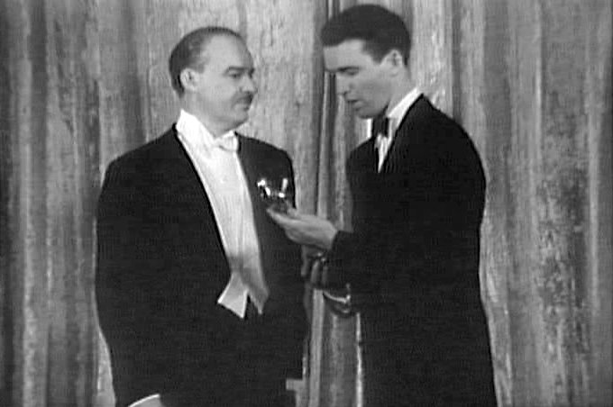
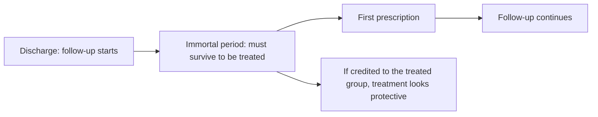
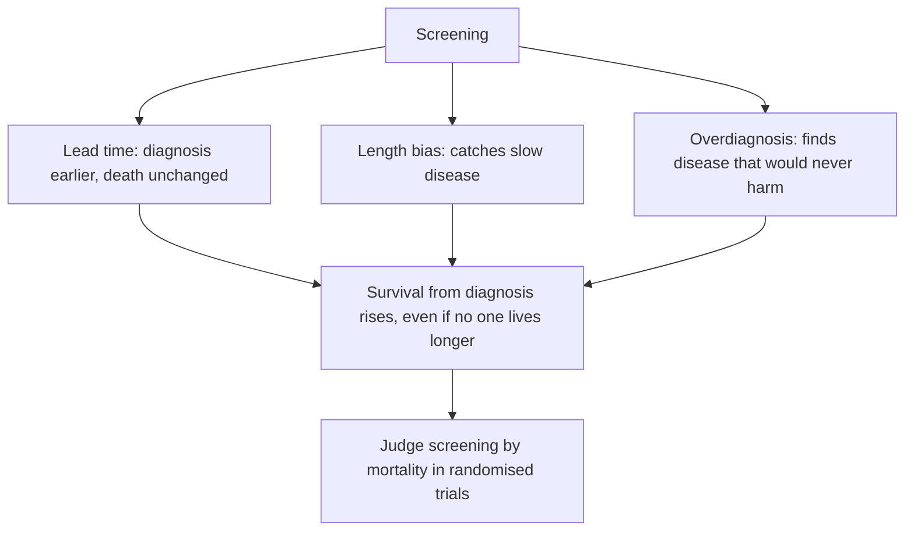

# Time-related biases

**Prerequisites:** [Measurement and recall bias](07-measurement-and-recall-bias.md) and [Sensitivity, specificity and screening](../02-statistics/15-sensitivity-and-specificity.md).

*James Stewart receiving an Academy Award; studies of Oscar winners' longevity illustrate immortal time bias. Credit: https://archive.org/details/1941-03-04_Screen_Notables_Hear_Roosevelt. License: Public domain. Source: [File:James stewart receives academy award 1941.jpg](https://commons.wikimedia.org/wiki/File:James_stewart_receives_academy_award_1941.jpg).*

Some of the most persuasive-looking errors in medical research come from how time is handled. They can make useless treatments look life-saving and useless screening look effective. Because they are subtle, they have fooled researchers in well-regarded journals.

## Immortal time bias

**Immortal time** is a period of follow-up during which, by the way the study is designed, the outcome cannot occur for one group.

Example: researchers compare people who received a drug at some point after hospital discharge with people who never received it, and they start follow-up for everyone at discharge. Anyone in the "drug" group must have **survived** until they got the drug. The time between discharge and first prescription is "immortal" for them. If that time is counted as treated follow-up (or simply credited to the treated group), the drug looks protective even if it does nothing.

A well-known example: in 2001 Donald Redelmeier and Sheldon Singh reported in the *Annals of Internal Medicine* that Oscar-winning actors lived 3.9 years longer than other performers. Winners, however, had to survive long enough to win. A 2006 reanalysis by Marie-Pierre Sylvestre, Ella Huszti and James Hanley in the same journal, which counted the years before a win correctly, found an advantage of about one year that was not statistically significant. In pharmacoepidemiology, Samy Suissa has written extensively about immortal time bias, showing in a 2008 paper in the *American Journal of Epidemiology* how it had produced exaggerated benefits in observational drug studies.

Defences include treating exposure as **time-varying** (people count as unexposed until they start treatment), **landmark analyses** (start follow-up at a fixed time after an event), and the **target trial emulation** approach described below.

## Lead-time bias

**Lead time** is the interval by which screening brings forward a diagnosis. If a cancer would have been diagnosed from symptoms at age 67 but screening finds it at 64, and the person dies at 70 either way, "survival from diagnosis" rises from 3 to 6 years even though screening added no life at all. Comparing survival from diagnosis between screened and unscreened people therefore exaggerates screening's benefits. The right outcome is **mortality** in randomised groups.

## Length bias

Slow-growing disease spends longer in the detectable-but-symptomless phase, so screening at intervals is more likely to catch it. Aggressive, fast-growing disease is more likely to appear between screens. Screen-detected cases therefore have better prognoses on average, regardless of any benefit from early treatment.

## Overdiagnosis

The extreme form of length bias is **overdiagnosis**: detecting abnormalities that would never have caused symptoms or death. Overdiagnosed people gain nothing from treatment but bear its harms, and they inflate "survival" statistics because they were never going to die of the disease. South Korea's thyroid cancer screening experience is a striking example: after widespread ultrasound screening began in the late 1990s and 2000s, thyroid cancer diagnoses rose roughly fifteen-fold by 2011, while thyroid cancer mortality stayed essentially flat, as reported by Hyeong Sik Ahn, H. Gilbert Welch and colleagues in the *New England Journal of Medicine* in 2014.

## Other time traps

- **Time-window bias**: in case-control studies, cases and controls have exposure measured over windows of different lengths.
- **Protopathic bias**: a drug is started because of early symptoms of an undiagnosed disease ([reverse causation](03-reverse-causation.md)).
- **Calendar-time confounding**: practices, diagnostic criteria and other exposures change over time, so comparisons of people treated in different years are confounded.

## Target trial emulation

A unifying approach, developed by Miguel Hernán and James Robins, is **target trial emulation**: designing an observational analysis to mimic the randomised trial you would ideally run. You specify eligibility, treatment strategies, the start of follow-up ("time zero"), outcomes and analysis as if for a trial. Aligning eligibility, treatment assignment and time zero eliminates immortal time and prevalent-user biases by design. It cannot remove unmeasured confounding.

## Key ideas

- Immortal time bias credits treated people with survival time they had to have to be treated.
- Lead-time bias, length bias and overdiagnosis make screening look better than it is.
- Screening should be judged by mortality in randomised trials, not survival from diagnosis.
- South Korea's thyroid cancer experience shows overdiagnosis at population scale.
- Target trial emulation aligns time zero to prevent many time-related biases.

## Where this leads

- Next: [The Bradford Hill criteria](09-bradford-hill-criteria.md)
