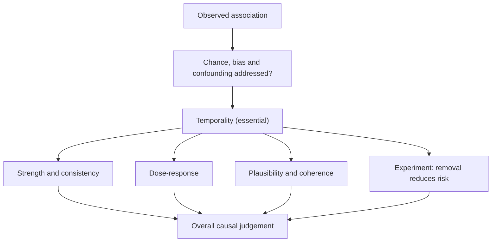

# The Bradford Hill criteria

**Prerequisites:** [Time-related biases](08-time-related-biases.md) and [Correlation and causation](01-correlation-and-causation.md).

@@IMG@@

In January 1965, the British statistician and epidemiologist Sir Austin Bradford Hill (1897–1991) gave the President's Address to the Section of Occupational Medicine of the Royal Society of Medicine. Published that year in the *Proceedings of the Royal Society of Medicine* as "The environment and disease: association or causation?", it set out nine "viewpoints" for deciding whether an observed association is likely to be causal. They are still the most widely cited framework for causal judgement in epidemiology.

## The context

Hill had helped design the 1948 streptomycin trial and, with Richard Doll, the landmark studies linking smoking to lung cancer ([case-control studies](../03-study-designs/05-case-control-studies.md), [cohort studies](../03-study-designs/06-cohort-studies.md)). By the 1960s the question was how to decide on causation when trials were impossible, as with smoking or occupational hazards. The US Surgeon General's 1964 report *Smoking and Health* used a similar set of considerations.

## The nine viewpoints

1. **Strength.** Strong associations are less likely to be entirely explained by bias or confounding. Heavy smokers had many times the lung cancer death rate of non-smokers. But weak associations can still be causal.
2. **Consistency.** The association is seen repeatedly, by different people, in different places, circumstances and times, ideally using different methods.
3. **Specificity.** The exposure is linked to a particular outcome rather than to everything. Hill himself regarded this as weak: smoking causes many diseases.
4. **Temporality.** The cause must precede the effect. This is the only viewpoint generally treated as essential.
5. **Biological gradient (dose-response).** More exposure leads to more effect, as with more cigarettes per day leading to higher lung cancer risk. Some real relationships have thresholds or are not monotonic.
6. **Plausibility.** There is a biologically plausible mechanism. Hill noted that this depends on the knowledge of the day.
7. **Coherence.** The causal interpretation does not seriously conflict with what is known about the natural history and biology of the disease.
8. **Experiment.** Experimental or semi-experimental evidence supports it; for instance, removing the exposure reduces the outcome (ex-smokers' risk falls).
9. **Analogy.** Similar exposures have similar effects; for example, if one drug causes birth defects, a similar drug might.

## What Hill actually said about them

Hill did not call these "criteria" and insisted they were not rules. In the address he wrote that none of the nine could bring indisputable evidence for or against the cause-and-effect hypothesis, and none could be required as a *sine qua non*, except temporality. What they could do, he argued, was help answer the fundamental question of whether there was any other way of explaining the facts, and whether any other answer was equally or more likely than cause and effect.

He also warned against over-reliance on significance tests, noting that they cannot answer whether an effect is large enough to matter, and he ended the address by stressing that the decision to act should depend on the stakes: weaker evidence might justify action when the harm is serious and the cost of acting is low.

## Using them well

The viewpoints are a checklist for thinking, not a scoring system. In practice:

- First rule out, as far as possible, **chance, bias and confounding**. The viewpoints assume this has been done.
- **Temporality** must hold. Check for [reverse causation](03-reverse-causation.md).
- **Consistency across different designs** is especially persuasive, because different designs have different weaknesses. If cohort studies, case-control studies, self-controlled studies and natural experiments all agree, a common bias is less likely.
- **Strength** and **dose-response** add weight but can be produced by confounding.
- **Plausibility** is useful but limited. Many accepted causes had no known mechanism when first identified (Semmelweis's hand-washing, Snow's cholera), and plausible-sounding mechanisms can be invented for almost anything.

## Modern refinements

Epidemiologists have updated the framework in several ways. Kenneth Rothman and Sander Greenland, among others, have criticised treating the viewpoints as criteria, and the field has added formal tools: [causal diagrams](10-causal-diagrams.md) to identify confounders, sensitivity analyses such as E-values, negative controls, triangulation across methods with different biases, and [natural experiments](../03-study-designs/12-natural-experiments-and-quasi-experiments.md). GRADE's upgrading criteria (large effect, dose-response, plausible confounding working against the result) are a descendant of Hill's thinking ([Cochrane and GRADE](../03-study-designs/16-cochrane-and-grade.md)).

## A worked application: smoking and lung cancer

- **Strength**: very large relative risks in heavy smokers.
- **Consistency**: dozens of studies in many countries.
- **Temporality**: smoking precedes cancer by decades.
- **Dose-response**: risk rises with cigarettes per day and years smoked.
- **Experiment**: risk falls after quitting.
- **Plausibility and coherence**: carcinogens identified in tobacco smoke; population lung cancer trends followed smoking trends with a lag.

The tobacco industry disputed this case for decades ([tobacco case study](../10-case-studies/01-tobacco-industry-research.md)), but by Hill's viewpoints it was overwhelming.

## Key ideas

- Hill's 1965 address set out nine viewpoints for judging causation from associations.
- They are guides to judgement, not criteria to be scored; only temporality is essential.
- Chance, bias and confounding must be addressed first.
- Consistency across different designs is especially powerful.
- Hill tied the decision to act to the stakes, not just to the strength of evidence.

## Where this leads

- Next: [Causal diagrams](10-causal-diagrams.md)
- Case study: [Tobacco industry research](../10-case-studies/01-tobacco-industry-research.md)
