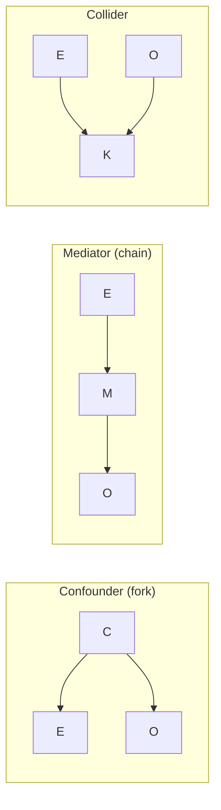

# Causal diagrams

**Prerequisites:** [The Bradford Hill criteria](09-bradford-hill-criteria.md), [Confounding](02-confounding.md) and [Selection bias](04-selection-bias.md).

@@IMG@@

Which variables should a study adjust for? Intuition says "as many as possible", but that is wrong: adjusting for some variables removes bias, while adjusting for others creates it. **Causal diagrams**, formally called **directed acyclic graphs** (DAGs), make the reasoning explicit. They are increasingly common in epidemiology papers, and you can use simple ones yourself to check whether a study adjusted for the right things.

## The basic vocabulary

A DAG draws variables as nodes and causal effects as arrows.

- **Directed**: every arrow points one way, from cause to effect.
- **Acyclic**: you cannot follow arrows round in a loop back to where you started (a variable cannot cause itself).

The approach was developed by computer scientist Judea Pearl and others from the late 1980s and 1990s and brought into epidemiology by Sander Greenland, James Robins, Pearl and colleagues, notably in a 1999 paper in *Epidemiology*. Pearl's popular book with Dana Mackenzie, *The Book of Why* (2018), introduces the ideas for general readers.

## Three basic structures

Every DAG is built from three patterns. Using E for exposure and O for outcome:

1. **Fork (confounder):** C causes both E and O. The path E ← C → O is a **backdoor path** that creates a non-causal association. **Adjusting for C blocks it.** This is ordinary confounding.
2. **Chain (mediator):** E causes M, which causes O. M is how E has its effect. **Adjusting for M removes part of the real effect.** If you want the total effect of E, do not adjust for mediators.
3. **Collider:** E and O both cause K. The path E → K ← O is naturally **blocked**: it creates no association. But **adjusting for K, or selecting on it, opens the path** and creates a spurious association. This is [collider bias](04-selection-bias.md).

## The backdoor criterion

To estimate the causal effect of E on O, you need to block every **backdoor path** (every path from E to O that starts with an arrow *into* E), without adjusting for any mediators or opening colliders. Pearl formalised this as the **backdoor criterion**. In practice, researchers draw their assumed DAG and use it (often with free software such as DAGitty) to find a sufficient set of variables to adjust for.

## A worked example

Suppose a study asks whether exercise (E) reduces heart attacks (O).

- **Age** affects both exercise habits and heart attack risk: a confounder. Adjust.
- **Blood pressure** is lowered by exercise and affects heart attacks: a mediator. Adjusting for it would hide part of exercise's benefit.
- **Being enrolled in a cardiac rehabilitation programme** might be caused both by exercise habits and by prior heart problems: a potential collider. Restricting the study to rehab patients could distort the association.
- **Underlying health** affects exercise and heart attacks: a confounder, but hard to measure, so residual confounding is likely.

## What DAGs do and do not do

DAGs make **assumptions visible**. Two researchers who disagree about a study's adjustments can compare diagrams and see exactly where they differ. That is a big improvement over unexplained lists of "covariates adjusted for".

But a DAG is only as good as the knowledge behind it. It cannot tell you whether an arrow exists; that comes from subject-matter knowledge. Unmeasured confounders drawn on the DAG remain unadjustable. And a DAG does not say how *strong* any effect is.

## Using DAG thinking as a reader

Even without drawing a formal diagram, you can ask of any adjusted analysis:

1. **Are there obvious common causes of exposure and outcome** that were not adjusted for?
2. **Did the authors adjust for anything caused by the exposure** (a mediator), which would understate the total effect?
3. **Was the study restricted to, or adjusted for, something caused by both exposure and outcome** (a collider), which could create a false association?
4. **Did the authors show or describe their causal assumptions?**

## Key ideas

- Causal diagrams (DAGs) draw causal assumptions as arrows between variables.
- Forks are confounders (adjust), chains contain mediators (don't adjust for total effects), colliders should not be adjusted or selected on.
- The backdoor criterion identifies which variables to adjust for.
- DAGs make assumptions explicit and debatable, but cannot supply missing knowledge.
- "Adjusted for many variables" is not the same as "adjusted for the right ones".

## Where this leads

- Next section: [Anatomy of a paper](../05-anatomy-of-a-paper/README.md), starting with [the shape of a paper](../05-anatomy-of-a-paper/01-the-shape-of-a-paper.md)
- Related: [Regression and adjustment](../02-statistics/18-regression-and-adjustment.md)
