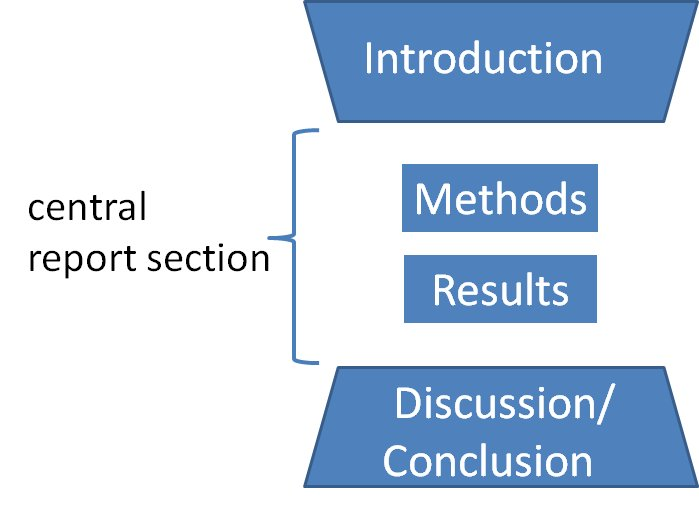
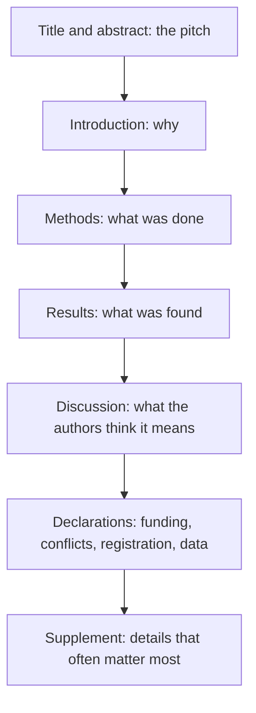

# The shape of a paper

**Prerequisites:** [Causal diagrams](../04-causation/10-causal-diagrams.md) and the statistics in [section 2](../02-statistics/README.md).

*The 'wineglass' model of the IMRaD structure: introduction, methods, results and discussion. Credit: Tom Toyosaki. License: [CC BY-SA 4.0](https://creativecommons.org/licenses/by-sa/4.0). Source: [File:Wineglass model for IMRaD structure..png](https://commons.wikimedia.org/wiki/File:Wineglass_model_for_IMRaD_structure..png).*

Most empirical research papers in medicine and the life sciences follow the same structure, known as **IMRaD**: Introduction, Methods, Results and Discussion. Knowing what each section is for, and the order in which experienced readers actually read them, saves a lot of time and protects against being steered by the authors' framing.

## The parts of a paper

A typical paper contains:

- **Title**, **authors** and **affiliations**.
- **Abstract**: a summary of 150–300 words, often structured into Background, Methods, Results and Conclusions ([lesson](02-title-and-abstract.md)).
- **Introduction**: why the question matters and what is already known ([lesson](03-introduction-and-background.md)).
- **Methods**: exactly what was done ([lesson](04-methods.md)).
- **Results**: what was found, in text, tables and figures ([results and Table 1](05-results-and-table-one.md), [graphs](06-reading-graphs.md)).
- **Discussion**: interpretation, comparison with other work, limitations and conclusions ([lesson](10-discussion-limitations-and-spin.md)).
- **Declarations**: funding, conflicts of interest, author contributions, ethics approval, trial registration, data availability.
- **References**.
- **Supplementary material**: extra methods, tables and analyses, sometimes the protocol ([lesson](11-supplementary-material-and-data.md)).

## Where IMRaD came from

Early scientific papers were often letters or narrative essays. The IMRaD format spread through medical journals during the twentieth century and became dominant after about the 1970s. Its strength is that it separates **what was done and found** (Methods and Results) from **what the authors think it means** (Discussion). That separation is what lets a reader reach their own conclusions.

## How experienced readers read

Few experienced readers go from start to finish. A common sequence is:

1. **Title and abstract**, to decide whether the paper is relevant, while remembering that the abstract is the authors' sales pitch.
2. **Declarations**: who funded it, what conflicts are declared, whether it was registered (and where). This takes thirty seconds and frames everything else.
3. **Methods**, especially the design, population, exposure, comparison, primary outcome and analysis. This is where most of the judgement happens.
4. **Results**, starting with the participant flow and Table 1, then the primary outcome. Look at the numbers before reading the authors' words about them.
5. **Discussion**, especially the limitations, compared with your own list.
6. **Supplement and registration record**, if the paper matters to you, to check for changes in outcomes or analyses.

Trisha Greenhalgh's book *How to Read a Paper*, first published in 1997 from a series in the *BMJ*, popularised a similar approach for clinicians.

## Types of articles

Journals publish many kinds of articles, and it is important to know which you are reading:

| Type | What it is | Weight as evidence |
|---|---|---|
| Original research | New data and analysis | Depends on design |
| Systematic review / meta-analysis | Synthesis of studies | Depends on methods and inputs |
| Narrative review | Expert summary | Useful orientation; prone to selective citation |
| Editorial / commentary / viewpoint | Opinion | Opinion |
| Letter / correspondence | Brief comment or data | Variable; often where errors are first pointed out |
| Case report | One or a few patients | Hypothesis-generating |
| Research letter / brief report | Short original research | As original research, less detail |
| Preprint | Not yet peer reviewed | Provisional ([preprints](../07-publishing/04-preprints.md)) |
| Correction / retraction notice | Fixes or withdraws a paper | Always check for these ([retractions](../07-publishing/06-retractions-and-corrections.md)) |

News stories often cite editorials or commentaries as if they were studies.

## Reading speed and depth

You do not need to read every paper deeply. For most purposes, a 10-minute triage (abstract, declarations, design, primary outcome with absolute numbers, limitations) tells you whether a paper deserves more time. The [step-by-step checklist](../11-practice/02-a-step-by-step-checklist.md) at the end of the course formalises this.

## Key ideas

- Most research papers follow IMRaD: Introduction, Methods, Results, Discussion.
- Methods and Results report what was done and found; the Discussion is interpretation.
- Read the declarations early: funding, conflicts and registration frame everything.
- Look at the numbers before the authors' words about them.
- Know what type of article you are reading.

## Where this leads

- Next: [Title and abstract](02-title-and-abstract.md)
