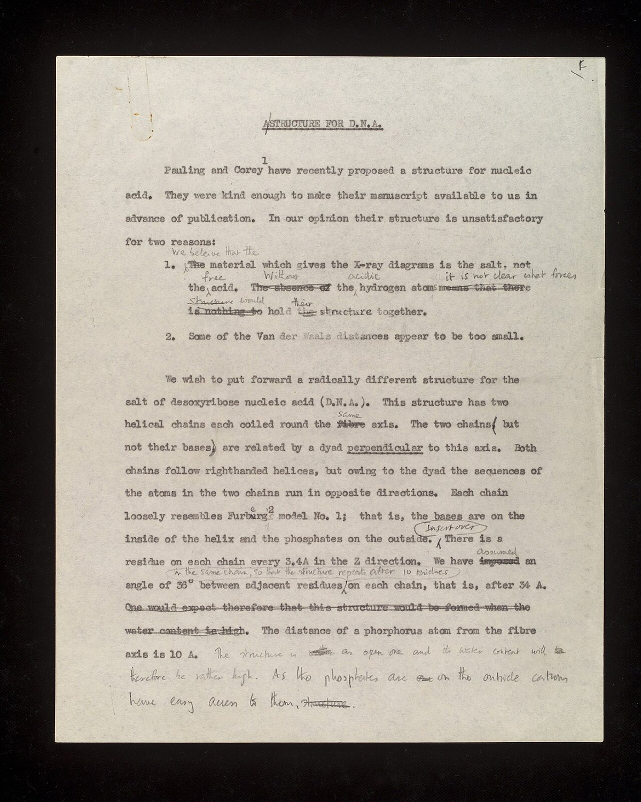
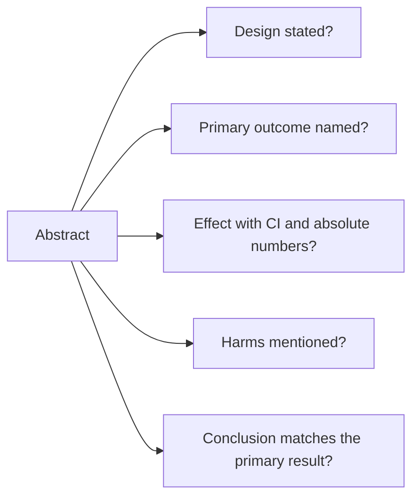

# Title and abstract

**Prerequisites:** [The shape of a paper](01-the-shape-of-a-paper.md).

*Draft of Watson and Crick's 1953 paper on the structure of DNA, famous for its brevity. Credit: https://wellcomeimages.org/indexplus/obf_images/ef/6b/797701826eabff8e6e3266665394.jpg Gallery: https://wellcomeimages.org/indexplus/image/L. License: [CC BY 4.0](https://creativecommons.org/licenses/by/4.0). Source: [File:Part 1 of a draft of the first Watson & Crick paper Wellcome L0032978.jpg](https://commons.wikimedia.org/wiki/File:Part_1_of_a_draft_of_the_first_Watson_&_Crick_paper_Wellcome_L0032978.jpg).*

The title and abstract are the most-read parts of any paper. Many readers, journalists and even citing authors never get further. They are also the parts most shaped by the authors' wish to present their work favourably, so they need to be read with care.

## Titles

A good title tells you the topic, the design and sometimes the main result: "Measles, Mumps, Rubella Vaccination and Autism: A Nationwide Cohort Study" (Hviid and colleagues, 2019) states exactly what it is. Watch for:

- **Declarative titles** that state a conclusion ("Drug X reduces mortality in heart failure"). They are common, but they present a finding as settled.
- **Causal verbs** for observational studies ("prevents", "causes", "boosts").
- **Question titles** ("Does X cause Y?"), which can promise more than the study delivers.
- **Missing design information**: a title that doesn't say "randomised trial", "cohort study" or "in mice" can mislead readers about what kind of evidence it is.

## Structured abstracts

Most medical journals require **structured abstracts** with headings such as Background, Methods, Results and Conclusions (or Objective, Design, Setting, Participants, Interventions, Main Outcome Measures, Results, Conclusions). The format was promoted by the *Annals of Internal Medicine* in 1987 and spread widely. The CONSORT and PRISMA reporting guidelines have extensions specifying what abstracts of trials and systematic reviews should contain.

A good abstract should tell you:

1. The design, setting and participants.
2. The intervention or exposure and the comparison.
3. The **pre-specified primary outcome**.
4. The main result **with numbers**: effect estimate, confidence interval, and ideally absolute risks in each group.
5. Important harms.
6. The trial registration number, if applicable.
7. Funding, for some journals.

## Spin in abstracts

**Spin** means reporting that makes results look more favourable than they are. Abstracts are where it is most common. A 2010 study by Isabelle Boutron and colleagues in *JAMA* examined reports of randomised trials with statistically non-significant primary outcomes and found spin in the abstract's conclusions in a majority of them. Common forms include:

- Focusing on a **significant secondary outcome** or **subgroup** when the primary outcome was not significant.
- Describing a non-significant result as a "trend" toward benefit.
- Claiming equivalence or safety from a non-significant difference, without a proper non-inferiority design.
- Emphasising **within-group** improvement ("patients improved significantly from baseline") instead of the between-group comparison.
- Conclusions recommending the treatment despite a null primary result.

## Abstracts can disagree with the paper

Abstracts sometimes contain numbers or claims that differ from the full text. A 1999 study by Roy Pitkin, Mary Ann Branagan and Leon Burmeister in *JAMA* examined abstracts in six major general medical journals and found that a substantial proportion contained data inconsistent with, or absent from, the body of the article. The full paper, not the abstract, is the record.

## A reading technique

Read the abstract **twice**: once quickly, and once after you have read the Methods and Results. On the second reading, check whether the conclusion follows from the primary outcome, whether the numbers match, and whether anything important (harms, dropouts, a null primary result) has been left out. It is also a good exercise to write your own one-sentence conclusion and compare it with the authors'.

## The conclusion line

The last sentence of the abstract is what gets quoted. Compare it with the design: an observational study should not conclude that something "should be recommended" or "prevents" disease; a small pilot study should not conclude that a treatment "is effective". The conclusion should match the strength of the evidence.

## Key ideas

- Titles and abstracts are the most-read and most-spun parts of a paper.
- Check that the title states the design, and watch for causal verbs in observational studies.
- A good abstract names the primary outcome and reports effect sizes with confidence intervals.
- Spin is common when primary outcomes are null.
- The full text, not the abstract, is the record; reread the abstract after the Methods and Results.

## Where this leads

- Next: [Introduction and background](03-introduction-and-background.md)
- Related: [Discussion, limitations and spin](10-discussion-limitations-and-spin.md)
