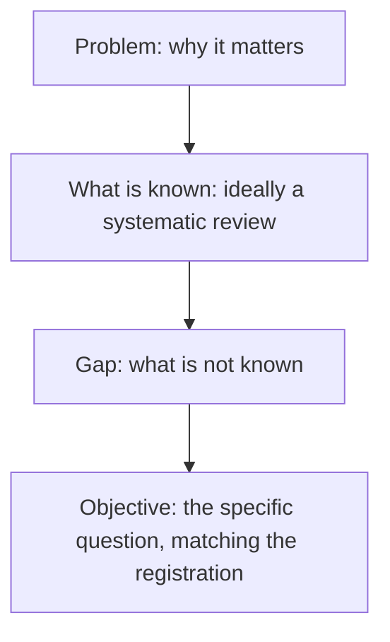

# Introduction and background

**Prerequisites:** [Title and abstract](02-title-and-abstract.md).

*A stack of journals and books; an introduction places a study in the existing literature. Credit: Kai3952. License: [CC BY-SA 4.0](https://creativecommons.org/licenses/by-sa/4.0). Source: [File:Stack of journals and books in the Central Geological Survey Library, MOEA.jpg](https://commons.wikimedia.org/wiki/File:Stack_of_journals_and_books_in_the_Central_Geological_Survey_Library,_MOEA.jpg).*

The introduction explains why the study was done: what problem it addresses, what is already known, and what gap the study fills. It is usually the least scrutinised section, but it shapes how readers interpret everything that follows. It is also where selective citation can make a study look more necessary, or more plausible, than it is.

## What a good introduction does

A well-written introduction, usually three or four paragraphs, should:

1. **State the problem** and why it matters (how common a disease is, how serious, what treatments exist).
2. **Summarise existing evidence** fairly, ideally citing a systematic review rather than a handful of chosen studies.
3. **Identify the gap**: what is not known, or what previous studies got wrong.
4. **State the objective or hypothesis** clearly, ideally the same one registered in advance.

## Selective citation

An introduction can cite only the studies that support the case for doing the study, or for its expected result, while ignoring contrary evidence. **Citation bias**, the tendency to cite supportive studies more than unsupportive ones, has been documented in several fields. A 2009 study by Steven Greenberg in the *BMJ* traced citation networks around a claim that β-amyloid is produced in the muscles of people with the muscle disease inclusion body myositis, and showed how selective citation, amplification and invention could create apparent authority for a claim that the underlying data did not support.

As a reader, ask: does the introduction cite systematic reviews, or only selected studies? Does it acknowledge evidence pointing the other way?

## Was the study needed?

The introduction should justify why the study was done. In a 2009 *Lancet* paper, Iain Chalmers and Paul Glasziou estimated that as much as 85% of investment in biomedical research is wasted through avoidable failures, including asking questions already answered, poor design, non-publication and poor reporting. One of their points was that new trials are often started without a systematic review of existing evidence. A 2011 analysis by Karen Robinson and Steven Goodman in the *Annals of Internal Medicine* found that reports of randomised trials cited only a small fraction of the relevant prior trials.

If a study's introduction does not engage with the existing evidence, that is a reason to wonder whether the study was well conceived, and whether its result should be read in isolation.

## The hypothesis

The objective at the end of the introduction is the study's promise. Compare it with:

- the **trial registration** or protocol ([trial registries](../06-research-integrity/02-trial-registries.md)): is it the same question?
- the **primary outcome** in the methods: is that what is being tested?
- the **conclusion**: does it answer this question, or a different one?

A mismatch between the stated objective and what is reported is a common sign of [outcome switching](../06-research-integrity/03-outcome-switching.md) or [HARKing](../06-research-integrity/05-harking.md).

## Framing effects

Introductions also set the frame. A paper about a new drug might describe the disease as devastating and current treatments as inadequate, which primes the reader to welcome any improvement. A paper questioning an established practice might stress uncertainty and past reversals. Neither framing is wrong in itself, but notice the frame and keep it separate from the evidence.

## Background in observational studies

For observational studies, the introduction often reviews a proposed **mechanism**. Mechanisms make associations seem plausible, but almost any association can be given a plausible-sounding mechanism after the fact. A mechanism described in advance and tested is worth much more than one invented to explain a finding ([falsifiability](../01-foundations/02-falsifiability-and-theories.md)).

## Key ideas

- The introduction states the problem, what is known, the gap and the objective.
- Selective citation can make a study look more necessary or a hypothesis more plausible.
- Good introductions cite systematic reviews and acknowledge contrary evidence.
- Compare the stated objective with the registration, the primary outcome and the conclusion.
- Notice the frame the introduction sets, and keep it separate from the evidence.

## Where this leads

- Next: [Methods](04-methods.md)
