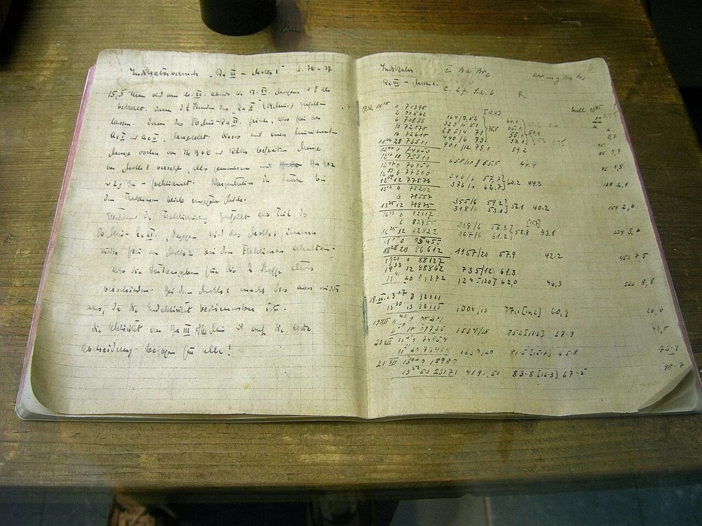
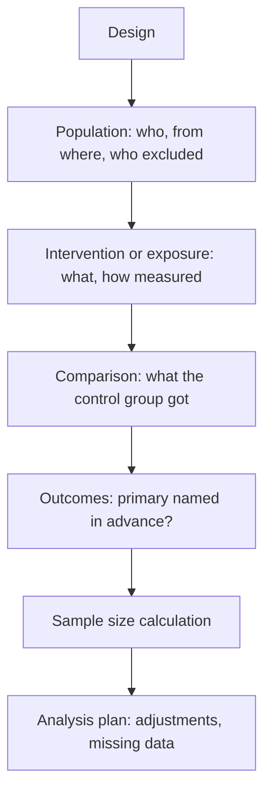

# Methods

**Prerequisites:** [Introduction and background](03-introduction-and-background.md) and the study designs in [section 3](../03-study-designs/README.md).

*Otto Hahn's laboratory notebook from 1938; methods sections record what was actually done. Credit: J Brew. License: [CC BY-SA 2.0](https://creativecommons.org/licenses/by-sa/2.0). Source: [File:Otto Hahn's notebook 1938 - Deutsches Museum - Munich.jpg](https://commons.wikimedia.org/wiki/File:Otto_Hahn's_notebook_1938_-_Deutsches_Museum_-_Munich.jpg).*

The methods section is the heart of a paper. It tells you exactly what was done, and therefore what the results can mean. Most of the judgement in reading research happens here. A study with a dramatic result and weak methods tells you little; a study with a modest result and strong methods may tell you a lot.

## The questions to answer

Work through the methods with a simple framework. For a study of an intervention or exposure, **PICO** plus design and analysis covers most of it:

- **Design**: randomised trial, cohort, case-control, self-controlled, cross-sectional? Prospective or retrospective? ([evidence hierarchy](../03-study-designs/01-the-evidence-hierarchy.md))
- **Setting**: where and when? Hospitals, primary care, a national registry? Which countries and years?
- **Population (P)**: who was eligible, how were they recruited, and who was excluded? Would people like you, or the patients you care about, have been included?
- **Intervention or exposure (I)**: exactly what, at what dose, for how long, and how was it measured?
- **Comparison (C)**: placebo, usual care, another active treatment, unexposed people? What exactly did the comparison group receive?
- **Outcomes (O)**: which was the **primary** outcome? How and when was it measured, and by whom? Was it pre-specified?
- **Sample size**: was there a calculation, and what effect was it designed to detect? ([power](../02-statistics/10-statistical-power.md))
- **Analysis**: what statistical methods, which comparisons, what adjustments, how was missing data handled? Was there a pre-specified analysis plan?

## For randomised trials

Check the specific safeguards described in [randomised controlled trials](../03-study-designs/07-randomised-controlled-trials.md) and [blinding and concealment](../03-study-designs/08-blinding-placebos-and-allocation-concealment.md):

- How was the random sequence generated?
- How was allocation concealed?
- Who was blinded, and how?
- Was analysis by intention to treat? ([ITT](../03-study-designs/09-intention-to-treat-and-per-protocol.md))
- Was there an independent data monitoring committee, and were there stopping rules? Trials stopped early for benefit tend to overestimate effects, as Dirk Bassler and colleagues found in a 2010 *JAMA* meta-analysis.

## For observational studies

Check:

- How were exposure and outcome defined and measured, and from what data source? Were definitions validated? ([measurement bias](../04-causation/07-measurement-and-recall-bias.md))
- When did follow-up start ("time zero"), and could immortal time arise? ([time-related biases](../04-causation/08-time-related-biases.md))
- Which confounders were adjusted for, and why? Is there a causal diagram? ([causal diagrams](../04-causation/10-causal-diagrams.md))
- Were there sensitivity analyses, negative controls or E-values?
- How were people lost to follow-up handled?

## Ethics and registration

The methods (or declarations) should state which ethics board approved the study and whether participants gave informed consent. For trials, the **registration number** (for example, an NCT number from ClinicalTrials.gov) should appear. Look it up and compare the registered primary outcome with the one reported ([trial registries](../06-research-integrity/02-trial-registries.md), [outcome switching](../06-research-integrity/03-outcome-switching.md)).

## What is missing

The hardest part of reading methods is noticing what is *not* there. Missing details are not always a sign of a problem (journals limit word counts, and details may be in the supplement), but some omissions are telling:

- No primary outcome named.
- No sample size calculation.
- No description of how randomisation or concealment worked.
- No explanation of why certain participants or data were excluded.
- No mention of a protocol or pre-specified analysis plan.

Reporting checklists like CONSORT and STROBE exist precisely so readers can check for such gaps ([reporting checklists](12-reporting-checklists.md)).

## Reproducibility

In principle, the methods should allow another researcher to repeat the study. In practice they rarely do. Many fields now encourage or require sharing of protocols, analysis code and data ([open science](../06-research-integrity/09-open-science.md)). If the methods say "data available on reasonable request", be aware that studies requesting such data have often found it hard to obtain.

## Key ideas

- The methods section is where most of the judgement in reading research happens.
- Use design plus PICO plus sample size and analysis as a framework.
- For trials, check randomisation, concealment, blinding, ITT and stopping rules.
- For observational studies, check data sources, time zero, confounder selection and sensitivity analyses.
- Notice what is missing, and check the registration.

## Where this leads

- Next: [Results and Table 1](05-results-and-table-one.md)
