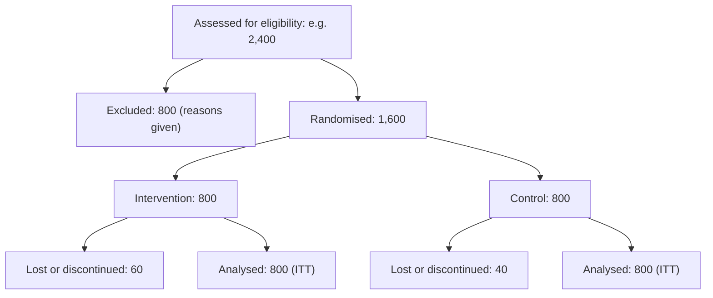

# Results and Table 1

**Prerequisites:** [[methods|Methods]].

@@IMG@@

The results section reports what was found, in text, tables and figures. Read the numbers before the authors' descriptions of them. This lesson covers the participant flow, the baseline characteristics table (almost always "Table 1"), and the main results tables.

## Start with the flow of participants

Before looking at any outcomes, find out **who was actually studied**. Trials should include a **CONSORT flow diagram** showing how many people were assessed for eligibility, how many were randomised to each arm, how many received the intervention, how many were lost to follow-up or discontinued, and how many were analysed. Observational studies should show how the final sample was derived from the source population.

Check:

- How many were excluded, and why? Heavy exclusion limits generalisability.
- Are the numbers analysed close to the numbers randomised? If not, why not?
- Is dropout similar in each arm? Unequal dropout is a warning sign.

(Illustrative numbers.)

## Table 1: baseline characteristics

**Table 1** describes the participants at the start: age, sex, disease severity, other conditions, medications and so on, usually separately for each group.

In a **randomised trial**, Table 1 shows whether randomisation produced comparable groups. Small differences are expected by chance. Many statisticians, including Douglas Altman, have argued that significance tests (p-values) for baseline differences in trials are pointless: if randomisation was done properly, any differences *are* due to chance by definition. Look instead at whether any difference is large enough to matter for prognosis. Implausibly perfect balance, or striking imbalances, can sometimes be a sign of problems with the randomisation itself. In 2017 the anaesthetist John Carlisle published an analysis in *Anaesthesia* of baseline data in more than 5,000 trials, flagging trials whose baseline distributions were statistically unlikely; some were later found to be fraudulent or flawed.

In an **observational study**, Table 1 shows how exposed and unexposed groups differ. Large differences show how much confounding the analysis must handle. If the exposed are younger, richer and healthier, think about the [[healthy-user-bias|healthy user effect]].

Also use Table 1 to ask: **are these people like the ones I care about?** If the average age is 55 and you are interested in 85-year-olds, the results may not apply.

## The primary outcome

Find the result for the **pre-specified primary outcome** first. A good report gives, for each group:

- the number of participants and the number with the outcome (or mean and SD for continuous outcomes);
- the effect estimate (difference, risk ratio, hazard ratio) with a **confidence interval**;
- a p-value, if reported.

Compute the **absolute** risks and the risk difference yourself if they are not given ([[relative-and-absolute-risk|relative and absolute risk]], [[number-needed-to-treat|NNT]]).

## Secondary outcomes, subgroups and harms

Secondary outcomes and subgroups follow. Remember [[multiple-comparisons|multiple comparisons]]: one or two significant secondary results among many are expected by chance. Subgroup claims need an interaction test ([[subgroups-and-secondary-analyses|subgroups]]).

**Harms** deserve equal attention. Are adverse events reported in full for each arm, with numbers? Serious adverse events, discontinuations due to adverse events and deaths should be clearly shown. A 2001 study by John Ioannidis and Joseph Lau in *JAMA* found that reporting of harms in randomised trials was often inadequate, and the CONSORT group published an extension on harms reporting in 2004.

## Reading tables efficiently

- Read the **title, column headings and footnotes** first: they tell you units, which analysis population, and what was adjusted.
- Identify **which row is the primary outcome**.
- Check **denominators**: are percentages based on all randomised participants or only those with data?
- Compare **crude and adjusted** estimates in observational studies.
- Look for **numbers that don't add up**: totals that don't match, percentages that don't follow from counts. Errors happen; occasionally they reveal deeper problems.

## Key ideas

- Start with the participant flow: who was randomised, lost and analysed.
- Table 1 shows baseline balance in trials and the scale of confounding in observational studies.
- P-values for baseline differences in trials are of little use; look at size and prognostic importance.
- Find the primary outcome first, with absolute numbers and a confidence interval.
- Give harms equal attention, and check that numbers add up.

## Where this leads

- Next: [[reading-graphs|Reading graphs]]
