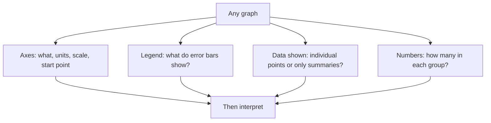

# Reading graphs

**Prerequisites:** [Results and Table 1](05-results-and-table-one.md).

@@IMG@@

Figures are often the most memorable part of a paper and the part most easily misread. A few habits will protect you from most graphical tricks and help you extract real information quickly.

## First, read the axes

Before interpreting any graph, read:

- **What is on each axis**, and in what units.
- **The scale**: does the y-axis start at zero? Is it linear or logarithmic?
- **The range**: has it been chosen to exaggerate or hide a change?
- **The legend**: what do the symbols, colours, lines and error bars represent?

A y-axis that starts at 95 instead of 0 can make a change from 96 to 98 look enormous. That is not always wrong (for many continuous variables, zero is meaningless), but it should be noticed. For ratios such as relative risks, a **logarithmic scale** is appropriate, because a halving and a doubling should look equally large ([odds and hazard ratios](../02-statistics/19-odds-ratios-and-hazard-ratios.md)).

## Error bars

Error bars can show the **standard deviation**, the **standard error** or a **confidence interval**, and these have very different widths and meanings ([SD versus SE](../02-statistics/05-variance-and-standard-deviation.md)). Standard error bars are much narrower than SD bars and make differences look more certain. A 2005 study by Sarah Belia, Fiona Fidler, Jennifer Williams and Geoff Cumming in *Psychological Methods* found that many researchers misjudged what overlapping error bars implied about statistical significance.

Rules of thumb (for two independent groups of similar size):

- If **95% confidence interval** bars do not overlap, the difference is significant at p < 0.05; but CIs can overlap somewhat and the difference still be significant.
- If **standard error** bars overlap, the difference is not significant at p < 0.05; if they don't overlap, it may or may not be.

Always check the legend.

## Common chart types

- **Bar charts** compare categories. Bars showing means hide the distribution; "dynamite plots" (bars with error bars on top) have been criticised by statisticians for this reason. Tracey Weissgerber and colleagues argued in *PLOS Biology* in 2015 that small-sample continuous data should be shown as individual points.
- **Box plots** show the median, interquartile range and outliers ([quartiles](../02-statistics/04-mean-median-and-mode.md)).
- **Scatter plots** show the relationship between two continuous variables. Look at the spread of points, not just the fitted line: a "significant" line through a cloud of scattered points may explain very little.
- **Line charts** show change over time. Check whether points are evenly spaced and whether the time axis has been truncated.
- **Histograms** show distributions ([distributions](../02-statistics/03-distributions.md)).

## Specialised plots in medical papers

Three types are so important they get their own lessons:

- **Forest plots** for meta-analyses and subgroup analyses ([lesson](07-forest-plots.md)).
- **Kaplan-Meier curves** for survival and time-to-event data ([lesson](08-kaplan-meier-curves.md)).
- **Funnel plots** for detecting small-study effects and publication bias ([lesson](09-funnel-plots.md)).

Others you will meet include **ROC curves** for diagnostic tests ([sensitivity and specificity](../02-statistics/15-sensitivity-and-specificity.md)), **Bland-Altman plots** for comparing two measurement methods (introduced by Martin Bland and Douglas Altman in *The Lancet* in 1986), and **Manhattan plots** for genome-wide studies.

## Graphical tricks to watch for

- **Truncated or broken axes** that exaggerate differences.
- **Dual y-axes**, which let any two trends be made to look correlated by rescaling.
- **Cherry-picked time windows** that start at a peak or trough.
- **Cumulative charts** that always rise, hiding a slowdown.
- **3D effects and area distortions** that make some values look larger than others.
- **Smoothing** that hides variability.
- **Missing numbers at risk** on survival curves, hiding how few people remain at the right-hand end.

The statistician Edward Tufte's books, such as *The Visual Display of Quantitative Information* (1983), are classic guides to honest graphics, and Darrell Huff's *How to Lie with Statistics* (1954) catalogues the tricks.

## Key ideas

- Read the axes, scales and legend before interpreting any graph.
- Error bars may be SD, SE or CI; they mean very different things.
- Prefer graphs that show individual data points for small samples.
- Ratios belong on logarithmic scales.
- Watch for truncated axes, dual axes, cherry-picked windows and missing numbers at risk.

## Where this leads

- Next: [Forest plots](07-forest-plots.md)
