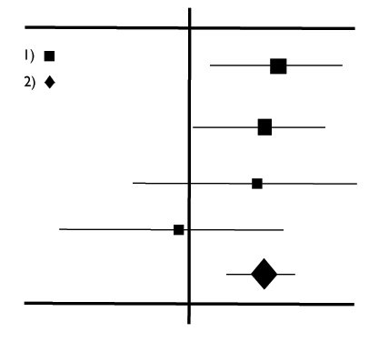
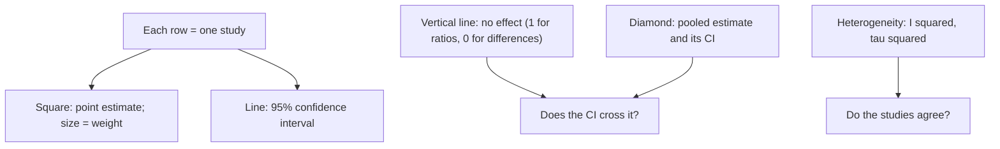

# Forest plots

**Prerequisites:** [Reading graphs](06-reading-graphs.md), [Meta-analysis](../03-study-designs/15-meta-analysis.md) and [Confidence intervals](../02-statistics/07-standard-error-and-confidence-intervals.md).

*A forest plot from a meta-analysis. Credit: Produnis. License: [CC BY-SA 3.0](http://creativecommons.org/licenses/by-sa/3.0/). Source: [File:Forestplot01.jpg](https://commons.wikimedia.org/wiki/File:Forestplot01.jpg).*

A **forest plot** displays the results of several studies (or several subgroups) side by side, with a pooled summary at the bottom. It is the standard figure of meta-analysis, and once you can read one, you can absorb a whole systematic review in a minute. The name is often said to come from the "forest of lines" it produces.

## Anatomy

A typical forest plot has:

- **One row per study**, labelled on the left (author and year), often with the raw numbers (events and totals in each group).
- **A square** for each study's point estimate. The **size of the square** reflects the study's **weight** in the meta-analysis, usually its precision.
- **A horizontal line** through each square showing its **95% confidence interval**.
- **A vertical line of no effect**: at 1 for ratios (risk ratio, odds ratio, hazard ratio), at 0 for differences.
- **A diamond** at the bottom for the **pooled estimate**: its centre is the point estimate and its width is the confidence interval.
- **Labels** under the axis such as "favours treatment" and "favours control".
- **Heterogeneity statistics** (I², τ², the Q test p-value) and the test for the overall effect.

## How to read one

1. **Check the measure and the direction.** Is it a risk ratio, odds ratio or mean difference? Which side favours treatment? (Labels are sometimes reversed between reviews.)
2. **Check the scale.** Ratio scales should be logarithmic, so 0.5 and 2 are equidistant from 1.
3. **Look at the diamond.** Where is it, and does it cross the line of no effect? How wide is it?
4. **Look at the spread of studies.** Do their confidence intervals overlap heavily (consistent), or do they scatter on both sides of the line (heterogeneous)? Check I².
5. **Look at the big squares.** Is the result driven by one or two large studies? Do they agree with the small ones?
6. **Look at the small studies.** Do they show larger effects than the big ones? That pattern suggests small-study effects or publication bias ([funnel plots](09-funnel-plots.md)).
7. **Check subgroups**, if the plot is split by study type, risk of bias or population, and whether the test for subgroup differences is significant.

## A famous forest plot

The Cochrane logo shows a stylised forest plot from a meta-analysis of randomised trials of corticosteroids given to women at risk of premature delivery. The individual trials, several of them small and inconclusive on their own, consistently pointed toward fewer newborn deaths, and the pooled diamond sat clearly on the side of benefit. The pooled evidence had shown this benefit years before the treatment was widely used, which is the story Cochrane tells about why systematic reviews matter ([Cochrane and GRADE](../03-study-designs/16-cochrane-and-grade.md)).

## Cumulative forest plots

A **cumulative meta-analysis** adds studies one at a time in chronological order, with each row showing the pooled result up to that point. It shows when the evidence became conclusive. Elliott Antman, Joseph Lau and colleagues used cumulative meta-analysis in 1992 to show that the benefit of clot-busting therapy after heart attack was clear long before expert recommendations caught up ([systematic reviews](../03-study-designs/14-systematic-reviews.md)).

## Forest plots for subgroups

Single trials also use forest plots to show results across **subgroups** (men and women, age bands, disease severity). These are easy to over-read. Some subgroup lines will cross the line of no effect simply because subgroups are smaller. The question is whether the subgroup estimates differ from each other more than chance would allow, which requires an **interaction test**, not eyeballing ([subgroups](../09-from-lab-to-headline/04-subgroups-and-secondary-analyses.md)).

## Common pitfalls

- **Mixing fixed and random effects** without saying which.
- **Double-counting** the same patients from overlapping publications.
- **Combining very different studies** (different populations, doses or outcomes) into one diamond.
- **Ignoring risk of bias**: a confident diamond built from low-quality studies is still low-quality evidence.

## Key ideas

- Each row shows one study's estimate (square, sized by weight) and confidence interval (line).
- The vertical line marks no effect; the diamond is the pooled estimate.
- Check direction, scale, heterogeneity and whether big and small studies agree.
- Cumulative forest plots show when evidence became conclusive.
- Subgroup forest plots need interaction tests, not visual impressions.

## Where this leads

- Next: [Kaplan-Meier curves](08-kaplan-meier-curves.md)
- Worked example: [Worked example: a meta-analysis](../11-practice/05-worked-example-a-meta-analysis.md)
