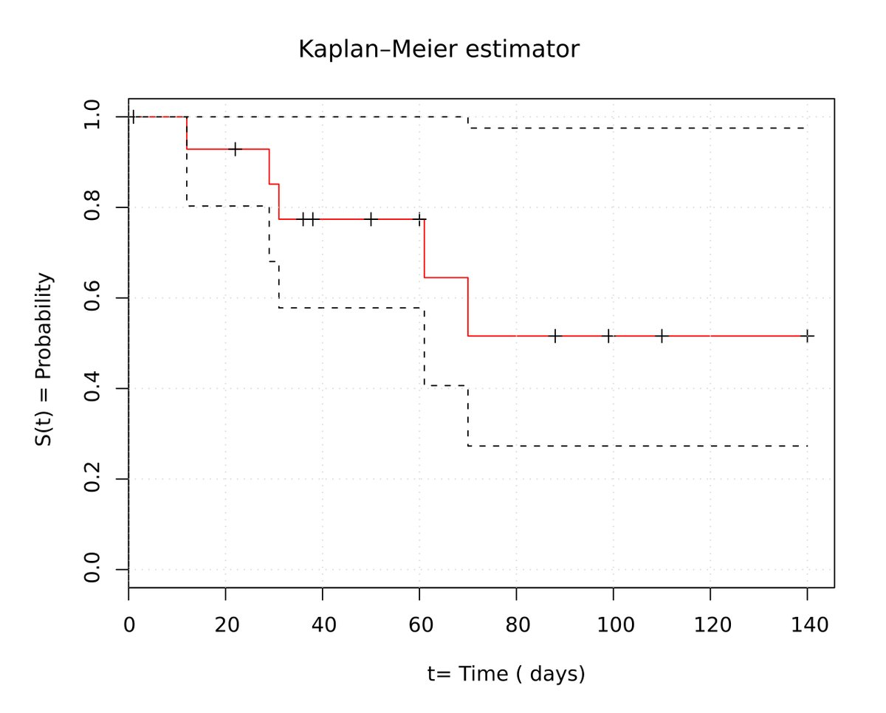
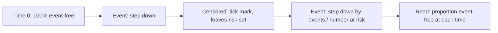

# Kaplan-Meier curves

**Prerequisites:** [Forest plots](07-forest-plots.md) and [Odds ratios and hazard ratios](../02-statistics/19-odds-ratios-and-hazard-ratios.md).

*Kaplan-Meier survival curves for two groups. Credit: Accountalive. License: [CC0](http://creativecommons.org/publicdomain/zero/1.0/deed.en). Source: [File:Kaplan-Meier-sample-plot.svg](https://commons.wikimedia.org/wiki/File:Kaplan-Meier-sample-plot.svg).*

When a study follows people over time to see when an event happens (death, relapse, infection, hospital admission), its results are usually shown as **Kaplan-Meier curves**. They are named after Edward Kaplan and Paul Meier, whose 1958 paper in the *Journal of the American Statistical Association* set out the method. It became one of the most cited statistics papers ever published.

## The problem they solve: censoring

In time-to-event studies, not everyone has the event before the study ends. Some people are still alive at the last follow-up; some move away or withdraw. Their information is **censored**: we know they were event-free *up to* a certain time, but not what happened after.

Simply ignoring censored people, or counting them as event-free forever, would bias results. The Kaplan-Meier method uses everyone's information for as long as they were observed.

## How the curve is built

The curve starts at 100% (everyone event-free) at time zero. Each time an event occurs, the curve **steps down** by the proportion of people still at risk who had the event at that moment. Censored people leave the "at risk" group without causing a step; they are often marked with small tick marks on the curve.

So the curve shows, at each time point, the estimated **probability of remaining event-free** (or, inverted, the cumulative incidence of the event).

## Reading a Kaplan-Meier plot

1. **What is the event?** Death from any cause, death from the disease, progression, a combined outcome? "Progression-free survival" and "overall survival" are different things.
2. **Where do the curves separate?** Early, late, or not at all? Do they converge or cross later?
3. **How far apart are they** at clinically relevant times (one year, five years)? Read off the absolute difference.
4. **Median survival**: the time at which each curve crosses 50%. If a curve never reaches 50%, the median is "not reached".
5. **Numbers at risk**: a good plot shows, under the x-axis, how many people remain at risk at each time. When numbers become small at the right-hand side, the curves become unreliable and can swing dramatically on a few events. Pay little attention to the tail.
6. **Confidence bands**: some plots shade the uncertainty around each curve.
7. **The statistical comparison**: usually a **log-rank test** (a p-value comparing the whole curves) and a **hazard ratio** from a Cox model.

## Crossing curves and proportional hazards

A single hazard ratio assumes the ratio of event rates is roughly constant over time ([proportional hazards](../02-statistics/19-odds-ratios-and-hazard-ratios.md)). If the curves cross, for example because surgery carries early risk but later benefit, a single hazard ratio can be misleading, and the log-rank test loses power. Look for alternative summaries such as **restricted mean survival time**, the average event-free time up to a chosen point, which many statisticians recommend when hazards are not proportional.

## Common misreadings

- **Reading the tail**: the right-hand end of a curve, based on few people, is the least reliable part.
- **Confusing relative and absolute**: a hazard ratio of 0.7 might correspond to a difference in five-year survival of only a few percentage points. Read the gap from the curves.
- **Surrogate events**: progression-free survival can improve without any gain in overall survival ([surrogate endpoints](../09-from-lab-to-headline/02-surrogate-endpoints.md)).
- **Informative censoring**: the method assumes people are censored for reasons unrelated to their risk. If sicker patients drop out more in one arm, the curves are biased.
- **Competing risks**: when people can die of other causes before the event of interest, standard Kaplan-Meier estimates of cumulative incidence can overstate it. Competing-risk methods (such as the Fine-Gray model) address this.

## Key ideas

- Kaplan-Meier curves estimate the probability of remaining event-free over time, handling censored data.
- Each step down is an event; tick marks show censoring.
- Always check the numbers at risk, and distrust the sparse tail.
- Read absolute differences and median survival from the curves, not just the hazard ratio.
- Crossing curves signal non-proportional hazards.

## Where this leads

- Next: [Funnel plots](09-funnel-plots.md)
